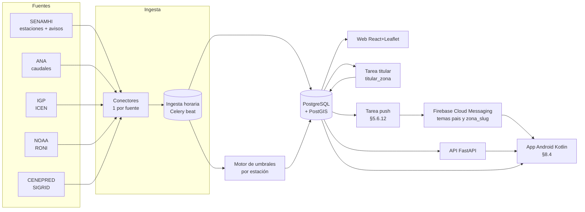

# SIMPAC — Documentación técnica (devs)

> **SIMPAC** — Sistema de Información Meteorológica y Prevención de Anomalías de Cajamarca.
> Plataforma web + app Android nativa en Kotlin + Jetpack Compose (`appmobile/android/`,
> `appmobile/README.md`, §8.4; la anterior con Capacitor se retiró del repo el 24-10-2026, §8.3) que
> **centraliza datos hidrometeorológicos del Perú, con foco en Cajamarca**, y emite **alertas
> tempranas de lluvia/crecidas** geolocalizadas, en lenguaje claro para gente sin formación técnica,
> con notificaciones push por FCM a la app cuando un departamento entra en alerta o emergencia (§5.6.12).
>
> Este documento es la referencia técnica: arquitectura, conectores de datos, los endpoints
> reales de cada organismo y las partes "peludas" de la ingesta. Para el panorama general
> no técnico, ver la *Pre-documentación general*. Para el catálogo visual de endpoints, ver
> [`fuentes-y-endpoints.html`](./fuentes-y-endpoints.html).

---

## 1. TL;DR / Quickstart

El stack real corre en Docker (§8). Los conectores, el prototipo y las pruebas usan **solo la
librería estándar** de Python (3.10+), así que corren sin instalar nada (desde la raíz del repo):

```bash
python -m unittest discover -s backend/tests -t .   # pruebas sin red ni BD (solo stdlib)

python -m backend.prototipo.demo     # foto rápida en consola (sin BD)
python -m backend.prototipo.ingest   # guarda una pasada en backend/prototipo/simpac.db (SQLite)
python -m backend.prototipo.api      # API JSON del prototipo en http://localhost:8000
```

Salida esperada de `demo` (datos en vivo — foto de Cajamarca): contexto El Niño (RONI/ICEN),
caudales de ríos con su estado de alerta, y la lluvia horaria de una estación automática.

```
NOAA RONI  JJA 2026: +1.36  -> El Niño moderado
IGP  ICEN  2026-05: +1.98  -> Cálida moderada
Mashcón            Mashcon      18:00     0.13 m³/s  (normal)
Yónan Gore         Jequetepeque 21:00      2.3 m³/s  (normal)
...
CUTERVO (4726A602) — 48 horas ; último 2026/09/06 - 21  precip=0.0 mm  temp=13.3 °C
```

---

## 2. Estructura del repo

```
VigiaFEN/
├─ backend/
│  ├─ connectors/
│  │  ├─ _http.py        # helpers GET/POST/descarga binaria (urllib, sin deps)
│  │  ├─ senamhi.py      # estaciones + serie horaria (lluvia/temp)
│  │  ├─ ana.py          # caudales de ríos + estado de alerta por umbral
│  │  ├─ igp.py          # Índice Costero El Niño (ICEN)
│  │  ├─ noaa.py         # RONI (contexto ENSO global, índice oficial de NOAA desde feb-2026)
│  │  ├─ enfen.py        # comunicado oficial ENFEN (estado de alerta) + ICEN del Informe Técnico (PDF)
│  │  ├─ senamhi_avisos.py   # avisos oficiales de SENAMHI (tabla HTML + polígonos WFS + párrafos) y aviso de 24 h
│  │  ├─ senamhi_umbrales.py # lluvia de la última hora en ~216 estaciones (WFS) + fechas de prec_1
│  │  ├─ senamhi_pronostico.py # pronóstico oficial por localidad (una página HTML, ~277 localidades)
│  │  ├─ senamhi_nowcast.py  # nowcasting de lluvia (visor + WFS g_nowcasting), experimental
│  │  ├─ senamhi_avisos_hidro.py # avisos hidrológicos (lista del país + detalle de un aviso, HTML); sentido crecida/descenso/indeterminado
│  │  ├─ ana_rios.py     # ANA - GeoSNIRH: trazo de los ríos (red hidrográfica RJ056 y Carta Nacional IGN), §5.6.8
│  │  └─ idesep.py       # catálogo GeoNetwork de SENAMHI: shapefile -> GeoJSON (no lo importa __init__)
│  ├─ ingesta/
│  │  ├─ recolectar.py   # baja de todas las fuentes en paralelo -> Pasada (no toca la BD)
│  │  ├─ guardar.py      # escribe una Pasada en Supabase (una transacción)
│  │  ├─ departamentos.py # slugs de SENAMHI y nombres canónicos de departamento
│  │  ├─ enfen.py        # tarea 'enfen' (cada 6 h): comunicado + ICEN del Informe Técnico
│  │  ├─ avisos.py       # tarea 'avisos' (cada hora): áreas de avisos SENAMHI + ícono + alertas por departamento
│  │  ├─ lectura_aviso.py # puro: ícono del aviso y lectura de su texto (descargas, granizo, mm/día)
│  │  ├─ lluvia_nacional.py # tarea 'lluvia_nacional' (cada 30 min): lluvia de la última hora en el país + alertas de lluvia
│  │  ├─ pronostico.py   # tarea 'pronostico' (cada hora): pronóstico por localidad
│  │  ├─ lectura_pronostico.py # puro: qué dice cada día del pronóstico (lluvia, tormenta, "tendencia a")
│  │  ├─ nowcast.py      # tarea 'nowcast' (cada 10 min): manchas de lluvia de las próximas 2 horas
│  │  ├─ rios.py         # tarea 'rios' (cada hora): avisos hidrológicos de SENAMHI (lista del país + detalle de los vigentes)
│  │  ├─ titular.py      # tarea 'titular' (cada 30 min): titular en lenguaje claro por departamento (titular_zona), §5.6.10
│  │  └─ push.py         # tarea 'push' (cada 5 min): avisos por Firebase Cloud Messaging a la app cuando una zona
│  │                     # sube a alerta/emergencia o vuelve la calma (push_estado), §5.6.12
│  ├─ data/
│  │  ├─ localidades_senamhi.json # coordenadas de las localidades del pronóstico (revisado a mano)
│  │  ├─ rios/mashcon/   # río vigilado (revisado a mano, §5.6.7): rio.json, cauce, cuenca, zonas,
│  │  │                  # faja (.geojson) e incidentes.json
│  │  ├─ rios/cauces_alias.json # alias de nombres, capa forzada y radios para los ríos del país que no coinciden solos (§5.6.8)
│  │  ├─ cauces/         # copias simplificadas de los cauces del país (105 GeoJSON, 2,98 MB; excepción en .gitignore y .dockerignore)
│  │  ├─ cauces_zonas/   # zonas que podrían inundarse junto a 20 ríos del país, estimadas con el relieve (20 GeoJSON +
│  │  │                  # _indice.json, 3,1 MB; versionados; las escribe zonas_relieve.py y las carga cargar_cauces_zonas.py, §5.6.11)
│  │  └─ acudir/         # "A dónde acudir": RENIPRESS de Cajamarca, comisarías y bomberos (CENEPRED, CGBVP), Defensa Civil, números (§5.6.9)
│  ├─ mapas/
│  │  ├─ cargar_fen.py   # carga los mapas históricos de eventos El Niño a la tabla mapa
│  │  ├─ cargar_rios.py  # carga un río vigilado (data/rios/<id>/) a rio_vigilado, rio_zona y rio_incidente
│  │  ├─ cargar_cauces.py # carga el trazo de los ríos con estación de ANA o aviso de SENAMHI (GeoSNIRH) a rio_cauce
│  │  ├─ zonas_relieve.py # calcula las zonas de relieve (HAND sobre Copernicus GLO-30) de un río de rio_cauce -> data/cauces_zonas/ (§5.6.11)
│  │  ├─ cargar_cauces_zonas.py # carga data/cauces_zonas/*.geojson a rio_cauce_zona (§5.6.11)
│  │  ├─ cargar_acudir.py # carga salud, comisarías, bomberos y Defensa Civil a punto_acudir
│  │  └─ semilla_localidades.py # arma localidades_senamhi.json (se corre una vez, §5.6.4)
│  ├─ prototipo/         # versión sin dependencias (SQLite + http.server), congelada
│  ├─ tests/             # 726 pruebas sin red (unittest; test_titular, test_cargar_cauces, test_cargar_acudir,
│  │                     # test_app para el CORS, test_push 44, test_zonas_relieve 19...; 10 se omiten si falta
│  │                     # numpy/shapely); muestras reales chicas en tests/muestras/
│  ├─ app.py             # API FastAPI async (Docker); CORS solo para los orígenes de SIMPAC_CORS_ORIGENES
│  ├─ celery_app.py      # worker + beat (tareas programadas, §7.1)
│  ├─ config.py          # variables de entorno, en un solo lugar (ajustes_push lee las FIREBASE_*)
│  ├─ db.py              # conexión a Supabase para quien escribe (worker, cargadores)
│  ├─ snapshot.py        # panorama cacheado en Redis que sirve la API
│  ├─ alerts.py          # motor de umbrales (caudal ANA + referencia de lluvia SENAMHI)
│  ├─ requirements.txt   # + requirements-mapas.txt (geopandas, solo worker); google-auth para el push
│  └─ requirements-relieve.txt # numpy, scipy, shapely, pyproj, tifffile, imagecodecs: solo para zonas_relieve.py, en un venv fuera del repo
├─ frontend/             # React + Vite + Tailwind + shadcn + Leaflet + react-router (detalle en frontend/README.md)
│  ├─ src/App.jsx        # marco: SesionProvider + ContextoApp + Sidebar + BarraInferior (< md) + <Routes> perezosas
│  ├─ src/pages/         # Mapa (el mapa de siempre, nunca se desmonta), Alertas, Comunidad, ReporteNuevo,
│  │                     # ReporteDetalle, Chat, Cuenta, Historico
│  ├─ src/components/    # MapView, LayersPanel, StatusPanel (hoja de 4 alturas), TuZona, MedidorCaudal, BarrasLluvia,
│  │                     # AcudirCercanos, OnboardingGps, PanelPagina, BarraInferior, EstadoCarga, TarjetaAlerta,
│  │                     # TarjetaReporte, Votos, GraficoSerie, ElNinoPanel, CitySelector, DiaSelector, ui/ (shadcn)
│  ├─ src/hooks/         # usePanorama, useRiosVigilados, useZonaAhora, useSesion, useGeolocation (navigator.geolocation),
│  │                     # useLayerVisibility, usePronosticoLocal, useAltoHoja, useContador
│  ├─ src/lib/           # queries (todas las consultas a Supabase), consultaCache, nivel, zonaRio, zonaAhora, cauces,
│  │                     # acudir, alertas, comunidad, historico, sesion, lenguaje, medidor, serie24h... (*.test.js al lado)
│  ├─ src/map/           # baseMap (Stadia + atribución propia), layers/ (15 capas: rios, zonasRio, acudir, avisos...),
│  │                     # popups, marcadores, iconos, rotuloLinea, rotuloBusqueda, atribucion
│  ├─ src/data/          # cities.js, emergencias.js (copia de backend/data/acudir/numeros.json)
│  ├─ public/            # manifest.webmanifest, sw.js (solo cáscara), iconos/ (PWA)
│  └─ nginx.conf         # gzip + gzip_static, caché inmutable de /assets/, CSP y cabeceras (§8.2)
├─ appmobile/
│  ├─ README.md          # la app Android nativa: compilar, probar, FCM, firmar y publicar
│  └─ android/           # app nativa en Kotlin + Jetpack Compose (§8.4): settings/build.gradle.kts, gradle/ (libs.versions.toml,
│                        # wrapper 9.1.0), app/ (build.gradle.kts, AndroidManifest.xml, res/, src/main/java/pe/simpac/app/:
│                        # SimpacApp, MainActivity, dominio/, data/, push/, ubicacion/, ui/{inicio,alertas,mapa,acudir,cuenta};
│                        # src/test (22 pruebas JVM), src/androidTest (4 de Compose UI)); google-services.json y build/ no se versionan
├─ supabase/
│  ├─ migrations/        # historia de la BD: un archivo por cambio, en orden (35 al 24-10-2026)
│  └─ schema.sql         # foto consolidada del estado final (secciones D a I: storage y realtime, rio_cauce, titular_zona,
│                        # push_estado, franja de rio_cauce_mapa, rio_cauce_zona)
└─ docs/
   ├─ README-tecnico.md          (este archivo)
   ├─ ESTADO.md                  (dónde estamos)
   ├─ guia-medicion.md           (cómo llenar las fichas ISO/IEC 25010 del curso con datos reales)
   ├─ catalogo-idesep.md         (catálogo de mapas de IDESEP)
   ├─ frontend-brief.md, stack-tecnologico.md   (brief original de las pantallas y el stack)
   ├─ fuentes-y-endpoints.html   (catálogo visual de endpoints)
   └─ pre-documentacion-general.html
```

---

## 3. Arquitectura

Principio: **un conector aislado por organismo** que normaliza su fuente a estructuras
simples. La ingesta (Celery beat, cada hora) guarda en PostgreSQL/PostGIS (Supabase). La web
(React + Leaflet) lee **Supabase directo** con la llave pública, protegida por RLS. La API
(FastAPI) sirve un resumen cacheado en Redis para otros consumidores (app móvil, terceros).

Desde el 14-10-2026 la web usa además tres servicios de Supabase fuera del Data API: **Auth** (cuentas
por correo y contraseña, con confirmación por correo; las páginas Comunidad, Chat y Cuenta), **Storage**
(bucket público `reportes` para la foto de un reporte) y **Realtime** (la tabla `message` del chat,
publicación `supabase_realtime`). El worker suma una tarea que no baja datos sino que los resume: el
titular en lenguaje claro por departamento (`titular_zona`, §5.6.10), con un modelo de lenguaje solo si
hay clave de API y siempre validado por reglas. Desde el 20-10-2026 (integrado el 24-10) hay dos
piezas más: la **app Android nativa** en Kotlin (§8.4) lee Supabase con la publishable key (RLS) y el
`/api/snapshot` de la API, y abre la web en un WebView solo para el mapa; y la tarea **`push`** del
worker (§5.6.12) manda por Firebase Cloud Messaging a los temas `pais` y `zona_<slug>` cuando el nivel
de `titular_zona` de un departamento sube a alerta o emergencia (o vuelve la calma), nunca por avisos
amarillos ni lluvia medida. La app anterior (Capacitor, retirada el 24-10-2026, §8.3) era la misma web dentro de un WebView.



### 3.1. Convención de un conector

Cada módulo expone funciones puras que devuelven `@dataclass`/listas; **no** guardan estado
ni tocan la BD (de eso se encargan los jobs). Así son testeables y cacheables.

---

## 4. Verificación de "tiempo real" (importante)

No basta con asumirlo; se verificó contra la hora del sistema (Perú, UTC−5):

| Fuente | Endpoint | Última marca observada | Frecuencia | ¿Tiempo real? |
|---|---|---|---|---|
| SENAMHI (est. automática) | `map_red_graf.php` | `2026/09/06 - 21h` (hora en curso, 21:15) | horaria | **Sí** |
| ANA (caudales) | `ReporteNacionalCaudal` | `HORA` hasta `21:00` (RPT 592-2026) | ~horaria | **Sí** |
| IGP ICEN | `ICEN.txt` | mes en curso | mensual | contexto |
| NOAA RONI | `RONI.ascii.txt` | trimestre en curso | mensual | contexto |
| ENFEN | comunicado + Informe Técnico (PDF) | quincenal / mensual | quincenal | estado oficial de alerta |

**Conclusión:** la lluvia (SENAMHI) y el caudal (ANA) se actualizan a la hora en curso —
suficiente para disparar alertas. ICEN/RONI son contexto estacional (El Niño), no gatillan
alertas inmediatas pero alimentan el modelo predictivo y el titular.

---

## 5. Conectores — referencia de endpoints

### 5.1. SENAMHI — estaciones y lluvia horaria

**Inventario de estaciones** (HTML con un array JS `PruebaTest` embebido):

```
GET https://www.senamhi.gob.pe/mapas/mapa-estaciones-2/?dp=cajamarca
```
```js
{"nom":"AUGUSTO WEBERBAUER","cate":"MAP","lat":-7.1675,"lon":-78.49309,
 "ico":"M","cod":"107028","estado":"REAL"}
```
- `ico`: `M` meteorológica · `H` hidrológica.
- `estado`: `REAL` (convencional, 07/13/19h) · `DIFERIDO` · `AUTOMATICA` (**telemetría horaria** → las útiles para alertas).

**Serie horaria por estación** (config de Highcharts embebida en el HTML, **sin CAPTCHA**):

```
GET .../map_red_graf.php?cod={cod}&estado={estado}&tipo_esta={M|H}&cate={cate}&cod_old={cod_old}
```
El parser extrae `xAxis.categories` (timestamps `YYYY/MM/DD - HH`) y las `series[].data`
(precip mm/h y temp °C). **Gotcha:** los textos vienen con escapes `\uXXXX` del lado del
servidor; se busca por palabra clave antes del escape (`"Precipitaci"`, `"Temperatura"`).

> **Las hidrológicas automáticas también miden lluvia horaria** (verificado el 22-09-2026 en 63
> estaciones, 10 de ellas en Cajamarca): la serie viene si se pide con `tipo_esta=M`; con
> `tipo_esta=H` viene vacía. El conector pide con el tipo de la estación y la ingesta solo baja las
> de tipo `M`, así que `lectura_lluvia` no las tiene (pendiente, §10). La tarea `lluvia_nacional`
> sí trae su última hora (§5.6.2).

```python
from backend.connectors import senamhi
autos = senamhi.estaciones_automaticas("cajamarca")
serie = senamhi.datos_horarios(autos[0])
print(serie.ultimo, serie.precip_acumulada(24))
```

> **Histórico bloqueado por CAPTCHA.** La pestaña "Tabla" (mensual, desde 2021-10) usa
> Cloudflare Turnstile y postea a `__dt_est_tp_0s3n@mH1.php`. **No se automatiza ni se evade.**
> Para series largas usar PISCO o la descarga oficial. El gráfico de 48 h sí es libre.

**Avisos meteorológicos** (tabla HTML, nivel amarillo/naranja/rojo):
```
GET https://www.senamhi.gob.pe/?p=aviso-meteorologico
```
Columnas: `Aviso · Nro · Emisión · Inicio · Fin · Duración · Nivel`. Conector y tarea en §5.6.1
(en todo el país, no solo Cajamarca).

### 5.2. ANA — caudales de ríos (inundaciones)

```
POST https://snirh.ana.gob.pe/onrh/ServicioReportes.asmx/ReporteNacionalCaudal
Content-Type: application/json; charset=UTF-8
body: {pTipoRPT:1, pFecha:"dd/mm/aaaa", pCodAAA:"00", pCodALA:"00", pCodUbigeo:"00"}
```
**Gotchas del ASMX:**
- El cuerpo **no** es JSON estándar (claves sin comillas) — es el string que arma la web.
  Un `{}` vacío devuelve **HTTP 500**; hay que mandar los 5 parámetros. `"00"` = todos.
- `pFecha` es `dd/mm/aaaa`. La respuesta llega como `{"d":[ ... ]}`.

Cada estación trae su **propio umbral** de alerta y emergencia:
```json
{ "DEPARTAMENTO":"Cajamarca","RIO":"Mashcon","ESTACION":"Mashcón",
  "VALOR":"0.13","UNIDADMEDIDA":"m³/s","UALERTA":"14.00","UEMERGENCIA":"18.00",
  "TENDENCIA":"Ascendente","HORA":"18:00","LONGITUD":"-78.4783","LATITUD":"-7.165" }
```
Estado de riesgo (implementado en `ana.EstacionCaudal.estado`):
```
umbrales de crecida (UEMERGENCIA >= UALERTA):     umbrales de NIVEL BAJO (UEMERGENCIA < UALERTA):
VALOR ≥ UEMERGENCIA  -> emergencia                VALOR ≤ UEMERGENCIA  -> emergencia
VALOR ≥ UALERTA      -> alerta                    VALOR ≤ UALERTA      -> alerta
si no                -> normal                    si no                -> normal
(s.d. si falta valor o umbral)
```
> **Gotcha de temporada:** en temporada seca ANA cambia, en algunos ríos amazónicos, a umbrales
> de **nivel bajo** (vaciante): el peligro es que el río baje (navegación). Se reconocen porque el
> de emergencia queda por debajo del de alerta. Ej. Enapu Perú (Iquitos): mar-jul 116.50/117.00,
> desde agosto 108.78/107.97. Leerlos como crecida daba "emergencia" falsa. Esas alertas son de
> tipo `nivel_bajo` y el mapa no dibuja zona de desborde. `RPT_PERIODO` no sirve para saberlo
> (dice "PERÍODO DE ESTIAJE" todo el año). ANA no publica el nivel amarillo que usa SENAMHI.
>
> El reporte de un día solo trae las estaciones que YA midieron ese día (de madrugada viene casi
> vacío): la ingesta pide ayer y hoy. Hay estaciones homónimas (San Pedro en el Charanal y en el
> Santa): la clave es (estación, río, fecha, hora).
Cajamarca aporta ~12 estaciones (Mashcón —río de la ciudad—, Jesús Túnel, Namora Bocatoma,
Corral Quemado, Chotano, Puente Crisnejas, Yónan Gore, Cañad, …). Ojo: `UNIDADMEDIDA` puede
ser `m³/s` (caudal) **o** `m` (nivel).

**Capas del mapa** (visor por cuenca, para contexto/cruce):
```
POST .../VisorPorCuenca/ServicioGeneral.asmx/ListarMapaGEO   -> [{I,D,O,C:[lon,lat]}]
Visor: https://snirh.ana.gob.pe/VisorPorCuenca/?IdVar={N}
```
IdVar: `228` ríos · `46` embalses · `39` emergencias hídricas · `106` SAMAQ (activación de
quebradas/huaycos) · `220` puntos críticos. **39 y 106 son ideales para el cruce con
reportes ciudadanos.**

> **Ojo con el IdVar 39:** el visor solo trae 2025–2026 (1269 registros en el país) y muchos
> caen en el **centroide del distrito** (el mismo punto se repite): sirve para saber qué pasó, no
> dónde. Para el histórico con texto se usa la capa ArcGIS 107 (abajo).

**Capas ArcGIS de GeoSNIRH** (verificadas el 03-10-2026; CORS: devuelven el `Origin` que reciben).
Se leen **una vez** para armar los datos de un río vigilado (§5.6.7); el worker no las consulta:
```
https://geosnirh.ana.gob.pe/server/rest/services/P%C3%BAblico/FajaMarginal/MapServer/127/query
https://geosnirh.ana.gob.pe/server/rest/services/P%C3%BAblico/EventosEmergenciasHidricas/MapServer/107/query
```
- **Faja marginal (capa 127):** puntos de hitos y vértices de las fajas aprobadas por resolución
  directoral (383 808 en el país; máximo 2000 por consulta, hay que paginar). Campos `NOMCUA`,
  `RESAPROB`, `FECAPROB`, `METODOLOGIA`, `MARGEN`, `PROGRESIVA`, `ESTE`, `NORTE`, `ANCHOFAJA`...
  El Mashcón (`UPPER(NOMCUA) LIKE '%MASHC%'`) tiene 1205 hitos en 4 resoluciones: RD 021-2021
  (modelamiento hidráulico, 190 der. / 203 izq.), RD 0889-2023 (huella máxima, 397 / 191),
  RD 0573-2024 (192 der.) y RD 0472-2026 (32 izq.). Coincide a 0,3 m con el hito H47 que cita la
  RD 1080-2025-ANA-AAA.M. Las líneas se arman uniendo los hitos por margen y progresiva (la capa de
  líneas `ONRH/Limites_Fajas_Marginales_Consolidado/MapServer/117` no trae al Mashcón). **La faja
  es una franja legal junto al cauce, no un mapa de zona inundable.**
- **Emergencias hídricas (capa 107):** 5005 registros de 2020 a 2026, con texto (`FechaHora`,
  `TipoEvento`, `Evento`, `Afectacion`, `Origen`, `AccionesSeguir`). Cuatro nombran al Mashcón
  (`LIKE '%MASHC%'`): 8679 (27-02-2022, 63,56 m³/s en rojo, con los 8 centros poblados que podrían
  verse afectados), 8759 (08-03-2022, bocatoma y unos 40 m de canal destruidos), 8797 (del Chonta,
  menciona al Mashcón) y 9913 (01-04-2022, desborde con viviendas inundadas en Bella Unión).
- **No se usan:** los puntos y tramos críticos (`PuntosCriticos/MapServer/125` y el IdVar 220)
  no tienen ninguno con el Mashcón como cuerpo de agua (están en sus afluentes) y los conjuntos de
  datos de tramos dan cifras distintas (3 frente a 67). Los modelos de inundación de la ANA (SSDH)
  no cubren la cuenca Crisnejas: **no hay una mancha de inundación oficial calculada para el
  Mashcón.**
- **Trazo de los ríos del país** (capas `Público/Rios/MapServer/37`, red hidrográfica RJ056, y
  `ONRH/Rios_Quebradas_Carta_Nacional_IGN/FeatureServer/0`): §5.6.8, conector `ana_rios.py` y
  cargador `cargar_cauces`. También carga única.

### 5.3. IGP — ICEN (contexto El Niño Costero)

```
http://met.igp.gob.pe/datos/ICEN.txt        # yy  mm  ICEN  (líneas '%' = comentario)
http://met.igp.gob.pe/datos/ICEN_91_20.txt  # base 1991-2020 (= base NOAA)
http://met.igp.gob.pe/datos/ICENr.txt       # ITCEN: valor reciente/provisional
```
> **HTTP-only** (Apache 2.2, puerto 80). Una web servida por HTTPS **no puede** hacer
> `fetch` a `http://` (mixed content). El **backend descarga y proxyea** el archivo (cachear
> a diario).

Categorías en `igp.categoria()`, según la **Nota Técnica ENFEN 01-2024** (la que citan los
comunicados de 2026): neutra -0.7 a +0.5 · cálida débil hasta +1.3 · moderada hasta +2.1 · fuerte
hasta +3.5 · extraordinaria encima. Los cortes antiguos (2012: 0.4/1.0/1.7/3.0) fallaban en 6 de 11
meses. Para las condiciones frías el ENFEN usa percentiles sin cortes numéricos: se dice "Fría".

> **El IGP se atrasa:** en setiembre 2026 `ICEN.txt` seguía en mayo (Last-Modified 06-07-2026),
> mientras el ENFEN ya había publicado julio (+3.38) y un estimado de agosto (+3.73). La tabla
> `indice` guarda el mes más nuevo de los dos (columna `origen`: IGP o ENFEN).

**Serie mes a mes (`icen_serie`, para el gráfico de El Niño).** La ingesta horaria escribe los
últimos 36 meses del IGP y la tarea `enfen`, los meses de la tabla de cada Informe Técnico nuevo
(normalmente 12). Un mes del ENFEN nunca lo pisa el IGP; el IGP completa los meses que el ENFEN no
tiene. Nada se borra. La categoría de los meses del ENFEN es la oficial de su tabla; la de los
del IGP la calcula SIMPAC con `igp.categoria()`. Protecciones:
- Un mes posterior al mes anterior al actual (hora de Perú) se descarta: el IGP se baja por http
  y una fila futura quedaría para siempre en la serie y en `indice`.
- Si la tabla no tiene meses del ENFEN, o si la relectura encontró un informe más viejo que el
  leído (marca `serie_pendiente` en el latido `enfen`), se relee el informe vigente como mucho una
  vez cada 24 h.
- El campo `icen_serie` de los latidos cuenta meses insertados o cambiados, no enviados.

El estimado `ICEN_TMP` no entra en la serie (no es definitivo): el gráfico lo dibuja punteado.

### 5.3.1. ENFEN — comunicado oficial (estado del Sistema de Alerta)

El ENFEN publica cada ~2 semanas un comunicado en PDF con el **estado del Sistema de Alerta**
(Vigilancia / Alerta de El Niño o La Niña costeros, No activo) y la fecha del próximo. No hay API:
`connectors/enfen.py` descubre el último comunicado (gob.pe, SENAMHI, web ENFEN), baja el PDF y
extrae el texto con `pypdf` (solo en el worker). La tarea Celery `enfen` corre cada 6 h en el mismo
worker y beat de la ingesta (y una vez al arrancar), y guarda en `comunicado_enfen`.

Los comunicados no traen el valor del ICEN: sale de la Tabla 3 del **Informe Técnico ENFEN** (SENAMHI
y gob.pe, ~17 MB), que se escribe en `indice` como `ICEN` e `ICEN_TMP` con origen ENFEN.
- **Se baja solo si es un informe nuevo.** El latido `enfen` guarda el informe leído (`informe`):
  URL, fecha de publicación, número, portada y alias, que son otras URL del mismo informe. Una
  candidata con la misma URL o fecha de publicación no se baja, ni una más vieja. Si la portada
  resulta igual a la del leído, la URL queda como alias. Si es anterior, se descarta.
- **Informe que se bajó pero no sirve** (PDF ilegible, sin la tabla, meses fuera de rango): queda en
  `informe_fallido` y no se vuelve a bajar antes de 24 h. Los errores de red se reintentan en
  cada corrida.
- **Comunicado e informe son independientes:** si falla uno, el otro se guarda igual. La falla
  queda en `fallas` y `avisos` del latido. Si fallan los dos, la tarea termina en error.

Corrida suelta: `docker compose run --rm worker python -m backend.ingesta.enfen`.

**Formato nuevo desde el CO 17-2026 (28-09-2026).** Ese comunicado cambió la plantilla y el conector
(`parsear_texto`) lo rechazaba; se corrigió el 14-10-2026 con el texto completo del PDF como muestra
(`backend/tests/muestras/comunicado_enfen_17_2026.txt`; `test_enfen.py` tiene 95 pruebas, 12 de ellas
de este formato):
- Ya no hay rótulo "Estado del sistema de alerta:" ni "RESUMEN EJECUTIVO". El **estado va en una línea
  suelta bajo la fecha** ("Alerta de El Niño Costero1", con la llamada de nota al pie pegada), sigue un
  **título en mayúsculas** ("EL NIÑO COSTERO SE PROLONGARÍA HASTA EL OTOÑO DE 2027") y luego el cuerpo.
  `_estado()` busca, en orden: el rótulo (comunicados 2020 a CO 16-2026), el estado suelto en los 600
  caracteres que siguen al encabezado (`_estado_suelto`, sin tomar una mención dentro de una frase como
  'de "No Activo" a "Vigilancia..."') y, de respaldo, la frase del cuerpo con verbo ("mantiene el estado
  de ..."). El rótulo sigue mandando si aparece.
- **Errata del año:** la fecha dice "28 septiembre 2027". Una fecha de emisión más de un día en el
  futuro (hora de Perú) se corrige con el año del encabezado si así deja de serlo (`_fecha_emision`,
  con aviso en el log); si ni así cuadra, `ValueError` (nunca datos a medias). Un comunicado NN-2026
  emitido en enero de 2027 no se toca.
- **Resumen sin "RESUMEN EJECUTIVO":** las primeras 3 frases (480 caracteres) del cuerpo que sigue al
  estado, saltando el título en mayúsculas (`_sin_titulo`: 3 o más palabras sin minúsculas; una sigla
  que abre la primera frase, "ENFEN sostiene...", se queda en el cuerpo), cortando donde empieza la
  leyenda de una figura ("Figura 1. Anomalía...") y quitando las llamadas de nota también tras un año
  ("enero 20272" -> "enero 2027").
- Resultado con la muestra: CO 17-2026, fecha 2026-09-28, "Alerta de El Niño Costero", próximo
  2026-10-15, sin tabla del ICEN.

Estado de la BD al 20-10-2026: `comunicado_enfen` tiene el CO 16-2026 (14-09) y el CO 18-2026 (16-10,
"Alerta de El Niño Costero", próximo 30-10); **el CO 17 nunca se guardó**: el worker con el conector
viejo lo rechazó mientras estuvo vigente y, cuando se reconstruyó el worker (19-10-2026), ya regía el CO
18, y la tarea solo lee el último comunicado publicado (`ultimo_comunicado`). No se rellena a mano.

### 5.4. NOAA / CPC — RONI (contexto ENSO global)

```
https://www.cpc.ncep.noaa.gov/data/indices/RONI.ascii.txt   # SEAS YR ANOM (ANOM = RONI)
```
Texto plano, HTTPS, sin auth. **Desde febrero de 2026 el CPC vigila El Niño con el RONI** (el ONI
relativo al calentamiento de todo el trópico), no con el ONI clásico (`oni.ascii.txt`): en jun-ago
2026 el RONI daba +1.36 y el ONI +1.80. `≥ 0.5` El Niño, `≤ -0.5` La Niña; magnitud en pasos de
0.5 (débil, moderado, fuerte, muy fuerte ≥ 2.0). El CPC puede corregir un valor hasta 2 meses después.

### 5.5. CENEPRED — SIGRID (peligro/riesgo, referencia)

Visor ArcGIS JS 3.41. Config del escenario:
```
POST https://sigrid.cenepred.gob.pe/sigridv3/entorno/traer
  -> { extension, mapa_base, shape(WKT), capas_activas:"cartografiaPeligros=[…];
       cartografiaRiesgos=[…]; elementosExpuestos=[…]" }
```
Capas servidas por **ArcGIS REST (MapServer/FeatureServer)** → `identify`/`query` o WMS.
Uso: capa de contexto de riesgo y para el **cruce** (¿el reporte cae en zona de peligro alto?).
No es tiempo real.

> **SIGRID pide token** (verificado el 03-10-2026). Los servicios
> `https://sig.cenepred.gob.pe/arcgis_server/rest/services/sigrid/…` (Cartografia_Peligros,
> Cartografia_Riesgos, Elementos_Expuestos y otros) responden **499 "Token Required"**, con tokens
> que vencen a los 60 min. El visor público incrusta uno en la página: **no se usa a propósito**
> (sería saltarse una restricción); para esas capas hay que pedir acceso a CENEPRED. El servidor
> antiguo `sigrid.cenepred.gob.pe/arcgis` está caído.
>
> Lo único de CENEPRED que se consultó es el escenario El Niño 2027, **público y sin token** (CORS
> sí): `https://sig.cenepred.gob.pe/arcgis_server/rest/services/FEN/ER_NINO2027_BD/MapServer`. Su
> capa 1 (susceptibilidad por inundaciones, imagen) y la 4 (riesgo por distrito) son de escala
> regional: pintan todo el valle de Cajamarca en "Alto" o "Muy alto", así que no entran en el mapa
> de los ríos vigilados (lo mismo la susceptibilidad de INGEMMET en GEOCATMIN, que además no manda
> CORS). La biblioteca de SIGRID sí es pública: de ahí sale el estudio INDECI-PNUD 2005 (§5.6.7).

### 5.6. ENFEN — estado de alerta El Niño Costero

Implementado: ver §5.3.1 (`connectors/enfen.py`). No se usa el `wp-json` del WordPress del ENFEN
(no existe su API REST y su DNS no resuelve desde Docker): el comunicado y el Informe Técnico se
descubren en gob.pe y SENAMHI y se leen del PDF con `pypdf`. El ICEN al día sale del Informe
Técnico (Tabla 3), no del comunicado ni del IGP (que se atrasa).

### 5.6.1. SENAMHI — avisos oficiales como áreas (tarea `avisos`)

`connectors/senamhi_avisos.py` + `ingesta/avisos.py`, cada hora y al arrancar el worker.
```
GET https://www.senamhi.gob.pe/?p=aviso-meteorologico          # tabla HTML: qué avisos están emitidos o vigentes
GET https://www.senamhi.gob.pe/?p=aviso-meteorologico-vigente&a=..&b=..   # párrafos oficiales: general y por día (opcional)
GET https://idesep.senamhi.gob.pe/geoserver/g_aviso/ows?service=WFS&request=GetFeature
    &typeName=g_aviso:view_aviso&viewparams=qry:{nro}_{mapa}_{año}&cql_filter=nivel<>'Nivel 1'
    &outputFormat=application/json                             # polígonos: un mapa por día de vigencia
GET https://idesep.senamhi.gob.pe/geoserver/g_prono_pp_24h/ows?...typeName=g_prono_pp_24h:view_aviso24h
    &cql_filter=nivel<>'Nivel 1'                               # aviso de lluvia de 24 h (rige desde las 13:00)
```
- **Niveles:** 2 amarillo, 3 naranja, 4 rojo (el 1 es "sin aviso" y cubre el resto del país).
- **Tabla `aviso_senamhi`:** una fila por aviso, mapa (día) y nivel. Los polígonos del mismo nivel
  se unen y se simplifican (0,005°) en SQL. Los departamentos salen de las estaciones que caen
  dentro (o de la más cercana a menos de 0,1°). La vista `aviso_vigente` da los que no terminaron,
  con el polígono en GeoJSON, ordenados por nivel (el rojo encima).
- **Alertas:** una por aviso de lluvia (vigente o que empieza en menos de 48 h, contando todas sus
  áreas) y por departamento, tipo `aviso`. Nivel 2 da `aviso`, 3 `alerta` y 4 `emergencia`. El
  detalle va en lenguaje claro ("Lluvias de ligera a moderada intensidad en la sierra norte, del
  23 al 24 set").
- **Nunca borrar por una fuente rota:**
  - Si la tabla cambia de formato (cabecera distinta, filas activas sin etiqueta), falla y no se
    borra nada.
  - Si el WFS de un aviso viene vacío o falla, se conserva lo guardado (falla `aviso N`).
  - Si el aviso de 24 h viene vacío, se confirma con una consulta liviana antes de borrarlo.
  - Las "ACTUALIZACIÓN DEL AVISO N" reemplazan al original.
  - Candado (`pg_advisory_xact_lock`) contra corridas simultáneas.
- Un aviso guardado hace menos de 6 h no se vuelve a bajar (sus polígonos no cambian), salvo que
  sea de lluvia y no tenga ícono: así, tras la migración de íconos, los avisos de lluvia se vuelven
  a bajar solos y quedan con ícono. Un texto que falta (el párrafo general o el de un día) se
  reintenta cada 6 h, con los polígonos, no en cada corrida: no se le pide a la GeoServer cada hora
  un aviso cuyo párrafo no está en la página.

**Íconos y lectura del texto** (migración `avisos_iconos`; `ingesta/lectura_aviso.py`, puro). Todo
es derivado y el frontend lo rotula "basado en el aviso de SENAMHI" junto a la cita literal. Cada
fila de `aviso_senamhi` suma cuatro columnas:
- **`texto_dia`**: el párrafo oficial de ese día (mapa), literal. La página de vigentes trae una
  pestaña por día; cada párrafo se empareja con su mapa por el iframe que lo sigue (`av`, `mp`,
  `fc`; los ids de las pestañas son internos y no sirven) **y además** su fecha ("El miércoles 23
  de setiembre...") tiene que coincidir con la del mapa: el número del día y, además, el mes o el
  nombre del día (SENAMHI a veces yerra el mes: el 377 de 2024 dice "sábado 14 de noviembre" en el
  mapa del sábado 14 de diciembre; sin mes, basta el número). Si no coincide (el 375 mapa 2 decía
  "martes 22" en el mapa del 24), queda `null` y el latido lo anota en `fecha_no_coincide`.
- **`icono`**: `gota`, `gota_rayo` o `copo` (`null` si no es de lluvia, llovizna ni nevada). Ningún
  campo del WFS dice tormenta: las descargas eléctricas salen solo del párrafo general.
  **Regla del rayo:** `gota_rayo` solo si el título nombra UNA región (costa, sierra o selva), el
  párrafo no nombra otra y afirma las descargas (no "no se descarta", "podría", "posible"... hasta
  el fin de la cláusula de las descargas: en "acompañadas de descargas eléctricas y ráfagas de
  viento, con velocidades que podrían alcanzar hasta los 50 km/h" se afirman). En
  un aviso de varias regiones la frase puede valer para una sola (el 376, "sierra norte y costa
  norte", las dice solo para la sierra), y sin una capa de regiones no se sabe a qué parte va: lleva
  gota y el popup cita la frase. Sin párrafo general también es gota: el rayo nunca se inventa. El
  aviso de 24 h siempre es gota. Sobre 439 avisos de 2024 a 2026: 245 gota con rayo, 182 gota, 12
  copo.
- **`lectura`** (jsonb, `v = 1`): fenómeno, dónde, intensidad, regiones, `descargas`
  (`si`/`condicional`/`no`) con su frase literal, granizo y nieve (con la altura, "2 800" = 2800),
  ráfagas y `montos`. `null` en un aviso de lluvia = aún no se leyó su párrafo general: se
  reintenta cada 6 h.
  **Montos por día, "todo o nada":** "hasta los 12 mm/día en Tumbes, cercanos a los 6 mm/día en la
  costa de Piura y valores entre los 7 mm/día y 15 mm/día en la sierra norte" da Tumbes hasta 12,
  Costa de Piura cerca de 6 y Sierra norte de 7 a 15. Si un solo monto no se entiende, no tiene
  lugar claro, el lugar tiene cifras, un día de la semana o una frase que no es lugar ("en
  promedio", "en horas de la tarde"), un rango va al revés, o sobra un número (salvo los de la
  fecha: en "20, 30 y 40 mm/día en la selva norte, centro y sur" el 20 queda suelto), el párrafo
  entero queda en `null` y el frontend muestra la cita literal (nunca un monto en otro lugar).
  Sobre 1027 párrafos se lee el 92% (945), sin ningún lugar mal atribuido.
- **`anclas`**: dónde va la insignia: una por parte del MultiPolygon de 300 km² o más (y siempre la
  más grande), en el centro del mayor círculo inscrito (`st_maximuminscribedcircle`; el centroide
  de una parte en forma de C cae afuera), con `radio_km` para que el frontend oculte la de una parte
  que en pantalla se ve chica. Se calculan en el mismo `insert` (y la migración llena las de las
  filas ya guardadas). Van también en los avisos de calor, frío y viento.

Si la tabla no tiene aún esas columnas, la tarea guarda los avisos igual, sin íconos
(`SQL_PREVIOS_V1`, `SQL_AREA_V1`), y el latido avisa "falta la migración de íconos": los avisos
oficiales nunca dejan de actualizarse. Si la página de vigentes cae, se conservan los textos ya
guardados. El latido `avisos` suma la clave `lectura` (`null` sin la migración):

| Clave | Qué es |
|---|---|
| `iconos` | ícono de cada aviso escrito: `{"376": "gota", "24h": "gota"}` |
| `fecha_no_coincide` | `"aviso 375 mapa 2"`: párrafo de otro día, no se guardó |
| `mm_literal` | con párrafo del día pero sin montos leídos: el popup lo muestra literal |
| `sin_general` | avisos de lluvia sin párrafo general (van con gota; se reintentan cada 6 h) |

### 5.6.2. SENAMHI — lluvia de la última hora en todo el país y alertas de lluvia (tarea `lluvia_nacional`)

`connectors/senamhi_umbrales.py` + `ingesta/lluvia_nacional.py`, cada 30 min (las estaciones
reportan cada hora, pero no todas a la misma hora).
```
GET https://idesep.senamhi.gob.pe/geoserver/g_umbrales/ows?service=WFS&request=GetFeature
    &typeName=g_umbrales:umbrales_precipitacion&outputFormat=application/json
```
~216 estaciones automáticas de 24 departamentos (25 en Cajamarca), una petición de ~90 KB. Entre
ellas hay hidrológicas automáticas que la ingesta horaria no baja (§5.1). Campos: `pp` = mm de la
hora; `pp_acum` = **las últimas 6 h** (no el día; verificado contra las series horarias);
`umbral` = referencia de SENAMHI por estación (1 a 25 mm/h, no documentado como umbral oficial de
alerta) y `umb_acum` = la de 6 h (3 × `umbral` en las 216). Tabla `lluvia_senamhi` (una fila por
estación, con `pp_1h`, `umbral_1h`, `pp_6h` y `umbral_6h`; una lectura más vieja no pisa a la
guardada) y vista `lluvia_senamhi_actual` (solo las de las últimas 3 h).

**Alertas de lluvia** (tipo `lluvia`). Las escribe solo esta tarea, en todo el país; la ingesta
horaria ya no las evalúa ni las borra. Regla en `alerts.py` (`evaluar_lluvia_referencia`):
- **Cuándo pasa:** `pp_1h > umbral_1h` o `pp_6h > umbral_6h`, siempre mayor estricto (igual a la
  referencia no pasa). Solo se evalúa la estación que trae `pp_1h` y `umbral_1h > 0`; sin eso
  tampoco se mira la de 6 h. El frontend usa la misma regla (`referenciaLluvia` en `lenguaje.js`).
- **Una fila por estación:** `ventana_h` = 1 si pasó la de 1 h (aunque pase también la de 6 h), si
  no 6; `valor` y `umbral` son los de esa ventana. `referencia` = `lluvia_senamhi.clave`, `zona` =
  departamento (null = resto del país), `geom` = punto de la estación, `ts` = hora de la medición.
- **Nivel siempre `aviso`**, asegurado en tres lugares: literal en el INSERT, restricción
  `alerta_lluvia_referencia_check` en la BD y tope en el frontend (`nivelEfectivo`). En la interfaz
  se rotula "Atentos a la lluvia". La referencia no está documentada como umbral de alerta (la
  palabra "Alerta" solo aparece en la leyenda del visor, y ese estado cambia con el reloj) y,
  según las curvas IDF de SENAMHI, se supera casi cada año en 2 de cada 3 estaciones (20 de 25 en
  Cajamarca). El detalle termina en "Es lo que midió la estación, no un aviso oficial." y nunca dice
  "fuerte", "intensa", "alerta", "emergencia", "peligro" ni "extrema".
- **Reemplazo:** en la misma transacción, después del upsert, se leen de la BD las estaciones con
  `medido_en` de las últimas 3 h (también las que no vinieron en esta corrida; si la BD guarda una
  lectura más nueva que la de la capa, manda la de la BD), se borran todas las `tipo='lluvia'` y se
  insertan las que pasan. El candado `pg_advisory_xact_lock(hashtext('lluvia_nacional'))` es la
  primera sentencia de la transacción, siempre (también con la capa caída): pone en serie el beat y
  una corrida suelta, y también la lectura y escritura del latido. El índice único
  `alerta_lluvia_referencia_key` (una por estación) hace que un error falle en vez de duplicar.
- **No se toca ninguna** si la capa está caída o vacía, si no trae lecturas vigentes, si ninguna
  estación es evaluable o si falta la migración (se mira con `to_regclass` de ese índice). En los
  dos últimos casos queda un aviso en el latido (no una falla) y `lluvia_senamhi` se escribe igual.
- **Vigencia:** la vista **`alerta_actual`** (la que leen el frontend y el snapshot) muestra la
  lluvia solo mientras su `ts` tenga 3 h o menos, igual que `lluvia_senamhi_actual`: si el worker se
  detiene, desaparecen solas. También oculta las filas `lluvia` sin `ventana_h` (formato viejo).
- **UNC CAJAMARCA** (472645F0), una de las 14 de `lectura_lluvia`, no está en la capa y no tiene
  referencia: queda fuera de las alertas y de la cobertura, y sigue en el resumen de 24 h.

Claves del latido `lluvia_nacional` para las alertas. Van siempre (que existan indica worker
nuevo). El frontend solo dice "ninguna pasa la referencia" si `alertas` no es nulo (esa corrida de
verdad evaluó) y su consulta a `lluvia_senamhi_actual` respondió; la frase del resto del país,
además, solo si hay estaciones evaluables fuera de la zona.

| Clave | Qué es |
|---|---|
| `evaluadas` | estaciones vigentes en la BD, después del upsert, con `pp_1h` y referencia mayor que 0 |
| `alertas` | filas `tipo='lluvia'` escritas; `null` = en esta corrida no se tocaron |
| `alertas_6h` | de esas, las que pasaron solo por las 6 h |
| `sobre_umbral` | vigentes del lote de la capa con `pp_1h > umbral_1h` (solo 1 h; no son las alertas) |

`fallas` puede traer `"umbrales"` (capa caída, vacía o sin lecturas vigentes) y el panel lo avisa:
"la lluvia de la última hora puede estar atrasada".

**Despliegue** (migración `alerta_lluvia_referencia_senamhi`), en este orden:
1. La migración, que es aditiva: el frontend viejo sigue leyendo `alerta`, que hoy no tiene filas
   de lluvia.
2. El frontend: lee `alerta_actual` y, mientras el latido no traiga `alertas`, dice "No se pudo
   revisar la lluvia…", que es cierto.
3. Worker y API (reconstruir las dos imágenes, §8). La primera corrida, que se encola al arrancar,
   borra todas las `tipo='lluvia'` e inserta las nuevas.

Si el worker se adelanta a la migración no rompe: se salta las alertas con aviso. Lo que no puede
adelantarse es el worker al frontend: el frontend viejo describiría las nuevas como "lluvia fuerte"
o con "umbral referencial de SIMPAC". Control después del despliegue (los dos números iguales, y
`count(*)` igual a `latido.alertas`):
```sql
select count(*), count(distinct referencia) from alerta where tipo = 'lluvia';
```

**Fechas de la lluvia observada** (capas WMS `prec_1` y `prec_1_ac07d` que el frontend pide
directo): salen del visor `monitoreo-precipitacion.php` y van al latido (`prec_1`,
`prec_1_ac07d`, `prec_1_ac07d_desde`). "prec_1 del 21 set" es la lluvia de las 07:00 del 21 a las
07:00 del 22. El visor calcula la fecha con el reloj, así que de madrugada anuncia un día que
SENAMHI aún no procesó: se compara una huella de `prec_1_all_points` y, si no cambió, se conserva
la fecha anterior (`prec_1_pendiente`). Si el visor cae, se conservan las fechas del latido
anterior.

### 5.6.3. Capas de mapa que el navegador pide directo (sin worker)

| Capa | Servicio | Nota |
|---|---|---|
| Lluvia de ayer / 7 días | WMS `monitoreo_meteorologico:prec_1`, `prec_1_ac07d` | estilo propio por `sld_body` (ColorMap, transparente bajo el primer corte) |
| Quebradas que podrían activarse | WMS `silvia:cuencas_nivel_12_prono1_silvia` | pronóstico SILVIA por microcuenca, niveles 2 y 3 |
| Lluvia por satélite | NASA GIBS WMTS `IMERG_Precipitation_Rate_30min` | `.../epsg3857/best/.../default/{Time}/GoogleMapsCompatible_Level6/{z}/{y}/{x}.png`, zoom nativo máx. 6, 5-6 h de retraso |

La GeoServer de SENAMHI es intermitente (3 a 8 s por imagen): si falla, la capa lo avisa. GIBS
anuncia a veces en `default` una hora que aún no publicó (404 al pedirla): el frontend la
confirma y retrocede de a 30 min.

> **Licencia SENAMHI** (https://www.senamhi.gob.pe/?p=terminos-condiciones): uso libre sin
> comercializar, con la leyenda literal "Información recopilada y trabajada por el Servicio
> Nacional de Meteorología e Hidrología del Perú. El uso que se le da a esta información es de mi
> (nuestra) entera responsabilidad" en todo soporte. Los polígonos simplificados se rotulan
> "basado en el aviso de SENAMHI" y enlazan al original. Los términos dicen también que la página
> es "para el uso personal y del usuario": conviene mencionarlo al presentar el proyecto.

### 5.6.4. SENAMHI — pronóstico oficial por localidad (tarea `pronostico`)

`connectors/senamhi_pronostico.py` + `ingesta/lectura_pronostico.py` + `ingesta/pronostico.py`,
cada hora y al arrancar el worker (migración `pronostico_localidad`).
```
GET https://www.senamhi.gob.pe/?p=pronostico-meteorologico      # una página de ~770 KB con todo el país
```
- **Qué trae:** ~277 localidades (17 en Cajamarca), cada una con 3 a 5 días: el ícono que eligió
  el pronosticador, máxima, mínima y un texto ("Cielo nublado parcial variando a cielo nublado...
  con lluvia."). La emisión ("Emisión: martes, 22 de septiembre del 2026") no tiene hora: sale una
  por día hábil, de noche; en fines de semana y feriados sigue la del último día hábil.
- **Una página cambiada falla, no se lee como "sin pronóstico"** (`ValueError`, no se escribe
  nada): sin emisión o con una posterior a hoy, con menos de 200 o más de 400 localidades
  legibles, o con más del 10% de los bloques sin entender. Un bloque cuyo número de fechas no
  coincide con los días leídos va a `problemas` entero. Temperaturas fuera de −30 a 50 °C, o una
  mínima mayor que la máxima, van como `null`. La página viene en UTF-8: un byte dañado se
  reemplaza (y se anota en `problemas`) sin pasar la página entera a Windows-1252, que solo se usa
  si casi nada se lee como UTF-8.
- **Tabla `pronostico_localidad`:** una fila por localidad y día, upsert por `(codigo, fecha)`. Una
  emisión más vieja no pisa una más nueva (`where excluded.emision >= pronostico_localidad.emision`);
  la misma sí se reescribe. Solo se borran las fechas pasadas (hoy se conserva todo el día). Con la
  página caída, o con el catálogo ilegible (las filas irían sin punto y pisarían los guardados), no
  se escribe ni se borra nada. La vista **`pronostico_vigente`** da hoy, mañana y
  pasado (hora de Perú), solo las localidades ubicadas y de una emisión de 5 días o menos, con el
  enlace a la página de la localidad.
- **Es un punto por localidad**, no un área: el frontend nunca sombrea el distrito, y donde no hay
  localidad no dice nada (no quiere decir que no llueva).

**Qué dice cada día** (`clasificar(icono, texto)`, el texto manda y el ícono solo suma o pone en
duda: SENAMHI usa sus íconos con libertad), en orden:
1. Negación ("sin lluvias", "no se prevén lluvias") → `sin_lluvia`.
2. Texto con tormenta, descargas, truenos o relámpagos → `tormenta`.
3. Texto con nieve, o granizo sin lluvia → `nieve`.
4. Texto con lluvia: con el ícono de tormenta (010, 011, 037) → `tormenta` posible (`por = 'icono'`;
   `lluvia_segura` si la lluvia no va bajo "tendencia a"); si no → `lluvia`.
5. Solo el ícono de lluvia, tormenta o nieve (006–017, 035–037) → `lluvia` posible (`por = 'icono'`).
6. Si no → `sin_lluvia` con el `cielo` (despejado, parcial, nublado, neblina).

`posible` también es verdadero si la palabra queda bajo "tendencia a" (sin CON, `;`, `.` ni
VARIANDO en medio): el frontend lo dibuja punteado y dice "puede llover". `momento` es la frase de
hora pegada a la palabra ("en la tarde"); "durante el día" no cuenta, porque describe el cielo.
Verificado con la emisión del 22-09 para el 23-09: Cajamarca 7 lluvia, 6 "puede llover", 4 sin
lluvia; el país 57 / 42 / 4 tormenta posible / 174.

**Catálogo de coordenadas** (`backend/data/localidades_senamhi.json`, revisado a mano; es `.json`
porque el `.dockerignore` excluye los `*.geojson`). La página no trae coordenadas: cada localidad
casi siempre coincide con una estación meteorológica de SENAMHI del mismo nombre y departamento.
Hoy tiene 236 de 277 localidades con punto (213 por estación, 23 por el centro de la ciudad),
entre ellas las 17 de Cajamarca y las 25 ciudades del selector (24 códigos: Lima y Callao comparten
`15-0001`). Las 41 que no se ubicaron están en la clave `sin_ubicar`: se guardan con `lat` nula, la
vista no las muestra y el latido las lista. La tarea descarta un punto fuera del Perú con un aviso
y avisa si SENAMHI cambió el nombre de un código (el punto se usa igual).

Se arma **una vez** (o cuando SENAMHI sume localidades) con `backend/mapas/semilla_localidades.py`,
con red y BD (solo lee `estacion`): empareja por nombre normalizado en el mismo departamento,
prefiere las convencionales (CO, CP, MAP), usa `ALIAS` (Cajamarca = AUGUSTO WEBERBAUER, San Miguel
de Pallaques = la CO San Miguel) y `MANUAL` (ciudades sin estación homónima, con
`ubicacion: "ciudad (centro aproximado)"`), e imprime las no resueltas y las que tenían varias
estaciones posibles. Su salida se revisa y se sube al repo: la tarea nunca inventa un punto.
Montando el repo para que el archivo quede en el host (PowerShell; en Git Bash, `$PWD` y
`MSYS_NO_PATHCONV=1` como en §5.7):
```powershell
docker compose run --rm -v "${PWD}:/app" worker python -m backend.mapas.semilla_localidades
# --html ARCHIVO: lee una página guardada en vez de bajarla · --salida RUTA: otro destino
```

Claves del latido `pronostico`:

| Clave | Qué es |
|---|---|
| `emision` | fecha de la emisión leída (`null` si la página falló) |
| `localidades` | localidades legibles de la página |
| `filas` / `escritas` | días enviados al upsert (desde hoy) / filas de verdad escritas (menos si la BD ya tenía una emisión más nueva) |
| `purgadas` | filas de fechas pasadas borradas |
| `sin_ubicacion` | localidades sin punto en el catálogo (máx. 30) |
| `problemas` | bloques o días de la página que no se entendieron (máx. 20) |
| `cajamarca`, `pais` | `{fecha: {lluvia, posible, tormenta, nieve, sin_lluvia}}` (`posible` = "puede llover") |
| `fallas` | `pagina` (caída o ilegible) o `catalogo` (no se pudo leer): no se escribe nada y la tarea termina en error después de escribir el latido; `migracion` (falta la tabla) |
| `avisos` | detalle; si la emisión tiene más de 3 días: "SENAMHI no publica un pronóstico nuevo desde el ..." |

Corrida suelta: `docker compose run --rm worker python -m backend.ingesta.pronostico`.

### 5.6.5. SENAMHI — nowcasting de lluvia, experimental (tarea `nowcast`)

`connectors/senamhi_nowcast.py` + `ingesta/nowcast.py`, cada 10 min y al arrancar el worker
(migración `nowcast_senamhi`). SENAMHI no lo documenta; todo se verificó en vivo el 22-09-2026.
```
GET https://www.senamhi.gob.pe/mapas/mapa-nowcasting/nowcasting-pronostico-1h.php   # visor: última emisión
GET https://idesep.senamhi.gob.pe/geoserver/ows?service=WFS&version=2.0.0&request=GetFeature
    &typeNames=g_nowcasting:view_nowcasting&outputFormat=application/json
    &viewparams=fichero:{fichero}&CQL_FILTER=nivel>0&propertyName=nivel,fecha1,fecha2,fichero,geom
```
- **Qué es:** manchas de celdas de ~2 km con lluvia de nivel 1, 2 y 3 (moderada, fuerte y extrema
  según la leyenda del visor) para ahora (análisis), +1 h y +2 h. SENAMHI lo llama "producto
  referencial y aún en etapa de calibración": el frontend lo rotula **Experimental**, en azules y
  violeta (nunca los colores de los avisos) y sin rayos (el texto por nivel del visor es la
  plantilla del aviso de 24 h, no un dato de rayos).
- **Ficheros:** el visor trae el último en `var fichero = "nowcasting_20260922-2040_forecast_..."`
  (hora de Lima). De la emisión T salen tres: `nowcasting_{T}_analysis_{T}_web` (ahora) y
  `nowcasting_{T}_forecast_{T+1h}_web` / `_{T+2h}_web` (cruzan la medianoche). La validez sale de
  `fecha1`/`fecha2` (UTC): [T, T] el análisis, [T, T+1 h] el +1 h y [T, T+2 h] el +2 h, así que
  "en 2 horas" es "entre T y T+2 h".
- **Trampas:** sin `viewparams` la capa da 0 elementos. En WFS 2.0 el BBOX del CQL va en orden
  lat,lon y al revés devuelve 0 elementos sin error: no se usa BBOX; se recorta al Perú en SQL
  (`st_intersects` con el recuadro, la mancha que cruza la frontera se guarda entera) y se
  controla el orden de ejes del primer vértice. Un XML de excepción con HTTP 200 es falla, no "sin
  manchas". Una respuesta filtrada vacía se confirma con una consulta sin filtro de un elemento: si
  también viene vacía, el fichero aún no existe (`ProductoNoPublicado`, falla de ese horizonte).
  Con peticiones en paralelo la GeoServer corta: todo va en serie, con 1,5 s de pausa.
- **Tablas:** `nowcast_producto` (una fila por horizonte, upsert: una emisión más vieja no pisa) y
  `nowcast_mancha` (una fila por horizonte y nivel, con la unión de las manchas simplificada a
  ~330 m). Una emisión ya guardada no se vuelve a pedir: si SENAMHI no publicó nada nuevo, la
  corrida solo lee el visor.
- **Umbral de 30 min:** vive **solo** en las vistas. `nowcast_estado` da cada producto con
  `vigente` y `vence_en`; `nowcast_vigente` da las manchas solo si la emisión tiene 30 min o menos.
  Nada se borra por una falla ni por antigüedad: cuando SENAMHI se detiene (el 22-09 no publicó
  nada desde las 20:40 hasta pasadas las 23:25), el mapa se vacía solo y el chip dice desde cuándo.
  El frontend no recalcula el umbral.
- **Tiempos:** la tarea tiene 240 s (`soft_time_limit`); cada pedido al WFS se intenta 2 veces y,
  pasados 90 s desde el inicio, no se pide otro horizonte (queda como falla `hNN`), así que el
  latido se escribe siempre. En el beat va con `expires` de 540 s: si la cola se atrasa, una
  corrida vieja se descarta en vez de juntarse con la siguiente.

Claves del latido `nowcast`:

| Clave | Qué es |
|---|---|
| `emision`, `edad_min` | T según el visor (hora de Perú) y sus minutos de antigüedad (`null` si el visor falló) |
| `bajados`, `reusados` | horizontes bajados y escritos / que ya tenían T (o una más nueva) guardada |
| `manchas` | `{"60": 62}`: elementos de nivel 1 a 3 que tocan el Perú, de los bajados |
| `retraso_min` | edad de T cuando se bajó algo: cuánto tarda SENAMHI en publicar (para calibrar los 30 min) |
| `detenido` | la emisión tiene más de 30 min; si el visor respondió no es falla, va a `avisos` ("SENAMHI no publica el nowcasting desde las 20:40") |
| `fallas` | `visor` (caído, sin fichero o con hora futura; la tarea termina en error después del latido), `h0` / `h60` / `h120` (ese horizonte no se bajó y su fila no se toca), `migracion` |

Corrida suelta: `docker compose run --rm worker python -m backend.ingesta.nowcast`.

### 5.6.6. Diagnóstico de avisos, pronóstico y nowcasting (solo lectura)

```sql
-- íconos y anclas de los avisos de lluvia (hoy: 376 mapa 1 -> gota, 2 anclas)
select numero, mapa, nivel, icono, jsonb_array_length(anclas), lectura->'montos'
from aviso_vigente where tema = 'lluvia';
-- pronóstico de hoy: filas y cuántas sin ubicar
select count(*), count(*) filter (where lat is null) from pronostico_localidad
where fecha = (now() at time zone 'America/Lima')::date;
select tipo, posible, count(*) from pronostico_vigente
where fecha = (now() at time zone 'America/Lima')::date group by 1, 2;
-- nowcasting: emisión, validez y si sigue vigente
select * from nowcast_estado;
-- latidos de las tres tareas
select servicio, ts, resumen->'fallas', resumen->'avisos' from latido
where servicio in ('avisos', 'pronostico', 'nowcast');
```
Además, en el *advisor* de Supabase: RLS activo en las tablas nuevas y las vistas con
`security_invoker`.

### 5.6.7. Ríos vigilados: Mashcón (cargador `cargar_rios` y tarea `rios`)

El Mashcón es el río que cruza el borde norte y este de la ciudad de Cajamarca. La web lo resalta
siempre (halo blanco y su nombre sobre la línea), pinta junto a él la **zona que podría afectar si
se desborda**, marca los **desbordes y daños pasados** documentados y colorea la zona según las
**señales de hoy**. Todo se verificó en vivo el 03-10-2026 (de 00:30 a 01:15, hora de Lima). Cómo
se ve y las reglas del nivel de la zona: `frontend/README.md` ("Ríos vigilados") y
`frontend/src/lib/zonaRio.js`.

Son dos partes:
- **Datos estáticos revisados a mano** en `backend/data/rios/mashcon/`, que se cargan **una vez**
  con `backend/mapas/cargar_rios.py` (como los mapas FEN) a `rio_vigilado`, `rio_zona` y
  `rio_incidente`. No cambian solos.
- **Señales de hoy:** los avisos hidrológicos de SENAMHI (tarea `rios`, tabla `aviso_hidrologico`),
  los avisos de lluvia (`aviso_senamhi`) y la lluvia medida (`lluvia_senamhi_actual`) que caen en la
  cuenca, cruzados por la BD en la vista `rio_senal`, más el caudal de ANA (`caudal_actual`). El
  nivel de la zona lo decide el frontend.

**Archivos** (`backend/data/rios/mashcon/`, 6 archivos, ~130 KB, coordenadas con 5 decimales). Son
la excepción a la regla de no versionar `*.geojson`: `.gitignore` y `.dockerignore` dejan pasar
`backend/data/rios/**/*.geojson`, para que el cargador los encuentre en el repo y en la imagen del
worker.

| Archivo | Contenido | Fuente y licencia |
|---|---|---|
| `rio.json` | id `mashcon`, nombre, departamento; estaciones `estacion_ana: "Mashcón"`, `rio_ana: "Mashcon"`, `estacion_senamhi: "220213"`; centro del mapa (-7.14987, -78.49459, zoom 13); `lugares_aviso`: los 8 centros poblados que SENAMHI nombra en sus avisos ("Bellavista" con `mapa: false`: hay dos) | SENAMHI (nombres) y GEOCATMIN (puntos INEI/IGN/MINEDU) |
| `cauce.geojson` | partes `tronco` (13,92 km), `afluente` (Grande, Porcón, San Lucas) y `rotulo` (tronco simplificado a 120 m, guía del nombre) | OpenStreetMap, ODbL 1.0 |
| `cuenca.geojson` | cuenca estimada hasta la unión con el Chonta (318,4 km², con una franja de 200 m alrededor del cauce). **No se dibuja**: decide qué avisos y estaciones de lluvia cuentan para el río | estimación SIMPAC (Copernicus GLO-30 + ríos OSM) |
| `zonas.geojson` | 7 zonas: `estimada` (`mashcon:relieve:1`, `:2`, `:3`; 0,82 / 1,32 / 1,94 km²) y `estudio` (`mashcon:indeci2005:{mayor,menor}:{norte,confluencia}`). Cada una con `nombre`, `texto`, `fuente`, `fuente_url`, `licencia`, `atribucion`, `metodo`, `fecha_fuente` y `orden`. Las de relieve se llaman "Zona más baja junto al río" (`bajo_1m`, no se dibuja), "Zona que podría inundarse si el río se desborda" (`bajo_2m`) y "Zona que también podría inundarse" (`bajo_3m`); sus textos no dan metros | Copernicus + ODbL; INDECI-PNUD 2005 |
| `faja.geojson` | 6 líneas `tipo: "faja"` (una por resolución y margen) | ANA - DSNIRH |
| `incidentes.json` | 14 registros: 11 incidentes (10 con punto en el mapa; el de 1974 solo tiene el distrito) y 3 crecidas en rojo (`tipo: "crecida"`, sin punto). Cada uno con su fuente (URL https), precisión y texto | la de cada registro |

**Fuentes y URLs verificadas** (03-10-2026):

| Fuente | URL | Qué se tomó |
|---|---|---|
| OpenStreetMap, API 0.6 (no Overpass) | `https://api.openstreetmap.org/api/0.6/way/{id}/full.json` | el tronco: 6 ways `name="Río Mashcón"`, `waterway=river` (332783291 y 981139390 a 981139393, 981140512), 13 992,6 m de la unión Grande/Porcón (-78.5275, -7.1148) a la unión con el Chonta (-78.4617, -7.1843); la estación ANA queda a ~5 m del cauce. Afluentes Grande, Porcón y San Lucas |
| Copernicus DEM GLO-30 | https://registry.opendata.aws/copernicus-dem/ | relieve de 30 m para la zona estimada y la cuenca (se baja solo la ventana del valle) |
| HydroBASINS nivel 12 | IDs 6120399750 y 6121118080 | solo para validar la cuenca (87 % de coincidencia) |
| ANA - faja marginal (capa 127) | §5.2 | 1205 hitos de 4 resoluciones -> 6 líneas |
| ANA - emergencias hídricas (capa 107) | §5.2 | incidentes 8759 y 9913 (2022) |
| SENAMHI - avisos hidrológicos | `https://www.senamhi.gob.pe/?p=avisos-hidrologicos` y `...?p=avisos-detalle-hidrologicos&ca={ca}&ce={ce}` | señal de hoy (tarea `rios`), centros poblados que nombra y crecidas en rojo. La estación 220213 está en el mismo punto que la de ANA (-7.165, -78.4783); su umbral rojo es **18 m³/s**, igual que el de emergencia de ANA (el de alerta de ANA es 14) |
| INDECI-PNUD PER/02/051 (dic. 2005), Lámina 19 "Inundaciones" (1:27 000) | https://sigrid.cenepred.gob.pe/sigridv3/storage/biblioteca/5225_programa-de-prevencion-y-medidas-de-mitigacion-ante-desastres-de-la-ciudad-de-cajamarca.pdf | zonas lisas del estudio (PDF de 15,6 MB) |
| GEOCATMIN (INGEMMET), centros poblados INEI/IGN/MINEDU | https://geocatmin.ingemmet.gob.pe/arcgis/rest/services/SERV_CARTOGRAFIA_BASE_WGS84/MapServer/12 | el punto de cada centro poblado que nombra SENAMHI |
| Incidentes | URL de cada registro en `incidentes.json` | RPP (2012, 2014, 2016), Municipalidad Provincial de Cajamarca (2022), INDECI Reporte Complementario 743 (2019), Red Integrada de Salud Cajamarca (Gobierno Regional de Cajamarca, reporte CPCED de 2025), SOLTV (2025), tesis UNC (2018), DesInventar (1974), ANA (8759, 9913) y SENAMHI (avisos 987, 593 y 1169). Se descargaron y se buscó el texto clave (prensa y municipio) o se comprobó que responden 200 (INDECI, Red Integrada de Salud, tesis, inventario SENAMHI) |

**Método:**
- **Cauce:** el tronco de OSM simplificado, con los formadores (Grande y Porcón) y el San Lucas como
  afluentes finos. La guía del rótulo es el tronco simplificado a 120 m.
- **Cuenca (318,4 km²):** delimitada sobre Copernicus GLO-30 con los ríos de OSM grabados en el
  terreno, hasta la unión con el Chonta. Coincide en 87 % con HydroBASINS (cuyo punto de salida
  queda antes y deja fuera el último 14 % del río) y no tiene nada del Chonta. La delimitación dejaba
  fuera los últimos 337 m del Mashcón (tenía el 98 % del río de OSM): se le unió una franja de 200 m
  alrededor del tronco (antes medía 318,2 km²) y ahora lo tiene entero. La estación GRANJA PORCON
  (107002) queda fuera: esa zona drena al Jequetepeque.
- **Zona estimada (rayada):** HAND (altura sobre el drenaje más cercano) sobre Copernicus GLO-30
  con el trazo de OSM grabado, relleno de depresiones y dirección de flujo D8; solo zonas conectadas
  al río y a menos de 1,5 km; suavizado. Tres umbrales, unos 1, 2 y 3 m sobre el cauce: la web
  dibuja la de 2 m rayada y la de 3 m lisa y tenue (la de 1 m no se dibuja). El error vertical del
  modelo (2 a 3 m) es del orden de los umbrales: **se rotulan por lo que significan ("Zona que
  podría inundarse si el río se desborda", "Zona que también podría inundarse"), nunca en metros**.
  Dos estimaciones independientes no coincidieron (hasta 2 m: 2,605 frente a 1,317 km²,
  superposición del 44 %): se usa la de relieve, que tuvo más control de calidad. SRTM se descartó
  (el agua se desvía del río, mediana de 289 m).
- **Zona del estudio (lisa):** la Lámina 19 escaneada, digitalizada por color, georreferenciada con
  su cuadrícula UTM y corrida 90 m al oeste y 160 m al sur para calzar con el río de OSM (la
  distancia típica al río bajó de 121 m a 10 m). Error esperado de 30 a 60 m. Solo 4 de las 18
  manchas de la lámina son del Mashcón (las grandes son del San Lucas): tramo norte (puente
  Moyococha) y unión con el San Lucas, cada una en "mayor" y "menor" inundación.
- **Faja marginal:** los hitos de ANA de cada resolución, ordenados a lo largo del río y unidos en
  una línea por margen (simplificada a 2 m). Se ve desde zoom 14.
- **Incidentes:** solo los que nombran al Mashcón en su fuente. Se descartaron Samana Cruz 2015, las
  quebradas de Baños del Inca (2017 y 2021), el Chonta en Otuzco (2025), el San Lucas (1994 y 1996)
  y el puente de Bella Unión del 18-06-2024 (ANA no nombra el río). 6 de los 10 con punto están en el
  tramo bajo (del aeropuerto a Huacariz) y 4 en el tramo norte urbano (de La Molina a la unión de los
  ríos). La ubicación es aproximada y cada uno dice su precisión (punto, sector, distrito o
  estación). Las 3 crecidas en rojo de SENAMHI (79,31 m³/s el 06-12-2021, 63,56 el 27-02-2022 y
  30,17 el 13-03-2026) no tienen punto: se citan en el popup de la zona.
- **Lugares de los avisos:** los 8 centros poblados de "Las potenciales áreas de afectación serían
  los centros poblados de ..." de los avisos del Mashcón, con el punto de GEOCATMIN. El punto marca
  el caserío, no la zona afectada; la web los muestra solo con aviso hidrológico o con el río en
  alerta o emergencia.

**BD** (migraciones `rios_vigilados`, `preferencia_mapa` y `rios_aviso_vigente_fuente_caida`, ver
`supabase/schema.sql`):
- Tablas `rio_vigilado`, `rio_zona` (`clave` como clave primaria; `tipo` en `estimada`, `estudio` o
  `faja`; MultiPolygon o MultiLineString), `rio_incidente` (CHECK de https, precisión y lat/lon) y
  `aviso_hidrologico` (`ca` como clave primaria; `sentido` con CHECK en `crecida`, `descenso`,
  `indeterminado` y el trigger `aviso_hidrologico_sentido` que lo recalcula en cada escritura, migración
  `20261020040341`). RLS de lectura pública; escriben solo el cargador y el worker (rol `postgres`).
- Vistas (`security_invoker`, lectura para anon y authenticated): `rio_vigilado_mapa` y
  `rio_zona_mapa` (GeoJSON con 5 decimales); `aviso_hidrologico_vigente` (vigente en la última
  lectura de la lista, `fin_dia` de hoy o después en hora de Lima y `fin` nulo o futuro; un aviso con
  `fin` conocido, del detalle, se ve hasta ese fin aunque SENAMHI no responda, porque una fuente
  caída no apaga un aviso; sin `fin` conocido, solo hasta 3 h después de la última lectura de la
  lista, `visto_en`, porque `fin_dia` es solo un día: así no queda encendido un aviso viejo);
  `rio_senal`, una fila por río con `avisos_lluvia` (avisos de lluvia que no terminaron y tocan la
  cuenca), `lluvia_cuenca` (estaciones de la cuenca con lectura de las últimas 3 h) y `avisos_hidro`
  (los vigentes de su estación, con `visto_en`: si pasó de 3 h, la web dice que SENAMHI no responde
  desde esa hora y que es su último aviso conocido). Sin detalle, el `inicio` de un aviso
  hidrológico es las 00:00 de Lima de `inicio_dia`, sea cual sea la zona horaria de la sesión.
- `preferencia_mapa` es de otra cosa (las capas recordadas de cada usuario, solo con sesión; ver
  `frontend/README.md`): RLS por dueño, permisos por columna, nada para anon y `actualizado_en` lo
  pone un trigger.

**Cargador** (única vía de escritura de las tres tablas estáticas):
```bash
docker compose run --rm worker python -m backend.mapas.cargar_rios            # prueba en seco
docker compose run --rm worker python -m backend.mapas.cargar_rios --aplicar  # escribe
# opciones: --rio mashcon (debe coincidir con rio.json) · --datos DIR (otra carpeta; pasar también --rio)
#           --podar (con --aplicar: deja borrar más de la mitad de las zonas o incidentes del río)
```
- La prueba en seco no conecta a la BD: valida y muestra "Río mashcon: 13 zonas {estimada 3, estudio
  4, faja 6}, 14 incidentes (10 en el mapa)".
- `validar()` rechaza lo mismo que los CHECK de la BD y algo más: tipo de zona que no corresponde a
  su geometría, clave que no empieza por `<rio>:` o repetida, campos obligatorios vacíos
  (`licencia`, `atribucion`, `metodo`...), URLs que no son https, lat sin lon (o al revés), lat/lon
  fuera del Perú, tipo o fecha inválidos y departamento no canónico. Exige además al menos una zona
  `estimada` o `estudio` y un incidente: un archivo vacío o mal generado borraría con `--aplicar`
  todo lo del río.
- `--aplicar` comprueba primero que existan las tablas (si no, sale con 2 sin escribir) y escribe
  en **una** transacción: upsert de `rio_vigilado`, borra las zonas e incidentes del río que ya no
  están en los archivos (dice cuántos) y upsert de los demás. Correrlo dos veces deja lo mismo.
- Antes de escribir nada, `--aplicar` cancela la carga (no guarda nada) si iba a borrar más de la
  mitad de las zonas o de los incidentes que el río tiene en la BD, salvo con `--podar`, y si un id
  de incidente ya es de otro río (los ids no llevan el río delante: hay que usar otro id).
- Códigos de salida: 0 bien, 1 datos inválidos o carga cancelada (poda grande sin `--podar`,
  incidente de otro río), 2 sin `SUPABASE_DB_URL` o sin las tablas.

**Avisos hidrológicos de SENAMHI** (`connectors/senamhi_avisos_hidro.py` + `ingesta/rios.py`,
tarea `rios`, cada hora y al arrancar el worker). SENAMHI no documenta el producto:
```
GET https://www.senamhi.gob.pe/?p=avisos-hidrologicos                         # lista: 12 meses, todo el país (~700 KB)
GET https://www.senamhi.gob.pe/?p=avisos-detalle-hidrologicos&ca={ca}&ce={ce}  # detalle de un aviso (~700 KB)
```
- **Lista:** una tabla HTML (UTF-8) con título literal, N.º ("1624 (vigente)" si sigue vigente),
  inicio, fin, duración y nivel (amarillo, naranja, rojo; algunas filas sin nivel). El enlace de
  cada fila trae `ca` (id del aviso) y `ce` (código de la estación). La vigencia va en dos señales:
  el texto "(vigente)" y `class="vigente"` en las celdas de la fila; se toma cualquiera de las dos
  ("(no vigente)" no cuenta) y, si no coinciden, la fila queda como ambigua. El 03-10-2026: 1680
  avisos, 7 vigentes en el país, 27 del Mashcón, 3 sin nivel y 37 de descenso.
- **Detalle** (solo del bloque `id="nav-avisodet"`; la presentación de la página también habla de
  "áreas que podrían verse afectadas"): emisión, inicio y fin con hora de Lima, el valor que
  registró la estación (`m3/s` en la sierra; `m.s.n.m` en la selva, p. ej. el Napo), el umbral rojo,
  las áreas literales y el significado del nivel rojo. **La leyenda trae el texto del rojo sea cual
  sea el nivel del aviso**: por eso la columna es `significado_rojo`. El nivel del aviso se lee del
  encabezado ("Aviso N°1169 ROJO") y solo completa el de la lista si esta no lo trae.
- **Sentido del aviso** (`crecida` | `descenso` | `indeterminado`; arreglo del 20-10-2026). El título
  solo lo dice en "INCREMENTO DEL CAUDAL/NIVEL" (crecida) y "DESCENSO DEL NIVEL" (vaciante, estiaje);
  los "SITUACIÓN ACTUAL DEL NIVEL ..." (unos 650 al año) no dicen si el río sube o baja, y hasta el
  19-10-2026 se guardaban como crecida: los 8 vigentes de la selva (Amazonas, Marañón, Huallaga, Napo,
  Ucayali, Nanay) pintaban 6 ríos de naranja en plena vaciante. Ahora `sentido_del_titulo` los deja
  `indeterminado` y el sentido lo fija la **leyenda del nivel rojo del detalle** (`sentido_del_detalle`:
  descenso, encallamiento, estiaje o vaciante -> `descenso`; desborde o inundación -> `crecida`; las dos
  o ninguna -> nada). Un título explícito manda sobre la leyenda (si no coinciden, se anota). La BD
  aplica la misma regla en un trigger (`aviso_hidrologico_sentido(titulo, significado_rojo)`, migración
  `20261020040341`), así un worker con código viejo tampoco puede guardar `crecida` sin evidencia. El
  frontend (`lib/zonaRio.js`, `lib/cauces.js`) y `titular.py` solo encienden un río con `crecida`; un
  aviso `indeterminado` no pinta nada hasta que se lea su detalle. Verificado con los avisos 1649
  (Enapu Perú) y 1654 (Lagarto), los dos "SITUACIÓN ACTUAL" y los dos de vaciante.
- **Pasos de `actualizar()`:**
  1. Sin las tablas (`to_regclass`): latido con `fallas: ["migracion"]` y termina.
  2. Lee las estaciones vigiladas (`rio_vigilado.estacion_senamhi`) y qué avisos ya tienen detalle
     (con su fin, su nivel y su sentido).
  3. Baja la lista (`_http.con_reintentos`: tope de 10 MB, 3 intentos solo ante fallas de red). Si
     falla: latido con `lista` y la tarea termina con la excepción.
  4. Con menos de 500 filas legibles (`MIN_FILAS`; la lista trae ~1680): latido con `lista_rara`,
     `ValueError` y **no escribe nada**. Si alguna fila es ambigua (el texto "(vigente)" y
     `class="vigente"` no coinciden), falla `vigente_ambiguo`: esas filas cuentan como vigentes y en
     esta corrida **no se apaga ningún aviso**.
  5. Baja el detalle de **todos los avisos vigentes del país** que aún no lo tienen, o cuyo fin o
     nivel cambió en la lista desde que se leyó (SENAMHI lo corrigió o lo extendió), primero los de
     las estaciones vigiladas y después los más nuevos (hasta el 19-10-2026 se pedían solo los de las
     estaciones vigiladas, y por eso los demás no tenían leyenda): 10 como máximo por corrida (el
     resto queda `indeterminado` hasta la próxima), en serie con 1 s de pausa, y ninguno más pasados
     100 s (la tarea tiene 240 s). Si uno
     falla (o no es el aviso pedido, o no trae inicio, fin, valor ni umbral), queda como
     `detalle:<ca>` y sigue; un detalle sin inicio se vuelve a pedir en la próxima corrida. Lo que no
     cuadra con la lista no se guarda (mejor sin el dato que con uno equivocado): un fin que no es del
     día que da la lista, o un valor de más de 10 veces el umbral rojo (`MAX_VECES_UMBRAL`; el récord
     del Mashcón es 79,31 m³/s con umbral 18), que deja sin guardar el valor y el umbral.
  6. En una transacción, con `pg_advisory_xact_lock(hashtext('rios'))`: upsert de todas las filas
     sin pisar las columnas del detalle (`visto_en = now()`; una fila sin nivel no borra el que vino
     del detalle, y un título `indeterminado` no pisa el sentido que fijó la leyenda), `vigente =
     false` para las que ya no figuran como vigentes (salvo con `vigente_ambiguo`), guarda los
     detalles (con su sentido) y borra los avisos con `fin_dia` de hace más de 400 días.
- **No crea filas en `alerta`:** el contador y el badge no cambian (decisión abierta, §10). Tampoco
  usa SILVIA (§5.6.3): es de movimientos en masa (huaycos), no de desbordes, y no tiene CORS.
- **Hoy** (20-10-2026) el Mashcón no tiene aviso vigente (el último es el N.º 1233, amarillo, del 17 al
  18-03-2026). En el país hay 9 vigentes (Napo, Huallaga, tres del Amazonas, dos del Marañón, Ucayali y
  Nanay), los 9 con detalle y sentido `descenso`; la tabla tiene 1704 avisos: 983 `crecida`, 47
  `descenso` y 674 `indeterminado` (viejos, sin detalle). La tarea baja la lista (~700 KB) cada hora y
  un detalle solo cuando aparece un aviso vigente nuevo o uno cambia.

Claves del latido `rios`:

| Clave | Qué es |
|---|---|
| `filas`, `vigentes` | avisos legibles de la lista y cuántos están vigentes (texto "(vigente)" o marca de la fila) en todo el país (`null` si la lista no se bajó) |
| `vigilados` | `[{ce, numero, nivel, vigente, fin_dia}]` de las estaciones vigiladas: los vigentes y el último de cada estación |
| `detalles` | `ca` de los detalles leídos y guardados en esta corrida |
| `indeterminados` | `ca` de los avisos vigentes que siguen sin sentido conocido tras la corrida (sin detalle todavía, o con una leyenda que no lo aclara): no encienden ningún río |
| `purgados` | avisos borrados por antigüedad |
| `fallas` | `migracion`, `lista`, `lista_rara`, `vigente_ambiguo` (no se apagó ningún aviso) o `detalle:<ca>` |
| `avisos` | detalle: errores, detalles que quedan para la próxima corrida o que se vuelven a leer, campos que no se encontraron o que no cuadran con la lista |
| `atribucion` | la leyenda literal de SENAMHI |

Corrida suelta: `docker compose run --rm worker python -m backend.ingesta.rios`.

**Licencias:**
- **OpenStreetMap (ODbL 1.0):** el trazo y lo que se derivó de él (las zonas estimadas y la cuenca,
  que usan el trazo grabado en el relieve) van con "© colaboradores de OpenStreetMap". Como quedan
  legibles por la API pública de Supabase, hay que ofrecerlos bajo ODbL (decisión abierta, §10; la
  alternativa es un cauce derivado del propio Copernicus, que coincide con OSM a una mediana de 17 m).
- **Copernicus GLO-30:** uso libre con el aviso literal en todo producto derivado ("Elaborado con
  Copernicus WorldDEM-30 © DLR e.V. 2010-2014 y © Airbus Defence and Space GmbH 2014-2018, provisto
  bajo COPERNICUS por la Unión Europea y la ESA; todos los derechos reservados"). Va en la fuente de
  la capa y en el campo `atribucion` de cada zona.
- **ANA, INDECI-PNUD, SENAMHI, GEOCATMIN y los incidentes:** información pública, siempre con la
  fuente citada y enlazada (columnas `fuente`, `fuente_url`, `atribucion`). Lo de SENAMHI lleva
  además su leyenda literal (§5.6.3).

**Límites** (y lo que la web nunca dice):
- No existe una mancha de inundación oficial para el Mashcón (§5.2). Ninguna de las dos zonas es un
  mapa oficial vigente: la estimada es un modelo de superficie (techos y árboles) que **se queda
  corta en la ciudad** (las manchas de INDECI 2005 caen solo entre un 5 % y un 36 % dentro de la de
  3 m), y la del estudio es de 2005 (la ciudad y el río cambiaron). Por eso se muestran las dos, se
  dice "marca dónde mirar, no hasta dónde llegará el agua" y **nunca se dan metros**.
- **Nunca se relacionan m³/s con la extensión de la zona.** La zona siempre refleja hoy (no sigue el
  selector de día).
- La faja marginal es una franja legal, no un mapa de inundación.
- Los incidentes son de prensa, municipio, INDECI, la Red Integrada de Salud Cajamarca (Gobierno
  Regional), ANA y una tesis: la ubicación es aproximada y "pasó antes" no quiere decir que hoy haya
  peligro.
- "Atento" (80 % del caudal de alerta de ANA, unos 11,2 m³/s en el Mashcón) es criterio de SIMPAC.
- **Overpass no se usa en vivo:** dio errores por saturación en 4 de 7 consultas durante la
  investigación. El trazo se bajó una vez por la API 0.6 y vive en el repo y en la BD; nada consulta
  OSM, ANA ni GEOCATMIN por visita.
- No entran: los tramos críticos de ANA (§5.2) ni la susceptibilidad de CENEPRED e INGEMMET (§5.5).

**Sumar otro río:** una carpeta `backend/data/rios/<id>/` con los mismos 6 archivos (las claves de
las zonas empiezan por `<id>:`), `cargar_rios --rio <id>` en seco y luego con `--aplicar`. Si tiene
estación hidrológica de SENAMHI, `estacion_senamhi` hace que la tarea `rios` baje sus detalles sin
tocar código. Candidatos: el Chonta, el San Lucas y el Namora (estación SENAMHI 220206, que también
tiene avisos).

**Despliegue** (hecho el 03-10-2026): migraciones `rios_vigilados`, `preferencia_mapa` y, después,
`rios_aviso_vigente_fuente_caida`; cargador en seco y con `--aplicar` (vuelto a correr con los datos
corregidos: cuenca, nombres de las zonas y fuente del incidente de 2025); worker y backend reconstruidos (`rios` registrada en `celery_app.py` y en
el arranque); después el frontend. El frontend tolera que falten las vistas: si
`rio_vigilado_mapa` no existe, no pide las otras tres y la capa de zonas lo dice. El 20-10-2026 se aplicó
`20261020040341_aviso_hidrologico_sentido_indeterminado` (CHECK, trigger y reclasificación de lo guardado)
y se reconstruyeron worker y API (19-10 22:19 y 20-10 00:49, hora de Lima); la primera corrida dejó los 9
vigentes como `descenso` con valor y umbral rojo, 0 `indeterminados`.

Diagnóstico (solo lectura):
```sql
-- lo cargado (esperado: 13 zonas, 14 incidentes, 10 con punto)
select tipo, count(*) from rio_zona group by 1;
select count(*), count(lat) from rio_incidente;
-- señales de hoy del Mashcón y avisos hidrológicos vigentes del país
select rio, json_array_length(avisos_lluvia), json_array_length(lluvia_cuenca), avisos_hidro from rio_senal;
select ca, ce, numero, nivel, sentido, fin_dia, visto_en from aviso_hidrologico_vigente;
-- sentido de lo guardado (20-10-2026: 983 crecida, 47 descenso, 674 indeterminado; vigentes: 9 descenso)
select sentido, count(*) from aviso_hidrologico group by 1;
select sentido, count(*) from aviso_hidrologico_vigente group by 1;
-- última corrida de la tarea
select ts, resumen->'filas', resumen->'vigentes', resumen->'indeterminados', resumen->'fallas', resumen->'avisos'
from latido where servicio = 'rios';
```

### 5.6.8. Ríos del país: el trazo de los ríos con estación (cargador `cargar_cauces`)

Desde el 14-10-2026 la web resalta, además del Mashcón, el cauce de los ríos que tienen estación de
caudal de ANA (`caudal_actual`) o aviso hidrológico de SENAMHI (`aviso_hidrologico`): tabla `rio_cauce`,
una fila por río (el Huallaga son 8 estaciones y una fila). Es una **carga única, a mano**, como los
mapas FEN y el Mashcón: la web nunca consulta a ANA en vivo. Cómo se dibuja: `frontend/README.md`
("Ríos vigilados") y `frontend/src/lib/cauces.js` (puro, 12 pruebas).

**Fuente: ANA - GeoSNIRH**, dos capas ArcGIS REST de solo lectura (`backend/connectors/ana_rios.py`;
verificadas el 14-10-2026, HTTP 200 en 0,2 a 4 s; CORS devuelve el `Origin` que recibe):
```
https://geosnirh.ana.gob.pe/server/rest/services/P%C3%BAblico/Rios/MapServer/37/query                          # RJ056
https://geosnirh.ana.gob.pe/server/rest/services/ONRH/Rios_Quebradas_Carta_Nacional_IGN/FeatureServer/0/query  # IGN
```
- `ana_rj056`, "RiosQuebradas": red hidrográfica oficial R.J. N.º 056-2018-ANA, 1224 cursos con código
  Pfafstetter, **una línea central por tramo** (el Huallaga son 10 tramos; el Marañón, 26). Campos
  `NOMBRE_CA`, `CODIGO_CA`, `CATEGORIA`, `TIPO_CA`, `LONG_KM`, `NOMBRE_UH`, `CODIGO_UH`, `NOMBRE_RH`;
  `maxRecordCount` 5000; elaborada el 30-01-2018 (DCERH-ANA).
- `ana_ign`, "Ríos y Quebradas (Carta Nacional IGN)": 34 061 cursos de la Carta Nacional 1:100 000 del
  IGN publicados por la ANA, un registro por río. Campos `NOMBRE_COMPLETO`, `IDE_CUERPO_AGUA`,
  `TIPO_CUERPO_AGUA`, `NOM_CUENCA`, `NUM_LONGITUD`, `jerarquia`; `maxRecordCount` 2000; modificada en
  abril de 2026. En los ríos anchos de la selva dibuja **las dos orillas** (el doble de km): por eso se
  prefiere RJ056.
- Las dos aceptan `f=geojson`, `outSR=4326`, `geometryPrecision=5`, `maxAllowableOffset` (se usa
  0.00005, ~6 m), filtro por punto (`geometry=lon,lat&geometryType=esriGeometryPoint&distance=2000&units=esriSRUnit_Meter&spatialRel=esriSpatialRelIntersects`)
  y paginación con `resultOffset` cuando `exceededTransferLimit`. Tope de 15 MB por respuesta,
  `User-Agent` y reintentos de `_http.py`, pausa de 0,4 s entre pedidos.
- **Licencia:** GeoSNIRH no publica texto de licencia (items con `licenseInfo` vacío, acceso público,
  sin API key); datosabiertos.gob.pe e IGN/IDEP tampoco dan un texto útil. Se trata como información
  pública del Estado con atribución obligatoria, igual que las capas 127 y 107 (§5.2). Atribución por
  fila: "Autoridad Nacional del Agua (ANA) - GeoSNIRH. Red hidrográfica R.J. N.º 056-2018-ANA (DCERH,
  2018)" o "Carta Nacional 1:100 000 del Instituto Geográfico Nacional (IGN), publicada por la ANA en
  GeoSNIRH". El GeoJSON no se redistribuye como propio: cada fila lleva `fuente`, `fuente_url`,
  `licencia`, `atribucion` y `url_consulta` (la consulta exacta que lo trajo).
- **Trampa del nombre:** el servidor compara CON tilde y la BD de ANA la escribe a veces sí y a veces no
  ("Río Rímac", "Rio Mashcon"). El LIKE lleva un comodín por letra acentuable (`[AEIOUN]` -> `_`,
  anclado al final: `UPPER(NOMBRE_CA) LIKE '% R_M_C'`) y el nombre se confirma en el cliente sin tildes
  (`nombre_normalizado`). Sin esto fallan Rímac, Marañón, Chillón, Cañete, Lurín, Camaná, Zaña, Perené,
  Monzón, Azángaro y Huancané.

**Método de emparejamiento** (`backend/mapas/cargar_cauces.py`; 24 pruebas en `test_cargar_cauces.py`):
1. El nombre de `caudal_actual.rio` se normaliza (NFKD sin tildes, minúsculas, sin "Río"/"Quebrada"
   delante): "Río Santiago" -> `santiago`; `rio_ana` es su slug (`chancay_lambayeque`).
2. Solo cuentan los tramos con ese nombre que pasan a **2000 m** (`RADIO_M`) de alguna estación del río
   (coordenadas de ANA y, para las de SENAMHI, de la tabla `estacion`). Así se separan los homónimos:
   los dos "San Pedro" (Santa y Charanal), el Chancay de Lambayeque y el de Huaral, las seis quebradas
   "Chonta".
3. Con el tramo encontrado se baja el río completo (todos los tramos del país con ese nombre) y se queda
   solo con los **conectados** al tramo de la estación (un extremo a menos de 200 m, `TOL_CONEXION_M`,
   de un vértice de un tramo ya aceptado). El prefijo Pfafstetter no sirve para esto (los tramos del
   Huallaga tienen `CODIGO_UH` distintos).
4. Preferencia: RJ056 (oficial, línea central) y, si no tiene el río, IGN. Los ríos que ya están en
   `rio_vigilado` (el Mashcón, OSM curado a mano) no se cargan aquí; la vista además marca `vigilado`.
5. Se guarda el **río completo**: las capas no traen el sentido del flujo ni tramos anclados a la
   estación, así que no se recorta aguas arriba/abajo por defecto. `--recorte KM` deja solo lo que está
   a menos de KM km (en línea recta) de alguna estación del río, partiendo la línea. El peso lo
   resuelven los dos niveles de detalle, no el recorte.
6. Estaciones de SENAMHI: del título del aviso ("... DEL RÍO X - ESTACIÓN Y", el más frecuente por `ce`)
   se une al río por el nombre de la estación (igual a una de ANA, p. ej. "RIO VERDE" -> río
   Cabanillas) o por el nombre del río (alias `senamhi`: "BIAVO" -> `biabo`, "CAJAMARQUINO" ->
   `cajamarca`); si queda a más de 5 km del trazo (`DIST_SENAMHI_M`) se suelta (homónimo). Un río solo
   de SENAMHI (Chilete, Ocoña, Pampas, Bigote, Piura, San Juan, Biabo, Vichaycocha) necesita la
   coordenada de su estación en `estacion`.
7. Alias manual en `backend/data/rios/cauces_alias.json` (25 entradas en `rios`, clave `rio_ana`, y 2 en
   `senamhi`): `nombre` en la capa ("Chancay Lambayeque" -> "Río Chancay"; "Palpa" -> "Río Llauta"; "El
   Ingenio" -> "Quebrada Ingenio"; "Motupe" -> "Río Chiniama"; "Callazas" -> "Río Callazos"), `capa`
   forzada, `radio_m` cuando la coordenada de ANA está desplazada (Amazonas, Socabaya, Llaucano,
   Charanal, Lurín...; nunca se mueve el trazo), `mostrar` para la web ("Río Chancay (Lambayeque)") y
   `sin_trazo` (Titicaca es el lago, Canopampa un canal/túnel, Chunchuca pasa a 6,8 km, Sumbay).

**Validación** (la prueba en seco la muestra por río; una fila que no pasa no se crea): alguna estación
a menos de **300 m** (`DIST_OK_M`) del trazo (si no, hace falta `radio_m` en el alias o `--forzar`; las
demás estaciones lejos quedan en `nota`: "estación Jesús Túnel a 866 m del trazo", coordenada del
túnel); km del trazo entre el 50 % y el 150 % de lo declarado por la capa (más del 150 %: doble orilla,
no se guarda); ninguna coordenada fuera del Perú; IGN con varios registros unidos se avisa.

**BD** (migración `20261014110044_rio_cauce`, `supabase/schema.sql` sección E): tabla `rio_cauce`
(`rio_ana` PK, `rio` literal, `nombre`, `departamento`, `estaciones[]`, `estaciones_senamhi[]`, `capa`,
`nombre_capa`, `codigos[]`, `tramos`, `km`, `km_declarado`, `dist_estacion_m`, `distancias` jsonb,
`alias`, `nota`, `geom` MultiLineString ~6 m, `geom_lejos` ~50 m (`st_simplifypreservetopology
0.00045`), `fuente`, `fuente_url`, `licencia`, `atribucion`, `fecha_fuente`, `url_consulta`, `bytes`,
`ts_carga`); índices GIST en las dos geometrías; RLS con lectura pública (política `lectura publica rio
cauce`), escribe solo el rol `postgres`. Vistas `security_invoker` con SELECT para `anon` y
`authenticated`:
- `rio_cauce_mapa`: GeoJSON con 5 decimales en dos niveles. `cauce_lejos` (~50 m; 729 kB para los 100
  ríos) se pide para todo el país de una vez; `cauce` (~6 m; 2473 kB en total) se pide por río con
  `.eq('rio_ana', ...)` al acercarse (PostgREST solo calcula las columnas pedidas); `vigilado` = ya está
  en `rio_vigilado`.
- `rio_cauce_senal`: por río, `lecturas` de `caudal_actual` de sus estaciones y `avisos_hidro` vigentes
  de sus estaciones SENAMHI (con `sentido`). El nivel lo decide el frontend con la regla del Mashcón
  (`lib/zonaRio.js estadoCauce`): la peor estación de ANA de crecida, o el aviso hidrológico vigente de
  SENAMHI si es más alto y es de `crecida`; un umbral de nivel bajo cuenta como tranquilo.

**Qué pide el frontend** (`lib/queries.js`): `getCaucesRios()` (todas las filas de `rio_cauce_mapa` con
`cauce_lejos`, caché de 60 min), `getCauceRio(rio_ana)` (el `cauce` fino, por sesión, solo para los ríos
a la vista desde zoom 13) y `getSenalesCauces()` (`rio_cauce_senal`, solo `rio_ana` y `avisos_hidro`,
5 min). Las geometrías viven en un `Map` aparte (`lib/cauces.js GEOMETRIAS`) para que la huella JSON de
`MapView` siga bajo 400 KB. Reglas de dibujo (capa `rio` y su aura en `zona`): halo blanco y cauce del
color del estado; en vista país (zoom 6 o menos) los ríos sin alerta van en gris fino; nombres sobre la
línea desde zoom 10, máximo 8 a la vez (primero alerta/emergencia); el Mashcón nunca se duplica y un río
sin trazo no se inventa (queda el disco de la estación y la nota de la capa cuenta cuántos). Un aviso
hidrológico tiñe solo la estación que nombra su título (`lib/zonaRio.js estacionDeAviso`,
`avisoEsDeEstacion`; arreglo del 20-10-2026), no todas las estaciones del río.

**Cargador:**
```bash
docker compose run --rm worker python -m backend.mapas.cargar_cauces                 # prueba en seco: consulta GeoSNIRH, valida, resume (~6 min)
docker compose run --rm worker python -m backend.mapas.cargar_cauces --desde-copia   # igual, desde backend/data/cauces/ (sin red salvo ríos nuevos)
docker compose run --rm worker python -m backend.mapas.cargar_cauces --desde-copia --aplicar   # escribe (una transacción, upsert por rio_ana)
# opciones: --rio Jequetepeque (uno solo) · --forzar (acepta estación lejos o km fuera de rango, queda en nota)
#           --recorte KM · --sin-copia · --copias DIR · --podar (con --aplicar: borra los ríos que ya no se buscan; no con --rio)
```
- La prueba en seco lee la BD (`caudal_actual`, `aviso_hidrologico` + `estacion`, `rio_vigilado`,
  `rio_cauce`) y escribe una línea por río: `OK | AVISO | SIN TRAZO`, capa, nombre en la capa, tramos,
  km (y declarados), distancia de las 3 estaciones más cercanas y los avisos. Al final: totales, los
  ríos sin trazo, los que aún no tienen fila y los que están en la tabla pero ya no tienen estación ni
  aviso (solo se borran con `--podar`). Nada se borra por una fuente caída: si GeoSNIRH falla en un río,
  ese río queda "SIN TRAZO GeoSNIRH falló" y su fila anterior no se toca.
- Copias: cada río consultado se guarda en `backend/data/cauces/<rio_ana>.geojson` (FeatureCollection
  con los tramos elegidos, `url_consulta`, bytes y fecha). Hoy son 105 archivos, 2,98 MB, versionados
  (excepción en `.gitignore` y `.dockerignore`), así la imagen del worker puede recargar la tabla sin
  consultar a ANA.
- Códigos de salida: 0 bien, 1 río pedido inexistente o `--podar` con `--rio`, 2 sin `SUPABASE_DB_URL`
  o sin la tabla.
- **Carga del 14-10-2026** (en seco y con `--aplicar`): 104 ríos buscados (96 de `caudal_actual` sin el
  Mashcón + 8 solo con aviso de SENAMHI), **100 cargados** (79 RJ056, 21 IGN; 352 tramos; 18 636 km),
  4 sin trazo (Titicaca, Canopampa, Chunchuca, Sumbay), 26 con nota. Tabla de 5,6 MB (verificado en la
  BD el 20-10-2026: 100 filas, 92 con estaciones de ANA y 8 solo de SENAMHI; 27 valores distintos de
  `departamento`, porque un río que cruza varios los lleva juntos, p. ej. "Loreto, Ucayali").
- **Pendiente al 20-10-2026:** `caudal_actual` tiene hoy 96 ríos (127 estaciones) y 4 de ellos no
  tienen fila (Quiroz, Sisa, Yauca y Acarí: estaciones intermitentes de ANA con lecturas desde
  setiembre); sus copias ya están en `backend/data/cauces/` (junto con la del Mantaro), falta correr
  `--desde-copia --aplicar`. Es lo esperado: la carga es única y se repite cuando `caudal_actual` gana
  estaciones (la prueba en seco lista los ríos sin fila). No hay tarea Celery: RJ056 es de 2018 y la
  capa IGN cambió por última vez en abril de 2026.

**Honestidad del dato:** el trazo es la línea central de 2018 o la Carta Nacional, no la orilla de hoy
(los ríos amazónicos migran: el Napo queda a 283 m de Bellavista, el Marañón a 2,4 km de Nauta, el
Ucayali a 2,7 km de LPO Pucallpa); no se deriva de él ninguna zona inundable (la aura en alerta o
emergencia marca el río a vigilar, no hasta dónde llega el agua); un río sin trazo no se inventa (la
web dibuja el disco de la estación y dice "Trazo del río no disponible").

Diagnóstico (solo lectura):
```sql
select count(*), count(*) filter (where capa = 'ana_rj056') rj056, round(sum(km)) km,
       pg_size_pretty(pg_total_relation_size('rio_cauce')) from rio_cauce;          -- 100, 79, 18636, 5600 kB
select rio_ana, nombre, capa, km, dist_estacion_m, nota from rio_cauce where nota is not null order by dist_estacion_m desc;
select rio from caudal_actual except select rio from rio_cauce;   -- ríos de ANA sin fila (20-10: Mashcon (vigilado), Titicaca, Canopampa, Sumbay + Quiroz, Sisa, Yauca, Acarí pendientes)
select rio_ana, json_array_length(lecturas), json_array_length(avisos_hidro) from rio_cauce_senal where json_array_length(avisos_hidro) > 0;
select pg_size_pretty(sum(length(cauce_lejos::text))::bigint), pg_size_pretty(sum(length(cauce::text))::bigint) from rio_cauce_mapa;   -- 729 kB, 2473 kB
```

### 5.6.9. A dónde acudir: salud, comisarías, bomberos y Defensa Civil (cargador `cargar_acudir`)

La capa "A dónde acudir" (grupo propio, apagada por defecto) y la tarjeta del mismo nombre en la hoja
de inicio muestran, con fuente y fecha, los lugares a los que una persona puede ir o llamar:
establecimientos de salud, comisarías, compañías de bomberos y oficinas de Defensa Civil. Todo sale de
fuentes oficiales y nada se estima. **No hay albergues ni zonas seguras:** al 14-10-2026 ninguna fuente
oficial abierta los publica georreferenciados para Cajamarca ni para el país (se revisaron el servicio
ArcGIS de CENEPRED `sig.cenepred.gob.pe/arcgis_server`, SIGRID v3, el visor de INDECI y sus servidores
`geoserver.indeci.gob.pe` (sin respuesta) y `geosinpad.indeci.gob.pe` (503), datosabiertos.gob.pe (0
conjuntos de datos para "albergues" y "zonas seguras") y las resoluciones de los planes de contingencia
del GORE Cajamarca, RER D267-2022 y D171-2023, sin anexos georreferenciados). Los tipos `albergue` y
`zona_segura` quedan previstos en la tabla para cuando una municipalidad publique su lista. El texto
"ve a terreno alto, lejos del cauce del río y de las quebradas; no cruces ríos crecidos; sigue las
indicaciones de Defensa Civil de tu municipalidad (115)" es contenido fijo del frontend
(`lib/acudir.js ZONA_SEGURA`), rotulado como recomendación general de INDECI y enlazado a la campaña
"Preparados ante lluvias intensas" (https://www.gob.pe/institucion/indeci/campa%C3%B1as/6555-preparados-ante-lluvias-intensas)
y a su nota de prensa. Nunca se dibuja un polígono de zona segura estimado ni se presentan colegios
(ESCALE) como albergues.

**Fuentes y licencias** (verificadas el 14-10-2026):

| Dato | Fuente | URL | Licencia / atribución | Fecha del dato |
|---|---|---|---|---|
| Salud (IPRESS) | SUSALUD, RENIPRESS, vía datosabiertos.gob.pe | ficha https://www.datosabiertos.gob.pe/dataset/registro-nacional-de-entidades-prestadoras-de-servicios-de-salud-renipress ; CSV mensual `RENIPRESS_30-09-2026.csv` (`;`, UTF-8 con BOM, 31 columnas, 19,9 MB, 36 128 filas) | ODC-By (declarada en la ficha). "Fuente: SUSALUD, Registro Nacional de IPRESS (RENIPRESS), datosabiertos.gob.pe" | Last-Modified 30-09-2026 (un CSV por mes) |
| Comisarías | MININTER (Observatorio Nacional de Seguridad Ciudadana), "comisarías básicas a noviembre de 2019", servidas por CENEPRED como puntos WGS84 | capa 12 `ComisariasBasicas` de https://sig.cenepred.gob.pe/arcgis_server/rest/services/sectores/COEN_FEN_2027/MapServer (`query`, `f=geojson`, `outSR=4326`, 1000 por página); ficha del padrón https://www.datosabiertos.gob.pe/dataset/comisar%C3%ADas-b%C3%A1sicas-de-la-polic%C3%ADa-nacional-del-per%C3%BA-mininter | ODC-By (ficha MININTER); el servicio CENEPRED no declara licencia. "Fuente: MININTER, comisarías básicas PNP (nov. 2019), servido por CENEPRED/COEN" | 2019-11-30 (fecha del padrón; el servicio no trae fecha). Sin dirección, teléfono ni horario |
| Bomberos | CGBVP, directorio del portal (dirección y teléfono) + CENEPRED capa 14 `Bomberos` (ubicación) | https://portal.bomberosperu.gob.pe/api/Comandancia y `/api/Compania/{codidenest}` (API interna del sitio: responde 403 sin cabeceras de navegador; se piden con `User-Agent`, `Accept: application/json` y `Referer`); capa 14 del mismo MapServer | Información pública institucional sin licencia declarada. "Fuente: CGBVP, portal.bomberosperu.gob.pe; ubicación: CENEPRED/COEN, capa Bomberos" | fecha de descarga (directorio vivo); los puntos CENEPRED no traen fecha |
| Defensa Civil (3 puntos) | gob.pe: INDECI sedes, Municipalidad Provincial de Cajamarca, Gobierno Regional | https://www.gob.pe/institucion/indeci/sedes , https://www.gob.pe/institucion/municajamarca/contacto-y-numeros-de-emergencias , https://www.gob.pe/institucion/regioncajamarca/contacto-y-numeros-de-emergencias | Contenido público del Estado. Coordenadas del enlace "Ver mapa" (`maps.google.com/maps?daddr=lat,lon`) de cada ficha | 14-10-2026 (`detalle.verificado_en`); revisar cada temporada |
| Números de emergencia | gob.pe/547 (105, 116, 115, 106, 113, 110), fichas de contacto anteriores, DIRESA y RENIPRESS (hospitales 24 h) | `backend/data/acudir/numeros.json` y su copia `frontend/src/data/emergencias.js` (no van a la BD) | Contenido público del Estado. El 106 (SAMU) va con la salvedad de que gob.pe no lista a Cajamarca; el COER Cajamarca no tiene número publicado vigente | 14-10-2026 |

**Método** (`backend/mapas/cargar_acudir.py`, 35 pruebas; datos en `backend/data/acudir/`, ver su README):
- Salud: solo `ESTADO = ACTIVO`, con `NORTE`/`ESTE` dentro del Perú y cuya `CLASIFICACION` (primer
  valor) sea hospital o clínica (general o especializada), instituto especializado, centro de salud
  (con o sin camas), puesto de salud o policlínico; se descartan consultorios, laboratorios, ópticas,
  odontológicos, hemodiálisis, etc. y los establecimientos INPE/penitenciarios. `categoria` = etiqueta +
  nivel ("Hospital II-2", "Clínica II-1" si `INSTITUCION = PRIVADO`, "Puesto de salud I-1").
  `atiende_24h` sale del texto libre `HORARIO` con expresiones regulares: `true` para "24 HORAS",
  "24HRS", "00:00 - 24:00", "L-D 00 -24", "7:00 - 7:00", "07:00 a.m. a 7 a.m."; `false` para un rango
  que no cubre el día ("8:00 - 20:00", "6:00 - 24:00") o "12 HORAS"; `null` si está vacío o no se
  entiende. El horario crudo, la institución, la clasificación y el nivel quedan en `detalle`.
- Comisarías: todos los puntos de la capa 12 con `cod_cpnp` (clave `comisarias:<cod_cpnp>`); nombre
  "Comisaría <resto>" (de "CPNP ..."); `categoria` "Comisaría tipo A..E"; `atiende_24h`, dirección y
  teléfono `null` porque la fuente no los trae; `detalle.nota` recuerda que el padrón es de 2019 (la
  web lo dice: "Sin teléfono en la fuente", "padrón MININTER 2019").
- Bomberos: cada punto de la capa 14 (`cia` "B-59") cruzado por número de compañía con el directorio
  del CGBVP ("Cajamarca Nº59"): 213 de 247 compañías tienen punto; las 34 sin punto no se cargan (no
  se geocodifica a mano). Clave `bomberos:<número>`; nombre "Compañía de Bomberos <nombre> Nº <n>";
  dirección y teléfono del CGBVP; `detalle` con comandancia, `cia`, `codidenest` y la URL de donde
  salen las coordenadas.
- Normalización: `nombre_bonito()` pasa las mayúsculas de las fuentes a lenguaje claro (mayúscula
  inicial, preposiciones en minúscula, artículos en minúscula solo tras preposición: "Clínica Los
  Fresnos", "Baños del Inca"; siglas, números romanos y niveles I-1..III-2 en mayúscula; EsSalud;
  tildes de las ~60 palabras más frecuentes). `telefono_limpio()` respeta el texto de la fuente,
  normaliza espacios y separa números con " / "; si no hay 6 dígitos queda `null`.
- Validación (igual que los CHECK de la BD, con error claro antes de escribir): clave `<fuente>:<id>`,
  tipo permitido, nombre/fuente/fuente_url/atribucion/actualizado presentes, departamento canónico
  (`backend/ingesta/departamentos.py`), lat/lon dentro del Perú (atrapa lat/lon invertidas),
  `fuente_url` https, teléfono con dígitos, ubigeo de 6 dígitos, `detalle` objeto, claves sin repetir,
  y cada fuente con al menos un punto (un archivo vacío no pasa).
- Escritura: una transacción, upsert por clave (idempotente). Sin `--podar` nunca borra: avisa cuántas
  claves de esa fuente y de los departamentos cargados ya no vienen. `--podar` borra solo esas (una
  carga solo de Cajamarca no toca los demás departamentos; una fuente que no se cargó no se toca).
- Descarga (`--descargar`): RENIPRESS se descubre leyendo la ficha (el `RENIPRESS_dd-mm-aaaa.csv` más
  reciente) y en el repo se guarda solo el departamento de Cajamarca (`renipress_cajamarca.csv`,
  1,1 MB; el CSV completo va a `<tmp>/simpac_acudir/` con `--pais`); CENEPRED se pagina de a 1000;
  CGBVP son 29 llamadas (1 + 28 comandancias). Guardas: menos de 100 filas de Cajamarca, menos de 1000
  comisarías, 150 bomberos o 150 compañías cancelan esa fuente. Si una fuente falla, su archivo
  anterior se conserva y `fuentes.json` no la pisa (una fuente caída no borra datos).

**BD** (migración `20261014105838_punto_acudir`, foto en `supabase/schema.sql`): tabla `punto_acudir`
con `clave` text PK (`^[a-z_]+:[A-Za-z0-9_.-]+$`), `tipo` en `salud | comisaria | bomberos |
zona_segura | albergue | otro`, `categoria`, `atiende_24h` (solo si la fuente lo dice), dirección,
distrito/provincia/departamento canónico, `ubigeo`, `telefono`, `lat`/`lon` + `geom` Point 4326
generada, `fuente`, `fuente_url` https, `fuente_id`, `licencia`, `atribucion`, `detalle` jsonb,
`actualizado` date, `cargado_en`; CHECK dentro del Perú; índices GIST y `(tipo, departamento,
atiende_24h)`; RLS con lectura pública para `anon` y `authenticated` (política `lectura publica punto
acudir`), escribe solo el rol `postgres` (cargador). Sin vista: `lat` y `lon` ya son columnas; el
frontend pide columnas explícitas (`COLUMNAS_ACUDIR`) para no traer `geom` en hexadecimal.

**Qué pide el frontend:** nunca la tabla entera. La capa `acudir` (`map/layers/acudir.js`) y la
tarjeta (`lib/acudir.js getPuntosAcudir`, `components/AcudirCercanos.jsx`) piden la caja a la vista
redondeada a 0,1 grados con `.gte/.lte` por lat/lon (`lib/queries.js getPuntosAcudirCaja`, caché de 60
min por caja, páginas de 1000). La capa no dibuja con zoom menor que 11, entre 11 y 12 omite los
establecimientos de salud sin atención 24 h y desde 13 dibuja todo (Cajamarca ciudad a zoom 14: 87
puntos); íconos `L.divIcon` compartidos por tipo con glifos lucide y colores fuera del semáforo. La
tarjeta muestra los números 105 / 116 / 106 con `tel:`, y los 3 puntos más cercanos (el mejor de salud
con la regla "hospital 24 h si está a menos de 15 km; si no, el establecimiento más cercano", la
comisaría y los bomberos) con distancia en línea recta, teléfono, "24 h" solo si `atiende_24h = true`,
"Cómo llegar" (Google Maps y `geo:` en Android) y "Ver en el mapa" (evento `simpac:acudir-ver`, que
enciende la capa, encuadra y abre el popup después de que el mapa se asienta).

**Cargador:**
```bash
docker compose run --rm worker python -m backend.mapas.cargar_acudir                       # en seco: valida y cuenta (no conecta a la BD)
docker compose run --rm worker python -m backend.mapas.cargar_acudir --aplicar             # escribe (Cajamarca en salud, país en comisarías y bomberos)
docker compose run --rm worker python -m backend.mapas.cargar_acudir --descargar           # rebaja las fuentes a backend/data/acudir/
docker compose run --rm worker python -m backend.mapas.cargar_acudir --descargar --pais --aplicar   # salud de todo el país
# opciones: --datos DIR · --podar (con --aplicar: borra lo que ya no viene, solo dentro de lo cargado)
```
Códigos de salida: 0 bien, 1 datos inválidos, 2 sin `SUPABASE_DB_URL` o sin la tabla.

**Carga del 14-10-2026, verificada en la BD el 20-10-2026:** 12 915 puntos: salud 11 376 (999 de 24 h),
comisarías 1323, bomberos 213, otro (Defensa Civil) 3; `actualizado` de 2019-11-30 (padrón de
comisarías) a 2026-10-14. Cajamarca: 1126 (salud 1001, 42 de 24 h; comisarías 118; bomberos 4; Defensa
Civil 3); según la prueba en seco, provincia de Cajamarca 134 y ciudad 87. Descartes de RENIPRESS en el
país: 14 823 por clasificación, 9156 no activos, 723 sin coordenadas, 48 penitenciarios, 2 fuera del
Perú. Los datos de pantalla se cotejaron con PostGIS el 19-10-2026 (Hospital II Cajamarca 24 h a 450 m
del centro, Comisaría Central a 170 m, Bomberos N.º 59 a 450 m).

**Consultas de control:**
```sql
select tipo, count(*), count(*) filter (where atiende_24h) from punto_acudir group by tipo;   -- 11376 (999) / 1323 / 213 / 3
select departamento, count(*) from punto_acudir group by 1 order by 2 desc;                    -- Lima 1907, Cajamarca 1126...
select tipo, count(*) from punto_acudir where departamento = 'Cajamarca' and provincia = 'Cajamarca' group by 1;
select clave, nombre, categoria, atiende_24h, telefono, lat, lon, actualizado
  from punto_acudir where clave in ('renipress:00007686', 'comisarias:5000', 'bomberos:59', 'manual:indeci_cajamarca');
select count(*) from punto_acudir where tipo = 'salud' and atiende_24h is null;               -- horarios que no se entendieron
select min(actualizado), max(actualizado) from punto_acudir where tipo = 'comisaria';         -- 2019-11-30: padrón viejo, decirlo en la web
select clave, nombre, round(st_distance(geom::geography, st_setsrid(st_makepoint(-78.5127, -7.1617), 4326)::geography)) as m
  from punto_acudir where tipo <> 'salud' order by geom <-> st_setsrid(st_makepoint(-78.5127, -7.1617), 4326) limit 6;
select tablename, policyname from pg_policies where tablename = 'punto_acudir';              -- solo lectura pública
```
Pendientes: albergues y zonas seguras por mesa de partes de la municipalidad, número del COER por
teléfono, servidores de INDECI caídos (§10).

### 5.6.10. Titular interpretado por departamento (tarea `titular`, HU-16)

`backend/ingesta/titular.py` (tarea Celery `titular`, cada 30 min, `soft_time_limit` 120 s / `time_limit`
180 s; al arrancar se encola con 300 s de espera para leer lo que `avisos`, `lluvia_nacional` y `rios`
acaban de escribir). Para cada uno de los 24 departamentos y el Callao escribe en **`titular_zona`** una
frase en lenguaje claro que resume lo que dicen HOY las fuentes oficiales. No baja nada de internet
salvo, con clave, el pedido al modelo. **No crea alertas** ni decide el nivel: el nivel es el mismo
semáforo del frontend. 41 pruebas en `test_titular.py`.

**Cómo se arma** (plan de seguridad del informe):
1. Python calcula los **insumos** por departamento con las mismas reglas del frontend: nivel más alto
   vigente de `alerta_actual` (la lluvia medida y un río muy bajo, `nivel_bajo`, valen como máximo
   `aviso`, `_nivel_efectivo`, paridad con `lib/nivel.js`; `sin_dato` si no hay ríos con nivel de alerta
   ni estaciones con lluvia reciente: nunca "normal" por lo que no se midió), cuántas alertas oficiales,
   avisos de SENAMHI por color (`aviso_vigente`), ríos que pasaron su nivel y los muy bajos
   (`caudal_actual`), lluvia de la última hora sobre la referencia (`lluvia_senamhi_actual`), señales del
   río vigilado (`rio_senal`, como `lib/zonaRio.js`), estado ENFEN (`comunicado_enfen`, como
   `lib/lenguaje.js`; pasados 16 días se da con su fecha) y la hora de cada fuente; más una **huella**
   sha256 de los insumos sin las horas.
2. Con clave de API (`SIMPAC_LLM_KEY` o, si no está, `ANTHROPIC_API_KEY`) se pide **una** redacción por
   departamento a `POST https://api.anthropic.com/v1/messages` con `urllib` (cabeceras `x-api-key`,
   `anthropic-version: 2023-06-01`), modelo `SIMPAC_LLM_MODELO` (por defecto
   `claude-haiku-4-5-20251001`, el Haiku vigente que acepta `temperature = 0`; Haiku 5.5 es más barato
   pero rechaza con 400 cualquier `temperature` distinta de la de fábrica, así que pasar a él exige
   quitar el parámetro y perder la salida determinista), `max_tokens` 200, 20 s de tiempo de espera, y
   **solo si cambió la huella** desde el titular guardado. Pasados 90 s (`PLAZO_S`) no se pide otro, y
   tras 3 fallas seguidas de la API (red, clave inválida, 429) no se insiste en la corrida.
3. La respuesta se **valida** (`validar`): texto plano de una línea, 240 caracteres como mucho, sin URL
   ni dominios, sin emojis ni marcas de formato, empieza con el nombre del departamento, **cada número
   que trae aparece en los insumos**, no afirma emergencia, desborde, inundación, evacuación, huaico ni
   víctimas si el nivel calculado no es `emergencia`, no habla de peligro o riesgo sin alertas, nunca
   dice normal/tranquilo/sin alertas cuando no hay datos (`sin_dato`) ni "sin avisos" cuando los hay.
   Si falla una regla se descarta (motivo en el latido y en `insumos.llm_descartado`; un texto
   descartado no se vuelve a pedir hasta que cambien los insumos) y se escribe el de reglas.
4. **Respaldo determinista** (origen `reglas`, lo que sale sin clave): `titular_reglas` arma la frase
   con las mismas frases del frontend (nivel más alto vigente, cuántas alertas, el río vigilado si tiene
   señales, la lluvia medida como "atentos", El Niño en una frase corta). `titular_corto` (columna
   `titular_corto`, 110 caracteres como mucho, migración `20261020040343`) sale **siempre** por reglas:
   solo la frase principal (qué hay vigente y de quién: SENAMHI, ANA), sin El Niño, río vigilado ni
   fuentes; con alertas, lo más grave primero y si no cabe se sueltan las partes de menor nivel desde el
   final; sin alertas dice qué se revisó ("N ríos de ANA y M estaciones de SENAMHI"). Se escribe en
   cada corrida, también cuando los insumos no cambiaron (`SQL_SIN_CAMBIO`).

**Garantías:** el modelo no calcula ni decide, solo redacta cifras ya calculadas; `temperature` 0;
salida validada antes de guardarse; **nunca se borra**: sin clave, o si la API falla, con los mismos
insumos el titular anterior se conserva intacto (solo se refrescan `detalle`, `insumos` y `revisado_en`)
y con insumos nuevos se escribe el de reglas (un titular viejo con datos nuevos sería mentir); cada fila
guarda en `insumos` las cifras, el nivel, la hora de cada fuente y la huella, y en `detalle` la frase
"Fuentes (hora de Perú): ..."; escrituras en una sola transacción con `pg_advisory_xact_lock(hashtext('titular'))`,
después de todas las llamadas; la tabla es de lectura pública (datos públicos) y solo escribe el worker.

**Tabla `titular_zona`** (migraciones `20261014154702_titular_zona` y `20261020040343_titular_zona_titular_corto`):
`departamento` PK (canónico, incluye Callao), `titular` (<= 240), `titular_corto` (<= 110), `detalle`,
`nivel` (`normal | aviso | alerta | emergencia | sin_dato`), `generado_en` (cuándo se escribió ESTE
titular), `revisado_en` (última corrida que confirmó que sus insumos siguen iguales), `modelo`, `origen`
(`llm | reglas`), `insumos` jsonb. RLS, política `lectura publica titular`, SELECT para `anon` y
`authenticated`.

**Costo estimado con clave** (precios de lista de Haiku 4.5: USD 1 por millón de tokens de entrada y 5
por millón de salida): cada pedido lleva ~900 a 1200 tokens de entrada (instrucciones + hechos del
departamento + titular de referencia) y devuelve ~60 a 120 (tope 200): ~USD 0,0015 por pedido. Peor
caso teórico (los 25 cambian en cada una de las 48 corridas del día): 1200 pedidos, ~USD 1,80 al día
(~54 al mes). Realista en temporada de lluvias (la lluvia de la última hora cambia los insumos de los
departamentos lluviosos casi cada corrida; los demás solo cuando entra o sale un aviso o un río cambia
de estado): 150 a 500 pedidos al día, USD 0,25 a 0,75. En época seca, decenas de pedidos al día
(centavos). Sin clave el costo es cero y no sale ningún pedido a internet.

**Activar el modelo:** en `.env` de la raíz poner `SIMPAC_LLM_KEY=sk-ant-...` (y opcionalmente
`SIMPAC_LLM_MODELO`), recrear el worker (`docker compose up -d worker`). Hoy (20-10-2026) está apagado:
la BD tiene 25 filas, todas origen `reglas`, `titular` de 119 a 234 caracteres y `titular_corto` de 43 a
100 (p. ej. "Cajamarca: 2 avisos de SENAMHI por lluvias (el más alto, naranja).", "Loreto: aviso
amarillo de SENAMHI por lluvias y 5 ríos muy bajos según ANA."), niveles 6 alerta, 16 aviso, 2 normal,
1 sin_dato; última corrida 2026-10-20 00:54 (hora de Lima): 25 departamentos, 20 por reglas, 5 sin
cambio, 0 fallas, aviso "sin clave de API (SIMPAC_LLM_KEY): titulares por reglas".

**Qué hace el frontend con él** (`lib/queries.js getTitular`, caché de 5 min; `hooks/useZonaAhora.js`):
el titular de la BD es **opcional**: el semáforo y la instrucción nunca dependen de él. La tarjeta "Tu
zona ahora" lo usaría en lugar de su frase determinista (`lib/zonaAhora.js titularCorto`) solo si está
fresco (menos de 90 min desde `revisado_en`), coincide en nivel con el calculado en el navegador, no es
alerta ni emergencia y mide 110 caracteres o menos. Desde el 20-10-2026 (integrado el 24-10)
`getTitular` pide también `titular_corto` y la tarjeta usa esa columna con la misma regla (por eso hoy
en Cajamarca se lee "Cajamarca: 3 avisos de SENAMHI por lluvias (el más alto, amarillo)." tal como lo
escribió el worker); el `titular` largo (240) y el `detalle` van en la altura completa de la hoja ("Qué
dicen las fuentes hoy", con la marca "resumen del servidor de SIMPAC" o "redactado automáticamente con
las cifras oficiales" según `origen`). La app Kotlin muestra las dos columnas en Inicio (§8.4) y la
tarea `push` usa `titular_corto` como cuerpo de la notificación (§5.6.12).

Corrida suelta: `docker compose run --rm worker python -m backend.ingesta.titular`. Control:
```sql
select departamento, nivel, origen, modelo, generado_en, revisado_en, titular_corto, titular from titular_zona order by nivel desc;
select ts, resumen->'llm', resumen->'reglas', resumen->'sin_cambio', resumen->'conservados', resumen->'descartados',
       resumen->'modelo', resumen->'fallas', resumen->'avisos' from latido where servicio = 'titular';
```

### 5.6.11. Zonas que podrían inundarse junto a los ríos del país, estimadas con el relieve, y franja de atención

Desde el 20-10-2026 (cargado en la BD el 24-10) la capa "Zonas que un río podría afectar" dibuja,
además de las del Mashcón, una zona estimada junto a **20 ríos del país** con trazo de ANA
(`rio_cauce`), calculada con el mismo método que la zona "estimada" del Mashcón (§5.6.7) pero ahora
como **pipeline reproducible**: `backend/mapas/zonas_relieve.py` (19 pruebas en
`test_zonas_relieve.py`; sin GDAL ni rasterio), salida en `backend/data/cauces_zonas/<rio>.geojson`
y cargador `backend/mapas/cargar_cauces_zonas.py` a la tabla `rio_cauce_zona`. Es una **estimación con
el relieve, no un mapa oficial**: cada zona lo dice y nunca se muestran metros.

**Método** (por río; docstring del módulo):
1. **Tramo útil:** se toma el trazo de ANA (`backend/data/cauces/<rio>.geojson`, el mismo que
   `rio_cauce.geom`), se unen sus piezas (`linemerge` + encadenado de extremos a menos de 200 m) y se
   recorta a un tramo de hasta **60 km** (`TRAMO_KM`) centrado en la estación de ANA o en la ciudad
   principal (diccionario `TRAMOS`: el Rímac en Lima, de Chosica al mar; el Chillón en Lima Norte; el
   Piura en la ciudad; el Tumbes entre El Tigre y la ciudad; el Santa en el valle bajo, de Condorcerro
   al mar; el Ica entre Los Molinos y la ciudad; el Mayo en Moyobamba; el resto en su estación).
   Corredor de **2,5 km** a cada lado (`CORREDOR_M`); malla UTM de **30 m** (`CELDA_M`). Los ríos cuyo
   trazo tiene piezas separadas por más de 200 m dan tramos más cortos (Cajamarca 30 km, Chicama 36,
   Cumbaza 53).
2. **Relieve:** teselas **Copernicus DEM GLO-30** (1 arcosegundo, EPSG:4326, `PixelIsPoint`) del
   bucket público de AWS (`copernicus-dem-30m`, sin autenticación, ~43 MB cada una; nombre por
   `floor(lat)`/`floor(lon)`: Cajamarca, -7.15, cae en `S08_W079`), leídas con `tifffile` +
   `imagecodecs` y georreferenciadas con `ModelTiepoint`/`ModelPixelScale`; remuestreo bilineal a la
   malla. Verificado el 20-10-2026: HTTP 200, 42,5 MB en 5,8 s por tesela; 3600x3600 float32.
3. **Cauce grabado:** las celdas que cruza el trazo toman la cota del río (mínimo 3x3, mediana móvil
   de 21 celdas a lo largo del tramo con `median_filter` de borde `nearest` y mínimo acumulado aguas
   abajo, para quitar puentes y árboles del modelo de superficie) menos 20 m (`QUEMA_M`).
4. **Relleno de depresiones** por inundación con prioridad (Barnes 2014) con epsilon, sembrado en el
   cauce y en el borde del corredor; dirección de flujo **D8** sobre el relleno; cada celda se sigue
   hasta el río por salto de punteros. **HAND** = cota original de la celda menos la cota del río
   donde drena.
5. **Zonas:** HAND <= ~2 m (`bajo_2m`, la web la dibuja rayada) y HAND <= ~3 m (`bajo_3m`, lisa y
   tenue), solo celdas que drenan al río, a menos de 1,5 km (`DIST_MAX_M`) y conectadas en el mapa
   con el cauce; filtro de mayoría 3x3; sin manchas ni huecos menores de 12 celdas (~1 ha);
   polígonos con cierre y apertura de 12 m, simplificados a **8 m** (`SIMPLIFICAR_M`; con 6 m los 20
   archivos pasaban de 3,4 MB y la vista los deja igual a ~6 m), 5 decimales.
6. **Control de calidad:** área por umbral, que la zona toque el cauce y que la de 2 m no supere el
   25 % del corredor (`MAX_FRACCION_2M`; si pasa, el relieve no distingue nada: el río queda con nota
   y no se carga). Los ríos de **selva baja muy plana** (`DESCARTADOS`: Amazonas, Ucayali, Napo,
   Nanay, Itaya y Marañón, cuyas estaciones de Loreto están en llanura; el tramo alto del Marañón,
   Balsas y Corral Quemado, queda pendiente como río aparte con `--centro`) no se calculan.

Cada zona lleva `metodo` ("HAND sobre Copernicus GLO-30, umbral ~2 m / ~3 m, tramo de N km alrededor
de X"), `fuente`, `licencia`, `atribucion` (el aviso literal de Copernicus: DLR e.V. 2010-2014, Airbus
Defence and Space GmbH 2014-2018, provisto bajo COPERNICUS por la Unión Europea y la ESA; más "trazo:
ANA - GeoSNIRH"), `fecha_fuente` (cuándo se bajaron las teselas) y `nota` (la advertencia de
estimación que ve el usuario). El resumen por río queda en `backend/data/cauces_zonas/_indice.json`
(estado, centro, km del tramo, km² del corredor y por umbral, fracción de 2 m, segundos, teselas).

**Corrida final del 24-10-2026** (20 ríos, teselas en caché local, 6 a 40 s por río):

| Río (`rio_ana`) | Centro | Tramo km | km² bajo ~2 m | km² bajo ~3 m | % del corredor |
|---|---|---|---|---|---|
| rimac | la ciudad de Lima (de Chosica al mar) | 60 | 7,10 | 8,64 | 2,2 |
| chillon | Lima Norte (de Puente Magdalena al mar) | 60 | 6,61 | 8,43 | 2,1 |
| piura | la ciudad de Piura | 60 | 16,26 | 25,97 | 5,5 |
| chira | la estación Pte. Simón Rodríguez (Sullana) | 60 | 22,40 | 32,50 | 8,4 |
| tumbes | la ciudad de Tumbes y la estación El Tigre | 60 | 16,67 | 21,95 | 6,5 |
| cajamarca | la estación Jesús Túnel (Baños del Inca y Jesús) | 30,2 | 3,47 | 4,19 | 2,2 |
| jequetepeque | la estación Yónan Gore | 60 | 19,19 | 20,64 | 6,4 |
| santa | el valle bajo del Santa (de Condorcerro al mar) | 60 | 8,02 | 10,27 | 2,6 |
| ica | la ciudad de Ica y la estación Los Molinos | 60 | 14,87 | 21,48 | 4,7 |
| chili | la estación Puente del Diablo (Arequipa) | 60 | 5,15 | 5,99 | 1,8 |
| mayo | la ciudad de Moyobamba | 60 | 11,97 | 17,97 | 5,0 |
| utcubamba | la estación Los Naranjos (Bagua Grande) | 60 | 14,54 | 20,80 | 5,2 |
| huallaga | la estación Tingo María | 60 | 12,36 | 15,22 | 4,1 |
| cumbaza | la estación Cumbaza (Tarapoto) | 53,3 | 5,94 | 8,39 | 2,7 |
| chancay_lambayeque | la estación Racarumi | 60 | 5,32 | 6,52 | 1,7 |
| la_leche | la estación Puchaca | 60 | 7,34 | 9,51 | 2,5 |
| zana | la estación Batan | 60 | 9,53 | 12,55 | 3,3 |
| chicama | la estación Salinar | 36,3 | 7,67 | 9,90 | 3,9 |
| tambo | la estación La Pascana | 60 | 10,97 | 13,81 | 3,5 |
| vilcanota | la estación Pisac | 60 | 7,97 | 11,12 | 2,7 |

Total: 213 km² bajo ~2 m y 286 km² bajo ~3 m; 20 archivos + `_indice.json` = 3,1 MB (versionados:
excepción `!/backend/data/cauces_zonas/*.geojson` en `.gitignore` y `.dockerignore`, así la imagen
del worker puede recargarlos). Se revisaron en el navegador Cajamarca, Piura y Rímac (zonas pegadas al
cauce; en Piura ciudad la zona queda angosta porque el DSM incluye edificios); los otros 17 no tuvieron
captura.

**Límites** (y lo que la web nunca dice): es una estimación, no un mapa oficial; el error vertical del
DSM (2-3 m) es del orden de los umbrales, por eso nunca se muestran metros al usuario; en ciudades el
modelo de superficie incluye edificios y la zona **queda corta** (Piura, Sullana, Lima); no considera
muros, defensas ribereñas, puentes ni drenajes; en zonas muy planas el HAND no distingue nada y no se
calcula; el trazo de ANA es la línea central de 2018 o la Carta Nacional, no la orilla de hoy; nunca
se relacionan m³/s con la extensión de la zona.

**BD** (migración `20261020165455_rio_cauce_zona`, sección I de `supabase/schema.sql`): tabla
`rio_cauce_zona` (`clave` PK `'<rio_ana>:relieve:<n>'`, `rio_ana` sin FK a `rio_cauce` porque los
cargadores son independientes, `subtipo` en `bajo_2m | bajo_3m`, `geom` MultiPolygon 4326,
`area_km2`, `metodo`, `fuente`, `licencia`, `atribucion`, `fecha_fuente`, `nota`, `cargado_en`;
único `(rio_ana, subtipo)`; GIST) y vista `security_invoker` **`rio_cauce_zona_mapa`** (las mismas
columnas y `geojson` con la geometría simplificada a ~6 m, 5 decimales). RLS con lectura pública
(política `lectura publica rio cauce zona`), `revoke all` + `grant select` a `anon` y
`authenticated`; escribe solo el cargador (rol `postgres`). Al 24-10-2026: **40 filas de 20 ríos**,
4,9 MB.

**Franja de atención** (migración `20261020164715_rio_cauce_mapa_franja`, sección H del schema): la
vista `rio_cauce_mapa` gana al final dos columnas, `ancho_m` (60 si `km < 50`, 120 si `km < 200`,
250 si `km >= 200`) y `franja` (GeoJSON del `st_buffer` de `geom_lejos` en geografía con ese ancho,
simplificado a ~6 m). Es una **banda referencial de ancho fijo junto al trazo**, no sale del relieve
ni de un estudio y **no es un mapa de inundación**; el frontend la pide por río
(`select=rio_ana,ancho_m,franja&rio_ana=eq.X`) solo cuando el río está en alerta o emergencia y la
dibuja punteada con relleno muy suave. Se calcula al vuelo: PostgREST evalúa solo las columnas
pedidas (4 ríos con el Marañón incluido, ~140 ms en la BD; Marañón 158 KB, Rímac 11 KB).

**Qué pide el frontend** (`lib/queries.js`, detalle en `frontend/README.md`): `getCaucesZonas(rioAnas)`
(`rio_cauce_zona_mapa` con `rio_ana=in.(...)`, caché por río 60 min, `null` si la vista no existe) para
los ríos cuya caja toca la vista desde zoom 12 (`lib/cauces.js riosParaZonas`, `ZONAS_DESDE`), visibles
desde zoom 13 con los estilos del Mashcón; `getFranjaRio(rioAna)` (caché 60 min) solo con el río fuerte;
y la tarjeta "Tu zona ahora" pide las zonas del río más cercano para el chip "Dentro/Fuera de la zona
que podría inundarse (estimación SIMPAC con el relieve)". Medido el 20-10-2026: zonas por río 320-850
ms (vista vacía), trazo fino 240-580 ms.

**Cómo repetirlo para otro río** (fuera del contenedor; el venv va fuera del repo):
```bash
python -m venv /ruta/fuera/del/repo/venv-relieve
/ruta/.../venv-relieve/bin/pip install -r backend/requirements-relieve.txt     # numpy, scipy, shapely, pyproj, tifffile, imagecodecs
# el trazo tiene que estar en backend/data/cauces/<rio>.geojson (lo guarda cargar_cauces.py)
python -m backend.mapas.zonas_relieve --rio <rio> --centro LAT,LON --etiqueta "la estación X" --dem-dir /ruta/teselas [--visor]
python -m backend.mapas.zonas_relieve --todos --dem-dir /ruta/teselas          # los 20 de TRAMOS (~6-8 min con las 12 teselas bajadas)
# revisar la línea de resumen y <salida>/_visor_<rio>.html; luego cargar:
docker compose run --rm worker python -m backend.mapas.cargar_cauces_zonas              # prueba en seco: valida los archivos
docker compose run --rm worker python -m backend.mapas.cargar_cauces_zonas --aplicar    # escribe (upsert por clave)
# opciones del cargador: --rio <rio_ana> · --datos DIR · --podar (con --aplicar: borra las zonas que ya no están en los archivos; nunca borra solo)
```
El cargador valida (rio_ana igual al nombre del archivo, claves sin repetir, cada subtipo una vez,
geometría válida dentro del Perú, `area_km2` positivo, campos de fuente no vacíos, fecha AAAA-MM-DD; un
archivo `descartado` no se carga) y escribe en una transacción; códigos de salida 0 bien, 1 datos
inválidos, 2 sin `SUPABASE_DB_URL` o sin la tabla. La imagen del worker trae los archivos de cuando se
construyó: tras cambiarlos, reconstruirla.

Consultas de control (solo lectura):
```sql
select rio_ana, subtipo, area_km2 from rio_cauce_zona order by 1, 2;                 -- 40 filas, 20 ríos
select count(*), count(distinct rio_ana), pg_size_pretty(pg_total_relation_size('rio_cauce_zona')) from rio_cauce_zona;   -- 40, 20, ~4,9 MB
select rio_ana, subtipo, length(geojson::text) from rio_cauce_zona_mapa where rio_ana = 'rimac';
select rio_ana, km, ancho_m, length(franja::text) from rio_cauce_mapa where rio_ana in ('rimac', 'maranon');   -- 60/250 m
```

### 5.6.12. Avisador push por Firebase Cloud Messaging (tarea `push`, HU-20)

`backend/ingesta/push.py` (tarea Celery `push`, cada 300 s, `soft_time_limit` 60 s / `time_limit`
90 s; al arrancar se encola con 420 s de espera, después de `titular`; 44 pruebas en `test_push.py`).
Manda una notificación a la app Android cuando el nivel de un departamento **cambia de verdad**, y
nada más. Verificado de extremo a extremo el 24-10-2026 (ver abajo).

**Qué envía y cuándo** (`decidir()`; el nivel es el de `titular_zona`, que es el mismo semáforo del
frontend, así que la lluvia medida y un río muy bajo nunca llegan a `alerta`):

| Cambio de nivel | Mensaje | `android.priority` |
|---|---|---|
| sube a `alerta` o `emergencia` (o pasa de alerta a emergencia) | título "SIMPAC: ALERTA en Cajamarca" / "SIMPAC: EMERGENCIA en Cajamarca", cuerpo = `titular_corto` | `high` |
| baja de alerta o emergencia a `normal` o `aviso` | "SIMPAC: vuelve la calma en Cajamarca" | `normal` |
| actual `sin_dato` (fuente caída) | nada: no se toca la fila (no es calma ni alerta) | |
| igual al previo (aunque cambie el texto) | nada | |
| normal <-> aviso, emergencia -> alerta | se anota el nivel sin enviar | |

Sin fila previa en `push_estado` la línea base es `normal`: una alerta vigente al activar el avisador
se notifica **una vez** y nada por debajo de alerta se notifica nunca. `data` =
`{nivel, zona, generado_en, ruta: "/alertas"}` (todo texto, como exige FCM); la app abre la pestaña
Alertas con `ruta`.

**Temas (el contrato con la app):** `pais` y `zona_<slug>`, donde el slug es el departamento en
minúsculas, sin tildes y con los espacios como guion bajo (`zona_cajamarca`, `zona_la_libertad`,
`zona_madre_de_dios`, `zona_callao`; `dominio/Departamentos.kt slugTema` en la app). Cada mensaje va
**una sola vez** a quien esté en cualquiera de los dos (`condition`: `'pais' in topics ||
'zona_cajamarca' in topics`), así quien se suscribió a los dos no lo recibe doble. Los temas no se
crean en la consola: existen cuando un teléfono se suscribe.

**Credenciales** (`backend/config.py ajustes_push`): la cuenta de servicio del proyecto Firebase
(`appsimpac`), que es un **secreto** (`*firebase-adminsdk*.json` está en `.gitignore`):
- En Docker, lo más simple: `FIREBASE_CREDENCIALES_ARCHIVO=<ruta en tu máquina al JSON>` en el `.env`.
  `docker-compose.yml` lo monta de solo lectura en `/run/secrets/firebase.json` dentro del worker y le
  pasa esa ruta en `FIREBASE_CREDENCIALES_MONTADA`; si la variable está vacía monta
  `.firebase-vacio.json` (`{}`, versionado) para que Docker no cree una carpeta.
- Fuera de Docker (o si no se quiere montar nada): `FIREBASE_CREDENCIALES` = ruta al JSON o el JSON en
  base64 en una línea. El archivo montado manda sobre esta variable.
- `FIREBASE_PROYECTO` es opcional (se lee `project_id` del JSON).
- **Sin credenciales la tarea no falla**: escribe su latido con el aviso "push sin credenciales de
  Firebase: no se envía nada" y la lista de `pendientes`, y **no toca `push_estado`**, así al ponerlas
  las alertas vigentes se avisan una vez.

**Cómo envía:** token OAuth2 con alcance `firebase.messaging` firmando un JWT RS256 con la clave de la
cuenta (`google-auth` solo para firmar; `POST https://oauth2.googleapis.com/token` con
`grant_type=urn:ietf:params:oauth:grant-type:jwt-bearer`), cacheado ~1 h en memoria del worker; luego
`POST https://fcm.googleapis.com/v1/projects/<id>/messages:send` con `urllib` (como en `titular.py`).
La clave nunca se registra: los avisos del latido llevan solo el código HTTP y el motivo. Todo va en
una transacción con `pg_advisory_xact_lock(hashtext('push'))`: leer, enviar, anotar y el latido;
`PLAZO_S` (40 s) corta los envíos antes del soft limit y lo que queda va a `pendientes` para la
próxima corrida. Caso raro conocido: si la corrida se corta por el soft limit después de enviar y
antes de confirmar la transacción, el estado se revierte y la próxima corrida repite ese mensaje.

**Tabla `push_estado`** (migración `20261020164538_push_estado`, sección G del schema): `zona` PK
(departamento canónico), `nivel` (último nivel conocido por el avisador), `titular` (cuerpo del último
mensaje), `enviado_en`, `mensaje_id` (`projects/<proyecto>/messages/<id>` que devuelve FCM),
`actualizado_en`. **No es un dato público**: RLS activo, sin políticas ni grants (la lee y escribe solo
el worker, rol `postgres`).

Claves del latido `push`:

| Clave | Qué es |
|---|---|
| `zonas` | filas de `titular_zona` evaluadas (25) |
| `enviados` | mensajes que FCM aceptó en esta corrida |
| `mensajes` | `[{zona, nivel, tema, tipo: alerta \| calma, mensaje_id}]` |
| `temas` | temas `zona_<slug>` a los que se envió |
| `anotados` | cambios de nivel por debajo de alerta anotados sin enviar |
| `pendientes` | `[{zona, nivel, tipo}]` lo que tocaba enviar y no se envió (sin credenciales, falla o plazo) |
| `proyecto`, `credenciales` | id del proyecto Firebase y si las credenciales se pudieron leer |
| `fallas` | `migracion` (falta `push_estado`), `credenciales` (ilegibles o FCM las rechazó: 401/403), `token` (no se obtuvo el token OAuth2), `envio` (FCM respondió error o no respondió) |
| `avisos` | detalle de las fallas (nunca la clave ni el token) |

**Verificado el 24-10-2026** (worker reconstruido con `google-auth`, secreto montado de 2367 bytes):
beat registra 10 tareas y `push` corre al arrancar y cada 300 s. Primera corrida con credenciales
(21:58:56 UTC): `{'zonas': 25, 'enviados': 6, 'proyecto': 'appsimpac', 'credenciales': True,
'fallas': [], 'avisos': []}`, es decir el envío único de las 6 alertas vigentes (Tumbes emergencia;
Piura, Huancavelica, Lima, Ayacucho y Arequipa alerta) a `zona_<slug>` y `pais`; las corridas
siguientes `enviados 0` (`push_estado` recuerda; al 22:23 UTC tenía 23 filas). `docker compose exec
worker python -m backend.ingesta.push --prueba --zona Cajamarca` (manda "SIMPAC: prueba en Cajamarca"
al tema `zona_cajamarca`, sin tocar la BD; sin credenciales imprime el aviso y sale con código 2)
llegó al emulador Pixel_7a suscrito a `zona_cajamarca` (canal `alertas`; la primera vez tardó unos
minutos mientras FCM propagaba la suscripción) y al tocarla la app abrió la pestaña Alertas. Antes,
el 20-10, se había verificado la corrida sin credenciales (latido con el aviso, 6 pendientes, 0
envíos, `push_estado` sin tocar) y la firma del JWT contra una clave RSA de prueba.

**Costo y volumen:** FCM es gratis sin límite de mensajes (plan Spark, sin tarjeta). SIMPAC manda
como mucho un mensaje por cambio de nivel por departamento (25 zonas): decenas al día en temporada de
lluvias. El push llega como mucho ~35 min después de que SENAMHI o ANA publiquen (`titular` cada 30
min + `push` cada 5). La web no recibe push (no hay Web Push).

**Activarlo en otro servidor:** 1) consola de Firebase > Configuración del proyecto > Cuentas de
servicio > Generar nueva clave privada (JSON del Admin SDK); 2) guardarlo fuera del repo y poner la
ruta en `FIREBASE_CREDENCIALES_ARCHIVO` del `.env`; 3) `docker compose up -d --build worker`; 4) si no
se quiere el primer envío de las alertas vigentes, sembrar antes la memoria:
```sql
insert into push_estado (zona, nivel) select departamento, nivel from titular_zona where nivel <> 'sin_dato';
```
Control:
```sql
select ts, resumen->'enviados', resumen->'pendientes', resumen->'credenciales', resumen->'fallas', resumen->'avisos'
from latido where servicio = 'push' order by ts desc limit 5;
select zona, nivel, enviado_en, left(titular, 60) from push_estado order by enviado_en desc nulls last;
```
En la consola de Firebase, Cloud Messaging > Informes muestra los envíos. Corrida suelta:
`docker compose run --rm worker python -m backend.ingesta.push`.

### 5.7. IDESEP (SENAMHI) — mapas históricos de eventos El Niño

IDESEP es el catálogo GeoNetwork de SENAMHI. Conector: `backend/connectors/idesep.py`.
```
GET https://idesep.senamhi.gob.pe/geonetwork/srv/eng/csw?service=CSW&request=GetRecords&...
    -> catálogo paginado (dc:identifier = uuid, dc:title = título)
GET https://idesep.senamhi.gob.pe/geonetwork/srv/api/0.1/records/<uuid>
    -> página HTML con el enlace al .zip del shapefile (dentro de /attachments/)
```
Cada registro trae **varios .zip adjuntos, uno por trimestre** (`..._DEF.zip`, `..._EFM.zip`,
`..._FMA.zip`; comprobado el 24-10-2026 dentro del worker: cada .zip tiene una sola capa, EPSG:4326, con
el único atributo `RANGO`). `enlaces_shapefile(uuid)` devuelve todos esos enlaces (sin repetir, en el
orden de la página), `trimestre_de_nombre()` saca el código del nombre del archivo o de la capa y
`capas_de_registro(uuid)` devuelve `[(trimestre, enlace, GeoJSON)]` ordenados por trimestre (DEF, EFM,
FMA...). `geojson_de_registro()` (el primer .zip) queda por compatibilidad. La conversión shapefile ->
GeoJSON usa **geopandas** (y `pyogrio` para listar capas), importados solo dentro de esas funciones.
`idesep` no se importa desde `connectors/__init__.py`, así los demás conectores siguen sin
dependencias. Los 5 eventos cargados tienen su **uuid fijo** en `EVENTOS_FEN` (`cargar_fen.py`); para
sumar uno nuevo basta su título, que se busca en el catálogo de forma normalizada (sin distinguir
mayúsculas, tipo de guion ni espacios). Solo se descargan adjuntos del propio `idesep.senamhi.gob.pe`
por HTTPS, con tope de 80 MB y reintentos ante fallas de red (los errores 4xx no se reintentan en
`_http`, pero el cargador reintenta cada evento hasta 3 veces con 5 s de pausa: IDESEP responde a
ratos HTTP 400 a la página de un registro y al rato bien, visto el 25-10-2026 en dos corridas seguidas).

**Cómo se guardan (desde el 25-10-2026, HU-15): una fila por evento y trimestre** en la tabla `mapa`
con `variable='FEN'` (el mensual usa `variable='precipitacion'`):
- `periodo` sigue siendo el evento (`"1997-1998"`, `"2017"`), nunca un mes.
- `trimestre` es el código de SENAMHI (`DEF` = diciembre a febrero, `EFM` = enero a marzo, `FMA` =
  febrero a abril); `null` en el mapa mensual.
- `meses` es el texto legible que calcula `meses_legibles(trimestre, periodo)` del cargador
  (`"diciembre de 1997 a febrero de 1998"`, `"enero a marzo de 2023"`): los meses antes de enero son
  del primer año del evento y los demás del último (un evento de un solo año, `"2017"`, empieza en
  diciembre de 2016). Pruebas sin red en `backend/tests/test_idesep.py` (`TestTrimestre`).
- Índice único `mapa_uuid_trimestre_key` sobre `(uuid, coalesce(trimestre, ''))` (migración
  `20261025020623_mapa_trimestre`, que reemplazó a `mapa_uuid_key`): el upsert es por evento y
  trimestre y `null` cuenta como un valor. Las 5 filas de antes recibieron su trimestre real en la
  migración y el cargador las actualizó en su sitio (no se borró ninguna).

Filas cargadas el 25-10-2026 (con `--simplificar 0.005 --decimales 5`; peso = `pg_column_size(geojson)`):

| Evento | periodo | trimestre | meses | Polígonos | Peso |
|---|---|---|---|---|---|
| El Niño 82-83 | 1982-1983 | DEF | diciembre de 1982 a febrero de 1983 | 2620 | 281 KB |
| | | EFM | enero a marzo de 1983 | 2044 | 228 KB |
| | | FMA | febrero a abril de 1983 | 1760 | 230 KB |
| El Niño 97-98 | 1997-1998 | DEF | diciembre de 1997 a febrero de 1998 | 1694 | 239 KB |
| | | EFM | enero a marzo de 1998 | 18 (*) | 204 KB |
| | | FMA | febrero a abril de 1998 | 2320 | 273 KB |
| El Niño Costero 2017 | 2017 | DEF | diciembre de 2016 a febrero de 2017 | 1590 | 221 KB |
| | | EFM | enero a marzo de 2017 | 18 (*) | 169 KB |
| | | FMA | febrero a abril de 2017 | 1754 | 241 KB |
| El Niño Costero 2023 | 2023 | EFM | enero a marzo de 2023 | 944 | 71 KB |
| | | FMA | febrero a abril de 2023 | 1037 | 74 KB |
| El Niño 2023-2024 | 2023-2024 | DEF | diciembre de 2023 a febrero de 2024 | 2197 | 115 KB |
| | | EFM | enero a marzo de 2024 | 1300 | 86 KB |

(*) En esos dos .zip SENAMHI entregó los polígonos ya unidos por clase: un multipolígono por cada uno
de los 18 valores de `RANGO`; se ven igual en el mapa. 1982-83, 1997-98 y 2017 traen 3 trimestres;
Costero 2023 (EFM y FMA) y 2023-2024 (DEF y EFM) traen 2: **13 filas** en total. El de 2017 `FMA`
(febrero a abril) es el que incluye marzo de 2017, cuando se desbordó el río Piura.

Cada feature trae solo la propiedad `RANGO` (rango de anomalía en texto, p. ej. `"-120 - -60"`).
Cobertura nacional; sin simplificar pesan hasta ~5.5 MB cada uno.

**Carga** (única vía de escritura; son mapas estáticos, no van en la ingesta horaria):
```bash
docker compose build worker                                                  # si cambió el código del cargador
docker compose run --rm worker python -m backend.mapas.cargar_fen --simplificar 0.005 --decimales 5            # prueba en seco
docker compose run --rm worker python -m backend.mapas.cargar_fen --aplicar --simplificar 0.005 --decimales 5  # upsert por (uuid, trimestre)
```
Opciones: `--simplificar 0.005` (aligerar geometrías), `--decimales 5`, `--exportar DIR`
(un GeoJSON por evento y trimestre, `fen_<periodo>_<trimestre>.geojson`, para
`backend/mapas/visor_geojson.html`), `--catalogo` (lista uuid + título).
El upsert usa el índice único `mapa_uuid_trimestre_key`, así que correrlo varias veces no duplica filas.
Sale con código 1 si algún evento falla (tras sus 3 intentos) o no aparece en el catálogo; en ese caso
basta volver a correrlo: los eventos que sí entraron quedan guardados.

Para `--exportar` dentro de Docker hay que montar una carpeta del host (con `--rm` el contenedor
se borra y los archivos con él). En PowerShell:
```powershell
docker compose run --rm -v "${PWD}/backend/mapas:/out" worker python -m backend.mapas.cargar_fen --exportar /out
```
En Git Bash hay que desactivar la conversión de rutas de MSYS (si no, `/out` se vuelve
`C:/Program Files/Git/out`):
```bash
MSYS_NO_PATHCONV=1 docker compose run --rm -v "$PWD/backend/mapas:/out" worker python -m backend.mapas.cargar_fen --exportar /out
```
geopandas solo está en la imagen del **worker** (`requirements-mapas.txt`, build arg
`INSTALAR_MAPAS=1`); la imagen de la API no lo trae.

> **Legal:** los GeoJSON de SENAMHI ya no se guardan en el repo (`backend/mapas/*.geojson` está en
> `.gitignore` y `.dockerignore`), aunque el archivo que se subió antes sigue en el historial de git
> hasta el commit `aaf5aaa`; borrarlo de ahí requiere reescribir el historial (decisión del equipo).
> Los mapas viven en la tabla `mapa`, que es de **lectura pública** vía la API de Supabase (como el
> resto de datos oficiales), siempre con la atribución a SENAMHI/IDESEP.

---

## 6. Motor de alertas y predicción

**Alertas (reactivas, tiempo real):** el motor (`alerts.py`, puro y sin red) compara cada
lectura, estación por estación y en todo el país, con el umbral que da la propia fuente:
- **Caudal** (ANA): usa los umbrales `UALERTA`/`UEMERGENCIA` que la propia fuente entrega (de
  crecida o de nivel bajo). Lo evalúa la ingesta horaria.
- **Lluvia** (SENAMHI automáticas): la referencia de SENAMHI de cada estación (capa `g_umbrales`),
  en la última hora o sumando las últimas 6 h (§5.6.2). Nivel siempre `aviso`, con el rótulo
  "Atentos a la lluvia". **No es un aviso oficial**: es lo que midió una estación. Lo evalúa la
  tarea `lluvia_nacional`.
- **Aviso oficial** (SENAMHI): eleva el nivel cuando el aviso aplica a la zona.
- **Río muy bajo** (`nivel_bajo`, vaciante de ANA): sigue en la lista con el rótulo "Río muy bajo",
  pero en el semáforo vale como máximo `aviso`, igual que la lluvia medida: no enciende el chip, la
  barra lateral, el modo emergencia ni la instrucción de alejarse de la orilla. Misma regla en
  `frontend/src/lib/nivel.js` (`nivelEfectivo`) y en `backend/ingesta/titular.py` (`_nivel_efectivo`),
  desde el 20-10-2026 (hallazgo: Loreto salía en "alerta" por 5 vaciantes y la tarjeta decía "un río
  pasó su nivel de alerta").

Se retiraron los umbrales provisionales de SIMPAC para la lluvia (20 y 40 mm en 24 h, 15 mm en
1 h): eran los mismos en todo el país y no se ajustaban a cada lugar (20 mm en 24 h es lluvia
normal en la selva).

Los avisos de SENAMHI llegan como alertas tipo `aviso` (§5.6.1): amarillo = `aviso`, naranja =
`alerta`, rojo = `emergencia`. El nivel resultante (normal/aviso/alerta/emergencia) alimenta el
titular y el mapa, y desde el 24-10-2026 la push por FCM (tarea `push`, §5.6.12, que lee el nivel de
`titular_zona`). La lluvia medida va aparte de lo oficial:
- Si la zona está en `aviso` solo por lluvia medida, el rótulo es "Atentos a la lluvia"; con un
  aviso amarillo de SENAMHI además, "Aviso amarillo".
- No cuenta en la insignia ni en la métrica "alertas y avisos" (en temporada de lluvias serían
  decenas de estaciones).
- **No dispara una push**: el snapshot la marca `oficial: false` (§8) y la tarea `push` solo mira el
  nivel de `titular_zona`, donde la lluvia medida vale como máximo `aviso` (§5.6.12).

En fase 2 se **cruza con los reportes ciudadanos** para ponderar su confianza (un reporte en zona
con alerta oficial pesa más).

**Predicción (fase 2+):** con la serie horaria histórica por estación (48 h de SENAMHI +
acumulación propia en la BD) se puede:
1. Empezar simple: **tendencia + umbral** (p. ej. precip acumulada creciente + pronóstico
   de aviso) → probabilidad de crecida en las próximas horas.
2. Luego un modelo de series de tiempo por estación (el ICEN/RONI entran como features de
   contexto estacional El Niño). Guardar histórico propio es clave: las fuentes solo dan
   ventanas cortas en tiempo real (SENAMHI 48 h) y el resto está tras CAPTCHA.

---

## 7. Persistencia, ingesta y API

### 7.1. Producción (Supabase + worker)

**Ingesta** (`backend/ingesta/`, la corre el worker cada hora):
1. `recolectar()` baja, en paralelo, el inventario de los 24 departamentos de SENAMHI (982
   estaciones; ojo, un slug mal escrito no da error: SENAMHI devuelve todo el país), la lluvia
   horaria de las estaciones automáticas de `SIMPAC_LLUVIA_DEPTS`, el reporte de ANA de **ayer y
   hoy** (fechas de Perú; el de un día solo trae las estaciones que ya midieron, y de madrugada
   viene casi vacío) y los índices IGP/NOAA. Cada fuente va protegida por separado: si una
   falla, queda anotada en `Pasada.fallas` y la corrida sigue.
2. `guardar()` escribe todo en una transacción. Las horas de SENAMHI se guardan con zona horaria
   (`medido_en`, UTC-5). **Regla de alertas de ríos** (`caudal`, `nivel_bajo`): solo se
   reemplazan las de las estaciones que se volvieron a evaluar con dato (si ANA o una estación no
   respondió, su alerta se queda) y las que nadie refresca caducan a las 6 h. La ingesta ya no
   evalúa ni borra las de lluvia: las escribe la tarea `lluvia_nacional` (§5.6.2).
3. El resultado de la tarea Celery es el resumen: `estaciones`, `lluvia`, `caudal`, `alertas` (de
   ríos), `icen_serie`, `fallas`, `avisos`. Corrida suelta: `docker compose run --rm worker python -m backend.ingesta`.

**Tareas del worker** (`backend/celery_app.py`; todas menos `refresh_cache` también corren al
arrancar, porque el beat pierde su programación al recrear el contenedor; `titular` arranca con 300 s
de espera). Cada una deja su latido en la tabla `latido` (servicio = nombre de la tarea) con lo que
escribió, `fallas` y `avisos`. Corrida del 20-10-2026 al reconstruir (celery 5.6.3, 9 tareas
registradas, sin ningún Traceback): nowcast 2,7 s, pronostico 2,9 s (277 localidades, 831 filas), rios
4,3 s (1695 filas, 9 vigentes, 0 indeterminados), lluvia_nacional 4,9 s (154 estaciones, 6 lloviendo),
enfen 5,7 s (CO 18-2026), avisos 7,1 s (4 vigentes, 38 alertas), ingesta 11,2 s (973 estaciones, 720
de lluvia, 127 caudales, 5 alertas), refresh_cache 1,2 s, titular a los 5 min (25 departamentos):

| Tarea | Cada | Qué hace |
|---|---|---|
| `ingesta` | 1 h | estaciones, lluvia de Cajamarca (24 h), caudales, índices, serie ICEN del IGP, alertas de ríos |
| `enfen` | 6 h | comunicado ENFEN + ICEN del Informe Técnico (§5.3.1) |
| `avisos` | 1 h | avisos oficiales de SENAMHI como áreas, con ícono y lectura del texto + alertas tipo `aviso` (§5.6.1) |
| `lluvia_nacional` | 30 min | lluvia de la última hora en ~216 estaciones del país + alertas de lluvia con la referencia de SENAMHI (§5.6.2) |
| `pronostico` | 1 h | pronóstico oficial de SENAMHI en ~277 localidades, 3 a 5 días (§5.6.4); límite de 300 s |
| `nowcast` | 10 min | nowcasting de SENAMHI para ahora, +1 h y +2 h (§5.6.5); límite de 240 s y `expires` de 540 s |
| `rios` | 1 h | avisos hidrológicos de SENAMHI: la lista del país y el detalle de todos los avisos vigentes (los de los ríos vigilados primero, 10 por corrida), con su sentido crecida/descenso, para las señales del Mashcón (`rio_senal`) y de los ríos del país (`rio_cauce_senal`) (§5.6.7); límite de 240 s. No crea alertas |
| `titular` | 30 min | titular en lenguaje claro por departamento (tabla `titular_zona`, 24 + Callao) a partir de `alerta_actual`, `caudal_actual`, `lluvia_senamhi_actual`, `aviso_vigente`, `rio_senal` y `comunicado_enfen`; con `SIMPAC_LLM_KEY` lo redacta un modelo de lenguaje a partir de cifras ya calculadas y se valida, si no, reglas fijas (origen `reglas`); `titular_corto` siempre por reglas (§5.6.10); límite de 120 s (deja de pedir al modelo a los 90 s). No crea alertas |
| `push` | 5 min | avisos por Firebase Cloud Messaging a la app Android (temas `pais` y `zona_<slug>`) cuando el nivel de `titular_zona` de un departamento sube a alerta o emergencia o vuelve la calma; memoria en `push_estado`; nunca por aviso amarillo ni lluvia medida; sin credenciales solo deja su latido (§5.6.12); límite de 60 s (deja de enviar a los 40 s); al arrancar se encola 7 min después (420 s), tras `titular`. Desde el 24-10-2026: 10 tareas registradas |
| `refresh_cache` | 5 min | snapshot en Redis para la API |

**Despliegue de avisos con ícono, pronóstico y nowcasting**, en este orden (todo es aditivo: si
algo sale mal, el worker y el frontend anteriores siguen funcionando):
1. Las migraciones `avisos_iconos`, `pronostico_localidad` y `nowcast_senamhi`, en ese orden, y
   `schema.sql`. La primera llena las anclas de los avisos ya guardados.
2. El catálogo `localidades_senamhi.json` revisado (17 de Cajamarca y las ciudades del selector
   con punto; §5.6.4). Ya está en el repo: solo se vuelve a correr la semilla si SENAMHI suma
   localidades.
3. El worker: `docker compose up -d --build worker` (y `backend`, §8). El arranque encola
   `avisos`, `pronostico` y `nowcast`; revisar con las consultas de §5.6.6. Si el worker se
   adelanta a las migraciones no rompe: los avisos se guardan sin íconos y las otras dos tareas
   solo escriben su latido con la falla `migracion`.
4. El frontend, **solo después** del paso 1: pide las columnas nuevas de `aviso_vigente` (si no
   existen, vuelve a las de antes una vez por sesión y el mapa va sin insignias) y las vistas nuevas.

**BD:** la estructura está en `supabase/migrations/` (historia, 35 archivos al 24-10-2026) y
`supabase/schema.sql` (foto). `lectura_caudal` es el historial; la vista **`caudal_actual`** da la última lectura de ayer u
hoy de cada estación (es la que usan el mapa y el snapshot). La vista **`alerta_actual`** da las
alertas que se muestran: las vigentes, y la lluvia medida solo con 3 h o menos (§5.6.2); la leen el
frontend y el snapshot, no la tabla `alerta`. Todo cambio de BD va como migración nueva.

Qué lee el frontend (`frontend/src/lib/queries.js`, columnas siempre explícitas; en la primera carga
del inicio son 19 consultas REST a 17 vistas o tablas, ninguna repetida, medidas el 20-10-2026):
- Mapa e inicio: `estacion`, `caudal_actual`, `indice`, `icen_serie`, `comunicado_enfen`, `latido`,
  `alerta_actual`, `aviso_vigente` (con ícono y anclas), `pronostico_vigente` (hoy, mañana y pasado),
  `nowcast_estado` / `nowcast_vigente` (el umbral de 30 min está en la vista), `lluvia_senamhi_actual`,
  `lectura_lluvia` (24 h de Cajamarca), `mapa` (FEN y mensual), `report` (reportes vigentes).
- Ríos vigilados (§5.6.7): `rio_vigilado_mapa`, `rio_zona_mapa`, `rio_senal` y la tabla
  `rio_incidente`. Ríos del país (§5.6.8): `rio_cauce_mapa` (todo con `cauce_lejos`; `cauce` por río;
  desde el 24-10, `ancho_m` y `franja` por río solo en alerta o emergencia) y `rio_cauce_senal`. Zonas
  estimadas de los ríos del país (§5.6.11): `rio_cauce_zona_mapa` por río a la vista desde zoom 12 y
  para el río más cercano de la tarjeta. A dónde acudir (§5.6.9): tabla `punto_acudir` por caja de la
  vista. Titular (§5.6.10): tabla `titular_zona` por departamento (`titular` y `titular_corto`).
- Páginas: Alertas = `alerta_actual` + `aviso_vigente` + ríos vigilados; "Pasadas" = la tabla `alerta`
  entre dos fechas de Perú (máximo 30 días, hasta 500 filas; **no existe** una vista `alerta_historial`);
  Histórico = `lectura_caudal` (por estación y río, umbrales de `caudal_actual`) y `lectura_lluvia`
  (por `cod`); Comunidad = `report`, `voto` (los propios), `comentario`; Chat = `message` por zona
  (= departamento) con Realtime (`postgres_changes` sobre la publicación `supabase_realtime`, que
  respeta la RLS) más un sondeo cada 10 s para los vencimientos; Cuenta = `perfil` (nombre,
  reputación, `zona` como punto de la ciudad) y `rpc('mis_reportes')`; con sesión, `preferencia_mapa`.
- Storage: la foto opcional de un reporte va al bucket público **`reportes`** en `<uid>/<archivo>.jpg`
  (reducida a 1280 px en el navegador; límite 3 MB; solo `image/jpeg`, `image/png`, `image/webp`) y
  su URL pública queda en `report.foto_url`.

**Despliegue del 14-10-2026 y del 20-10-2026** (todo aditivo; registrado en
`supabase_migrations.schema_migrations`): `20261014105232_comunidad_fotos_y_chat_realtime` (bucket
`reportes` y `message` en Realtime), `20261014105838_punto_acudir`, `20261014110044_rio_cauce`,
`20261014154702_titular_zona`; cargas únicas `cargar_acudir --aplicar` y `cargar_cauces --aplicar`;
y, tras la verificación adversarial del 19/20-10-2026, `20261020035127_report_foto_solo_bucket`,
`20261020040341_aviso_hidrologico_sentido_indeterminado` y `20261020040343_titular_zona_titular_corto`.
La BD de Supabase estuvo pausada del 15 al 19-10-2026 (plan gratuito) y se reanudó el 19-10 a las
22:10; worker y API se reconstruyeron el 19-10 a las 22:19 y los tres contenedores (con el frontend)
el 20-10 a las 00:49, hora de Lima.

**Despliegue del 24-10-2026** (fase construida el 20-10): `20261020164538_push_estado`,
`20261020164715_rio_cauce_mapa_franja` y `20261020165455_rio_cauce_zona` (las tres registradas; 35 en
total), carga única `cargar_cauces_zonas --aplicar` (40 filas), `docker compose up -d --build frontend
backend worker` (frontend con `node:22-alpine`, worker con `google-auth` y el secreto de Firebase
montado), primera corrida de `push` con credenciales a las 21:58 UTC. La app Kotlin se instaló en el
emulador con `adb install -r -g`.

### 7.2. Prototipo (sin dependencias, congelado)

`backend/prototipo/` es la primera versión del flujo **fuentes → ingesta → BD → API**, toda con la
librería estándar. Sirve para mostrar los conectores sin Docker ni Supabase; no se usa en producción.

**Persistencia** (`prototipo/store.py`, SQLite en `backend/prototipo/simpac.db`). Esquema:

| Tabla | Contenido | Clave / dedup |
|---|---|---|
| `estacion` | inventario (cod, nombre, tipo, cat, estado, lat/lon) | `cod` (upsert) |
| `lectura_lluvia` | serie horaria precip/temp por estación | `(cod, ts)` |
| `lectura_caudal` | caudal por estación + umbrales + estado | `(estacion, fecha, hora)` |
| `indice` | último RONI / ICEN | `fuente` |
| `alerta` | alertas vigentes (se reescriben cada corrida) | autoincrement |

**Ingesta** (`prototipo/ingest.py`): una pasada = inventario + lluvia (automáticas) + caudales +
índices + recálculo de alertas (solo de caudal: el prototipo ya no evalúa lluvia). Última corrida real: `93 estaciones, 672 filas de lluvia,
12 de caudal, 0 alertas` (estiaje). Programarla **cada hora**:

```bash
# Linux/mac (cron):     0 * * * *  cd /ruta/VigiaFEN && python -m backend.prototipo.ingest
# Windows (Programador de tareas): acción -> python  argumentos -> -m backend.prototipo.ingest
```
Acumular estas pasadas es lo que construye el histórico propio para el modelo predictivo.

**API** (`prototipo/api.py`, `http.server`, CORS abierto):

| Método | Ruta | Devuelve |
|---|---|---|
| GET | `/api/snapshot` | contexto (RONI/ICEN) + resumen + alertas + caudales |
| GET | `/api/estaciones` | inventario de Cajamarca |
| GET | `/api/caudales` | última lectura por estación, con `estado` |
| GET | `/api/lluvia?cod=107028` | serie horaria de una estación |
| GET | `/api/alertas` | alertas vigentes |
| GET | `/api/contexto` | índices El Niño |

> En producción esto ya lo hacen Supabase (PostgreSQL + PostGIS), `backend/ingesta/` y la API
> FastAPI (§8). `prototipo/api.py` no se usa en prod (sin validación, sin auth).

---

## 8. Despliegue con Docker (producción)

Stack completo en `docker-compose.yml` (4 servicios):

| Servicio | Qué es | Puerto |
|---|---|---|
| `frontend` | React build servido por **nginx** (gzip precomprimido, caché inmutable de `/assets/`, CSP; §8.2) | 8080 |
| `backend` | API **FastAPI async** (`backend/app.py`), CORS solo para los orígenes de SIMPAC | 8000 |
| `worker` | **Celery + beat**: ingesta horaria, ENFEN cada 6 h, avisos SENAMHI, lluvia nacional, pronóstico por localidad, nowcasting, avisos hidrológicos, titular por departamento cada 30 min, push por FCM cada 5 min, refresco de caché (10 tareas) | — |
| `redis` | caché (snapshot) + cola/broker de Celery | 6379 |

### ¿Por qué esta arquitectura? (van a entrar varias personas a la vez)
- **Nadie consulta las fuentes por visita:** SENAMHI/ANA solo los consulta el worker (de cada
  10 min en el nowcasting a cada 6 h en el ENFEN), así no nos rate-limitean en picos de tráfico.
  La **web lee Supabase directo** (RLS, con la llave pública, y un caché en memoria por pestaña: 60 s,
  10 min el pronóstico): cada visita hace unas pocas consultas a Supabase, más una por capa que se
  enciende, y ahí está el límite a vigilar si el tráfico crece.
- **Redis (caché de la API):** el worker deja un *snapshot* (índices, último caudal por estación,
  alertas vigentes) y la API lo sirve en milisegundos a consumidores que no son la web (app
  móvil, terceros). Si algún día la web necesita aguantar más, puede leer ese snapshot con un
  proxy `/api` en nginx en vez de consultar Supabase.
- **Worker (Celery + beat):** bajar datos de las fuentes es lento y a veces falla (ANA es
  intermitente). Eso corre **en segundo plano**, aparte de la web: la ingesta cada hora, la tarea
  `enfen` cada 6 h y las demás según §7.1. `beat` es el "reloj" que dispara las tareas; como su
  programación se pierde al recrear el contenedor, al arrancar encola una vez todas menos
  `refresh_cache` (señal `beat_init`). Cada corrida deja su **latido** (tabla `latido`) con lo que
  falló, y el frontend lo muestra.
- **Backend async (FastAPI):** atiende muchas peticiones a la vez sin bloquearse esperando I/O
  (`async`/`await` + consultas en paralelo). Un backend síncrono se traba bajo concurrencia.
- **Redis también como cola/broker:** deja listo repartir tareas pesadas entre **varios workers**
  (p. ej. envío masivo de notificaciones push) sin bloquear la API.
- **Docker Compose:** los 4 servicios se levantan igual en cualquier máquina con un comando; para
  escalar se suben réplicas del backend/worker detrás del mismo Redis.

**Levantar:**
```bash
cp .env.docker.example .env      # pon SUPABASE_DB_URL (secreto) en .env
docker compose up --build
```
- Web en `http://localhost:8080`, API en `http://localhost:8000` (`/health`, `/api/snapshot`).
- El **worker** corre la ingesta (`backend/ingesta/`, nacional y concurrente) cada hora y refresca
  el snapshot en Redis cada 5 min — sin cron (lo programa el **beat** de Celery).
- La API es **de solo lectura**: `GET /health` y `GET /api/snapshot` (índices, último caudal por
  estación, alertas vigentes). El snapshot vive `SNAPSHOT_TTL` s (900) y hay una copia sin
  vencimiento que se sirve si Supabase no responde.
- **Alertas del snapshot** (vista `alerta_actual`): `tipo, referencia, zona, nivel, detalle, valor,
  umbral, ventana_h, ts, lat, lon` más `oficial`, que pone el snapshot (`alerts.es_oficial`).
  - `aviso`, `caudal` y `nivel_bajo` tienen `oficial: true`.
  - `lluvia` tiene `oficial: false`: una estación midió más que la referencia de SENAMHI para ese
    lugar, no es un aviso. Su `umbral` es de esa estación y se lee con `ventana_h` (1 = mm en la
    última hora, 6 = mm en las últimas 6 h). Una app o una push nunca deben tratarla como alerta
    oficial.
  - `resumen.alertas` sigue contando filas (compatibilidad); `alertas_oficiales` y
    `lluvia_sobre_referencia` las separan.
- **Async / rendimiento:** la API es async (`httpx.AsyncClient` + `redis.asyncio`, consultas en
  paralelo con `asyncio.gather`) y sirve el snapshot **cacheado en Redis**: sus clientes no golpean
  Supabase en cada request (la web, en cambio, lee Supabase directo).
- **CORS** (desde el 14-10-2026; `backend/config.py origenes_cors`, 6 pruebas en `test_app.py`): la
  API responde solo a los orígenes de `SIMPAC_CORS_ORIGENES` (lista separada por comas; vacío = `http://localhost:8080`,
  `http://localhost:5173`, `https://localhost` y `capacitor://localhost`, la web de Docker, Vite y la app
  Android; un `*` se ignora) y solo `GET`. En producción poner el dominio de la web. Comprobación:
  `curl -sI -H 'Origin: https://ejemplo.com' http://localhost:8000/health` no trae
  `Access-Control-Allow-Origin` y con `-H 'Origin: http://localhost:8080'` sí (`/health` responde
  `{"ok":true,"service":"simpac-api"}` con `Vary: Origin`; `/api/snapshot`, 46 KB en 0,03 s el
  20-10-2026).
- **Imagen del frontend:** `frontend/Dockerfile` compila con `node:22-alpine` desde el 20-10-2026
  (antes `node:20-alpine`, con el aviso `EBADENGINE` de `@supabase/supabase-js` 2.116, que declara
  `node >= 22`); reconstruida el 24-10 sin el aviso. La app Kotlin no necesita Node (§8.4).
- **Secreto de Firebase en el worker:** con `FIREBASE_CREDENCIALES_ARCHIVO` en el `.env`,
  `docker-compose.yml` monta ese JSON de solo lectura en `/run/secrets/firebase.json` y pasa la ruta en
  `FIREBASE_CREDENCIALES_MONTADA`; vacío, monta `.firebase-vacio.json` (`{}`) y la tarea `push` solo
  deja su latido (§5.6.12). El JSON nunca entra en la imagen ni en git.
- El frontend recibe las llaves públicas por *build-args*; `SUPABASE_DB_URL` (secreto) solo lo usa
  el worker vía `.env` (nunca en git, ni en la imagen, ni en el contenedor de la API).
- **`SUPABASE_DB_URL` debe ser la del pooler** (`...pooler.supabase.com:5432`, usuario
  `postgres.<ref>`, con `?sslmode=require`). La conexión directa `db.<ref>.supabase.co` es **solo
  IPv6** y la red de Docker no tiene IPv6: desde los contenedores falla con "Network is unreachable".
- **Redis** se publica solo en `127.0.0.1:6379` (no queda expuesto a la red local ni al wifi).
- **TLS:** los conectores verifican siempre el certificado de los portales; si alguno falla, la
  petición falla (no hay modo "sin verificar").
- **Backend y worker tienen imágenes distintas** (mismo Dockerfile). Si cambia código de
  `backend/`, reconstruir los dos: `docker compose up -d --build backend worker`. Si solo se
  reconstruye uno, el otro sigue corriendo código viejo. Lo mismo con los datos de
  `backend/data/` (catálogo de localidades, ríos vigilados): la imagen del worker trae los de
  cuando se construyó.

**Cargas únicas y corridas sueltas** (dentro del contenedor worker, que tiene `SUPABASE_DB_URL`;
sin `--aplicar`, los cargadores solo validan y muestran el resumen):
```bash
docker compose run --rm worker python -m backend.mapas.cargar_fen --aplicar --simplificar 0.005 --decimales 5    # mapas El Niño por trimestre (§5.7)
docker compose run --rm worker python -m backend.mapas.cargar_rios             # río vigilado, en seco (§5.6.7)
docker compose run --rm worker python -m backend.mapas.cargar_rios --aplicar   # río vigilado, escribe
docker compose run --rm worker python -m backend.mapas.cargar_cauces --desde-copia           # ríos del país, en seco (§5.6.8)
docker compose run --rm worker python -m backend.mapas.cargar_cauces --desde-copia --aplicar # ríos del país, escribe
docker compose run --rm worker python -m backend.mapas.cargar_acudir                         # a dónde acudir, en seco (§5.6.9)
docker compose run --rm worker python -m backend.mapas.cargar_acudir --aplicar               # a dónde acudir, escribe
docker compose run --rm worker python -m backend.mapas.cargar_cauces_zonas                   # zonas de relieve de los ríos del país, en seco (§5.6.11)
docker compose run --rm worker python -m backend.mapas.cargar_cauces_zonas --aplicar         # zonas de relieve, escribe
docker compose run --rm worker python -m backend.ingesta.rios                  # una corrida de la tarea 'rios'
docker compose run --rm worker python -m backend.ingesta.titular               # una corrida de la tarea 'titular' (§5.6.10)
docker compose run --rm worker python -m backend.ingesta.push                  # una corrida de la tarea 'push' (§5.6.12)
docker compose exec worker python -m backend.ingesta.push --prueba --zona Cajamarca   # mensaje de prueba al tema zona_cajamarca
```
Las demás tareas se corren igual (`python -m backend.ingesta`, `.enfen`, `.avisos`,
`.lluvia_nacional`, `.pronostico`, `.nowcast`); la tabla está en el `README.md` de la raíz. Los datos
de `backend/data/` (cauces, cauces_zonas, acudir, ríos vigilados, localidades) viajan en la imagen del
worker: tras cambiarlos, reconstruirla. `zonas_relieve.py` no corre en el contenedor: necesita su
propio venv (`requirements-relieve.txt`, §5.6.11).

> **Gotcha (worker + Redis):** un cliente `redis.asyncio` ata su pool al event loop donde se usa
> primero. El worker corre cada tarea con `asyncio.run()` (loop nuevo y cerrado en cada corrida),
> así que **no** puede compartir un cliente global — daba `RuntimeError: Event loop is closed`.
> Solución: el worker crea/cierra un cliente Redis **por corrida** (`snapshot._redis_ctx`), y la API
> (loop persistente de uvicorn) inyecta **uno** de larga vida por `lifespan`. Ver `backend/snapshot.py`.

### 8.1. Seguridad: llave anon pública y RLS
- Supabase expone dos llaves: la **publishable/anon** (va en el frontend, es **pública por
  diseño** — visible en el navegador y en el bundle) y la **secret/service_role** (solo backend,
  **bypasea RLS**, jamás al cliente ni a git).
- La anon key **viaja en cada request** (header `apikey`); no es un secreto que robar: cualquiera
  que abra la web la ve. La protección real es **RLS**, no ocultar la llave. Todo va por **HTTPS**,
  así que un intermediario no la lee en tránsito, pero igual es pública.
- **RLS en todas las tablas** y **permisos por columna** en las de comunidad: el cliente solo puede
  escribir las columnas que le tocan (p. ej. en `report`: tipo, subtipo, descripción, foto y
  posición). `estado`, `confianza`, `likes`, vencimientos y fechas los pone la BD, y la reputación
  la mueven solo los votos (trigger `voto_aplicar`).
- **Ids uuid** en `report`, `voto`, `comentario` y `message` (y los usuarios, de Supabase Auth): no
  se pueden recorrer adivinando números.
- **Privacidad de ubicación:** la columna `autor` de `report` y `comentario` no es legible (con
  autor + GPS + hora se arma el historial de dónde estuvo alguien), los reportes vencidos dejan de
  ser públicos y `message` no expone su posición. Cada quien ve los suyos con
  `rpc('mis_reportes')`. Límites por hora: 5 reportes, 20 comentarios, 30 mensajes.
- Las funciones de los triggers viven en el esquema `privado` (el Data API no lo expone), son
  `SECURITY DEFINER` con `search_path` vacío y no se pueden llamar por RPC.
- `anon`/`authenticated` no tienen TRUNCATE, TRIGGER, REFERENCES ni MAINTAIN, tampoco en tablas
  futuras (default privileges). `rls_auto_enable()` ya no es llamable.
- Avisos que quedan en el *advisor*, todos de PostGIS y fuera del alcance del rol postgres: la
  tabla `spatial_ref_sys` sin RLS. El Data API la dejaba **escribible** por anon; ahora un trigger
  rechaza esas escrituras. También quedan la extensión en `public` y `st_estimatedextent`.
- **La ingesta escribe con el rol `postgres`** (dueño de las tablas) vía `SUPABASE_DB_URL`;
  `service_role` no tiene permisos de escritura en estas tablas.
- **Tablas nuevas del 14-10-2026** (`rio_cauce`, `punto_acudir`, `titular_zona`): RLS activo, `revoke
  all` para `anon` y `authenticated` y una sola política de SELECT público (`lectura publica rio
  cauce`, `lectura publica punto acudir`, `lectura publica titular`); escriben solo los cargadores y el
  worker con el rol `postgres`. Las vistas `rio_cauce_mapa` y `rio_cauce_senal` son `security_invoker`
  con SELECT para los dos roles. Verificado en `pg_policies` e `information_schema.role_table_grants`
  el 20-10-2026.
- **Tablas nuevas del 20-10-2026** (aplicadas el 20-10, en uso desde el 24-10): `rio_cauce_zona`
  (RLS, `lectura publica rio cauce zona`, vista `rio_cauce_zona_mapa` `security_invoker` con SELECT
  para `anon` y `authenticated`: es un dato público) y `push_estado` (**RLS sin políticas ni grants**:
  la memoria del avisador no es pública; la lee y escribe solo el worker). `rio_cauce_mapa` se
  recreó con `create or replace` y conserva sus grants. La cuenta de servicio de Firebase es el único
  secreto nuevo: va montada de solo lectura en el worker, nunca en la imagen, en git ni en la API.
- **App Kotlin:** lee Supabase con la publishable key (RLS) y la API de solo lectura; no tiene
  secretos (la URL y la llave pública se inyectan en `BuildConfig` al compilar); el token de registro
  de FCM se guarda cifrado (`EncryptedSharedPreferences`); en release solo https, salvo `10.0.2.2` y
  `localhost` por http (`res/xml/red_release.xml`); el WebView del Mapa concede geolocalización solo
  al origen de la WEB configurada y no accede a archivos locales (§8.4).
- **Cuentas (Supabase Auth):** correo y contraseña, con confirmación por correo (`signUp` devuelve
  `confirmar` cuando no hay sesión hasta abrir el enlace; la página lo dice y también cuando el correo
  ya tenía cuenta, sin revelar cuál), "olvidé mi contraseña" por `resetPasswordForEmail` y contraseña
  nueva al volver del correo (`lib/sesion.js`). El perfil (`perfil`) lo crea un trigger al registrarse y
  solo lo lee y edita su dueño (`perfil propio select/update`). Al 20-10-2026 no hay ninguna cuenta
  creada (0 filas en `auth.users`, `perfil`, `report` y `message`). Pendiente: registrar las Redirect
  URLs de producción y de la app en el panel de Auth (hoy solo funcionan las de localhost).
- **Foto de un reporte** (migración `20261020035127_report_foto_solo_bucket`, hallazgo de la
  verificación del 19-10-2026: `report.foto_url` aceptaba cualquier URL https y la tarjeta la pintaba
  como enlace e imagen): ahora el CHECK `report_foto_url_check` exige la URL pública del bucket
  `reportes` de este proyecto con carpeta `<uuid>` y extensión jpg/jpeg/png/webp, y el trigger
  `report_foto_validar` (función en el esquema `privado`, `security definer`) comprueba que la carpeta
  sea el autor del reporte y que el archivo exista en `storage.objects`. Probado con 12 casos en una
  transacción revertida. El bucket es público de lectura, sube solo `authenticated` dentro de su propia
  carpeta (`reportes foto sube autor`), y no hay políticas de update ni delete: una foto no se cambia
  ni se borra desde el cliente.
- **Chat en tiempo real:** `message` está en la publicación `supabase_realtime`; `postgres_changes`
  respeta la RLS (solo con sesión y solo los mensajes vigentes, `msg lectura vigente`) y la tabla no
  expone su posición.
- **API y nginx:** CORS cerrado a los orígenes de SIMPAC (§8); nginx manda CSP (`default-src 'self'`,
  scripts solo propios, estilos propios e inline más Google Fonts, imágenes y conexiones solo a
  Supabase, también `wss:` para la sesión y el chat, Stadia, NASA GIBS e IDESEP, `data:`/`blob:` para
  los glifos; `frame-ancestors 'self'`, `object-src 'none'`), `X-Content-Type-Options: nosniff`,
  `X-Frame-Options: SAMEORIGIN`, `Referrer-Policy: strict-origin-when-cross-origin` y `access_log off`
  (no se guardan direcciones IP). Si se suma un dominio externo nuevo hay que agregarlo a la CSP en
  los tres bloques del `nginx.conf`.
- **Service worker** (`public/sw.js`, registrado por `src/pwa.js` solo en producción): guarda la cáscara de la app (`/assets/`, `index.html`, manifest), nunca datos de Supabase
  ni tiles; sin red la app lo dice. Nota: en el navegador integrado del asistente el registro falló
  ("An unknown error occurred when fetching the script") aunque nginx sirve `/sw.js` con 200; no se
  pudo confirmar en Chrome (pendiente).

### 8.2. Entrega del frontend: nginx, PWA y mapa base

`frontend/nginx.conf` (desde el 14-10-2026; validar sin reconstruir con
`docker run --rm -v "$PWD/frontend/nginx.conf:/etc/nginx/conf.d/default.conf:ro" nginx:alpine nginx -t`):
- **Compresión:** `gzip on` + `gzip_static on`. El build deja un `.gz` al lado de cada `.js`, `.css`,
  `.svg`, `.json`, `.html` y `.webmanifest` de 1 KB o más (plugin `precomprimir` de `vite.config.js`,
  `zlib` de Node, sin dependencias), así nginx lo sirve sin comprimir en cada visita. Medido el
  20-10-2026 con `curl -sI -H "Accept-Encoding: gzip, br"`: `index-*.js` 445 544 -> 154 838 bytes
  (34,8 %), `supabase-*.js` 58 855, `react-*.js` 45 378, `leaflet-*.js` 43 143, `index-*.css` 19 666,
  iguales a los `.gz` del build. Brotli no se sirve (nginx:alpine no trae el módulo).
- **Caché:** `/assets/` (nombres con hash) un año, `public, max-age=31536000, immutable`; `index.html`,
  `manifest.webmanifest` y `sw.js` siempre `no-cache`; `/assets/noexiste.js` da 404 (nunca `index.html`
  con tipo de script); cualquier ruta de la SPA (`/alertas`, `/cuenta`...) cae en `index.html`.
- **Chunks:** `react`, `leaflet` y `supabase` van en archivos propios (`manualChunks`): un cambio en el
  código de SIMPAC invalida solo `index-*.js` (155 KB gzip) y no los ~148 KB gzip de los vendors. Build
  del 20-10-2026: 1801 módulos en 9,4 s; páginas perezosas Alertas 16,3 kB, Historico 15,1, Cuenta
  11,8, ReporteNuevo 7,1, Chat 6,0, Comunidad 2,8 kB.
- `index.html` lleva `preconnect` a Supabase (la URL la inyecta Vite con `%VITE_SUPABASE_URL%`),
  Stadia y Google Fonts, las fuentes por `<link>`, el manifest y `theme-color`. PWA:
  `public/manifest.webmanifest`, `public/iconos/` (192, 512 y 512 maskable) y `public/sw.js`.
- **Mapa base: Stadia Maps**, estilo Alidade Smooth (`https://tiles.stadiamaps.com/tiles/alidade_smooth/{z}/{x}/{y}{r}.png`,
  `src/map/baseMap.js`). Sirve sin llave a `localhost` (la web de Docker y la app Android, que corre en
  `https://localhost`); en un dominio real hace falta su API key gratuita (`?api_key=...`) o cambiar la
  base a OpenStreetMap/CARTO con su atribución. La atribución es un control propio (`Atribucion`,
  `src/map/atribucion.js`): en pantallas más angostas que `lg` una sola línea "© Stadia Maps ·
  OpenMapTiles · OSM · Datos: SENAMHI, ANA" con un botón "más" que despliega el texto completo con sus
  enlaces (arreglo del 20-10-2026: antes ocupaba 2 o 3 líneas a todo el ancho sobre la hoja); desde
  `lg`, el texto completo de siempre.

### 8.3. App Android anterior (Capacitor), retirada el 24-10-2026

Entre el 14-10 y el 24-10-2026 la app de SIMPAC fue la misma web empaquetada con **Capacitor 8.5.3**
(`frontend/android/`, `frontend/capacitor.config.json`, `appId` `pe.simpac.app`, origen
`https://localhost`, GPS por `@capacitor/geolocation`; APK de prueba de 5 304 253 bytes compilado el
20-10 y probado en el emulador `Pixel_7a`). Desde el 20-10 la app es la nativa en Kotlin (§8.4), con
el mismo `applicationId`, así que instalarla reemplazó a esta. **El 24-10-2026 se retiró Capacitor del
repo** después de arreglar el WebView del Mapa de la app Kotlin: se borraron `frontend/android/` y
`frontend/capacitor.config.json`, los scripts `android:*` de `frontend/package.json` y las
dependencias `@capacitor/*`; `hooks/useGeolocation.js` quedó solo con `navigator.geolocation` (el
WebView de la app Kotlin concede la geolocalización del sistema al origen de la web) y `src/pwa.js`
ya no comprueba `window.Capacitor`. Los orígenes `https://localhost` y `capacitor://localhost` siguen
en el CORS por defecto de la API (`backend/config.py`) sin hacer daño.

### 8.4. App Android nativa (Kotlin + Jetpack Compose)

Construida el 20-10-2026 e integrada el 24-10 en `appmobile/android/` (36 archivos Kotlin), por
decisión del usuario de tener una app nativa con push. La guía completa (requisitos, compilar, emulador,
FCM, firma, Play Console) está en `appmobile/README.md`; aquí el contrato con el backend y la BD.
- **Identidad y versiones:** `applicationId` `pe.simpac.app` (el que tenía la app de Capacitor: la reemplazó al
  instalarse), `versionCode 2`, `versionName "2.0"`; AGP 9.0.1, Kotlin 2.3.20, Compose BOM 2026.03.01,
  Gradle 9.1.0, JDK 21 (toolchain 17), `minSdk 26` (Android 8.0), `targetSdk`/`compileSdk 36`;
  Navigation Compose 2.9.5, DataStore 1.1.7, security-crypto 1.1.0, OkHttp 4.12.0, kotlinx-serialization
  1.9.0, play-services-location 21.3.0, Firebase BOM 34.0.0 + firebase-messaging, google-services 4.4.3
  (el plugin se aplica solo si existe `app/google-services.json`, que no se versiona; sin él la app
  compila y el interruptor dice "Notificaciones no configuradas en esta instalación").
- **Qué lee y de dónde** (`data/Repositorio.kt`, `data/Http.kt` con OkHttp; columnas explícitas, como
  la web): Supabase REST con la publishable key (`BuildConfig.SUPABASE_URL` / `SUPABASE_KEY`, tomadas
  al compilar de `SIMPAC_SUPABASE_URL`/`SIMPAC_SUPABASE_KEY`, `frontend/.env` o `frontend/.env.example`;
  ningún archivo del proyecto lleva la clave): `titular_zona` (titular, `titular_corto`, detalle,
  nivel, `generado_en`, `revisado_en`, origen), `alerta_actual`, `rio_cauce_mapa` + `rio_cauce_senal`
  (chip del río con señales), `pronostico_vigente` (caja alrededor de la posición), `estacion` (el
  departamento por GPS = la estación de SENAMHI más cercana, como la web; de respaldo la capital más
  cercana) y `punto_acudir` (caja de 30 km); y `GET <API>/api/snapshot` de FastAPI para el contexto
  ENFEN. Cada consulta guarda su última respuesta en `filesDir/simpac_cache` (`CacheDisco`) y, si la
  red falla, se muestra con la franja "Sin conexión" y la hora; el titular con más de 3 h sin
  `revisado_en` lleva franja "desactualizado"; sin titular el semáforo dice "Sin datos" (nunca "Normal"
  por algo no medido). Direcciones por defecto: API `http://10.0.2.2:8000` y WEB `http://10.0.2.2:8080`
  (el Docker de la PC visto desde el emulador), editables en Cuenta > Ajustes (DataStore).
- **Pantallas** (`ui/`, barra inferior de 5): Inicio (semáforo con color + etiqueta, `titular_corto` y
  detalle con "Generado el ... por reglas de SIMPAC con datos oficiales", chips "N alertas oficiales" y
  "Río X: estado en estación (valor)", ENFEN, pronóstico de 3 días, Llamar 105 / 116, fuentes con hora,
  pie referencial), Alertas (emergencia > alerta > aviso, oficiales primero, lluvia medida aparte como
  no oficial, filtro Mi zona / Todo el país), Mapa (la web en un WebView con JavaScript y
  geolocalización solo para el origen de la WEB, `useWideViewPort`/`loadWithOverviewMode`; botones
  Recargar y abrir en el navegador; los enlaces a otros sitios salen al navegador), Acudir (105, 116,
  115, 106 con la salvedad del SAMU y los 3 puntos más cercanos con "Llamar" y "Cómo llegar" por
  `geo:`), Cuenta (las cuentas se manejan en la web: botón a `<WEB>/cuenta`; ajustes; interruptor de
  notificaciones; Acerca de). Lógica pura en `dominio/` (Nivel, Departamentos con `slugTema`, Geo,
  Tiempo, Alertas, Acudir, Pronostico, Rios), probada en JVM: 22 pruebas (`DominioTest` 16,
  `ModelosTest` 6) más 4 de Compose UI en `androidTest` (`InicioScreenTest`).
- **Push (contrato con §5.6.12):** al prender el interruptor pide `POST_NOTIFICATIONS` (Android 13+) y
  se suscribe a `pais` y `zona_<slug>` (`push/PushSimpac.kt`); al cambiar de departamento se desuscribe
  del anterior; al apagar, de los dos. `push/ServicioMensajes.kt` muestra la notificación en el canal
  `alertas` (importancia alta) y al tocarla `MainActivity` abre la pestaña que diga `data.ruta`
  (`/alertas`). El token de registro se guarda cifrado (`AlmacenSeguro`). Verificado el 24-10-2026 con
  el envío real del worker y con `--prueba --zona Cajamarca`.
- **Compilación verificada el 24-10-2026** (Windows, PowerShell, `JAVA_HOME` jdk-21.0.11, `ANDROID_HOME`
  con `android-36`): `.\gradlew.bat testDebugUnitTest assembleDebug` BUILD SUCCESSFUL (22 pruebas, 0
  fallas; 4 min la primera vez por descargas, 5-22 s después) ->
  `appmobile/android/app/build/outputs/apk/debug/app-debug.apk`, **15 846 448 bytes (15,1 MiB)**.
  Emulador Pixel_7a sin ventana (`-memory 3072`, imagen Google Play x86_64): Inicio, Alertas, Acudir,
  Cuenta y el push se vieron bien; el Mapa (WebView) cargaba la web pero la captura salía en blanco en
  ese emulador con `-gpu swiftshader_indirect` y con `-gpu host` (el árbol de accesibilidad traía los 92
  nodos con sus medidas; una página simple sí se pintaba en el mismo WebView y Chrome del emulador sí
  pintaba la web; `LAYER_TYPE_SOFTWARE` no cambió nada). **Causa y arreglo (24-10-2026)**: con el
  DevTools remoto del WebView (`adb forward tcp:9222 localabstract:webview_devtools_remote_<pid>`)
  `innerHeight` y `documentElement.clientHeight` daban 705 px pero `100vh` y `height: 100%` resolvían a
  0: el `WebView(ctx)` creado en el `factory` de `AndroidView` no trae `LayoutParams` y el `ViewGroup`
  de Compose le pone `WRAP_CONTENT`, y con alto `WRAP_CONTENT` Chromium (AwLayoutSizer,
  `force_zero_layout_height`) deja el alto de layout en 0, así que `html`/`body`/`#root` y el
  `div.h-screen` de la web medían 0 px (la app de Capacitor no lo sufría: su WebView venía del XML con
  `match_parent`, y la misma web en ese APK daba `100vh = 845` con el mismo WebView 155). Con
  `layoutParams = ViewGroup.LayoutParams(MATCH_PARENT, MATCH_PARENT)` en `ui/mapa/MapaScreen.kt`
  `100vh = 705`, Leaflet mide 649 px, cargan 16 tiles y la captura muestra el mapa, el chip SIMPAC y la
  hoja. Sin excepciones de `pe.simpac.app` en logcat.
- **Límites y pendientes:** WebView del Mapa en teléfono real (en el emulador ya pinta); una vez el botón atrás dentro del
  WebView volvió a Inicio en vez de retroceder (revisar `canGoBack` en `onPageFinished`); la sesión de la
  web (Supabase Auth) no se comparte con la app; sin iOS; firma y Play Console (`appmobile/README.md`);
  avisos de deprecación de `security-crypto` 1.1.0 (sin reemplazo publicado por AndroidX).

### 8.5. Despliegue en la nube: Railway (API, worker, Redis) y Vercel (web)

Guía preparada el 04-11-2026 contra la documentación de Railway de ese día. `docker-compose.yml` no
cambia (sigue siendo el stack local de §8); en la nube cada pieza va a su propio servicio y nada se
despliega desde esta máquina: el usuario conecta sus cuentas de GitHub, Railway y Vercel desde el
navegador.

| Pieza | Dónde | Cómo se construye y arranca | Red |
|---|---|---|---|
| BD, cuentas, fotos, chat | Supabase (ya está) | — | pooler `aws-0-sa-east-1.pooler.supabase.com` (IPv4) |
| `Redis` | Railway, servicio de base de datos Redis (plantilla del panel) | lo crea Railway | expone `REDIS_URL` por la red privada del proyecto |
| `api` | Railway, desde el repo de GitHub, `backend/Dockerfile`; ajustes en Settings (referencia versionada: `railway.api.json`) | uvicorn en `$PORT` (lo inyecta Railway), healthcheck `/health`, reinicio *On failure* | dominio público `https://<nombre>.up.railway.app` |
| `worker` | Railway, mismo repo y Dockerfile; ajustes en Settings (referencia: `railway.worker.json`), variable `INSTALAR_MAPAS=1` (llega al `ARG` como *build arg*) | `celery -A backend.celery_app worker --beat --loglevel=info --concurrency 2`, reinicio *Always* | sin puerto ni dominio |
| web | Vercel (o Netlify), carpeta `frontend/` | `npm run build` -> `dist/`, sitio estático (`frontend/vercel.json`, `frontend/netlify.toml`) | dominio `https://<proyecto>.vercel.app` |
| app Android | APK o Play (`appmobile/README.md`) | — | Cuenta > Ajustes: API = dominio de Railway, Web = dominio de Vercel |

**Quién habla con quién.** La web lee Supabase directo con la llave pública y **no llama a la API**
(`frontend/src` no usa `/api/snapshot`): CORS en la API importa solo si algún día la usa, por eso
`SIMPAC_CORS_ORIGENES` lleva igual el dominio de Vercel. La app Android sí pide `GET /api/snapshot` a
la API (OkHttp, sin CORS) y abre la web en su WebView. El worker escribe en Supabase por el pooler y
refresca el snapshot en Redis; la API lee Redis y, si está vacío, Supabase. Mientras el worker corre,
Supabase gratuito no se pausa por inactividad (recibe consultas cada hora).

**Ajustes de cada servicio (y los archivos `railway.api.json`, `railway.worker.json`).** Lo que cada
servicio necesita está escrito en esos dos archivos de la raíz, en el formato *config as code* de
Railway (`railway.json`). **Ojo:** la documentación de Railway (04-11-2026) dice textual que *config as
code* está deprecado, que "New services cannot opt into Config as Code" y que los archivos solo siguen
leyéndose en servicios que ya los usaban, hasta el 2026-12-01 (corte duro). Como los servicios de SIMPAC
se crean nuevos, **los dos archivos no se van a leer**: sirven como referencia versionada de lo que hay
que escribir a mano en el panel (Settings de cada servicio, abajo) y como entrada de `railway config
migrate` si más adelante se pasa a *Infrastructure as Code*. Si el panel todavía ofreciera Settings >
*Config-as-code* > *Railway Config File*, iría la ruta absoluta desde la raíz del repo
(`/railway.api.json`, `/railway.worker.json`), pero no hay que contar con eso. Campos:
`build.builder` `DOCKERFILE` y `build.dockerfilePath` `backend/Dockerfile` (el contexto del build es la
raíz, como en compose; equivale a la variable `RAILWAY_DOCKERFILE_PATH`); `build.watchPatterns`
`backend/**` (un push que solo toque `frontend/` o `appmobile/` no redespliega la API ni el worker);
`deploy.startCommand`; en la API `deploy.healthcheckPath` `/health` y `healthcheckTimeout` 120 s (Railway
lo prueba solo al desplegar, hasta recibir `2xx`, y recién entonces apaga el despliegue anterior; no es
monitoreo continuo; debe aceptar el host `healthcheck.railway.app`, y FastAPI no filtra hosts);
`deploy.restartPolicyType` `ON_FAILURE` con `restartPolicyMaxRetries` 10 en la API (el valor por
defecto de Railway) y `ALWAYS` en el worker (debe correr siempre; Celery no suele salir solo, pero si
muere no puede quedarse abajo hasta el próximo push). El worker no lleva healthcheck: no escucha HTTP.
Todo esto se escribe en el panel (Settings > Build: *Builder*, *Dockerfile Path*, *Watch Paths*;
Settings > Deploy: *Custom Start Command*, *Healthcheck Path*, *Restart Policy*). El reemplazo oficial es
*Infrastructure as Code* (`.railway/railway.ts`, comandos `railway config init` / `pull` / `plan` /
`apply`, y `railway config migrate --apply` para convertir los `railway.*.json` en ese archivo); exige la
CLI de Railway con sesión iniciada, así que queda para cuando el proyecto exista (pendiente en
`ESTADO.md`).

**`PORT`.** Railway inyecta `PORT` a cada servicio y lo usa para el healthcheck y para enrutar el
dominio público. Desde el 04-11-2026 `backend/Dockerfile` arranca con
`CMD ["/bin/sh", "-c", "exec uvicorn backend.app:app --host 0.0.0.0 --port ${PORT:-8000}"]`: en Railway
escucha donde toca y en `docker compose` (que no define `PORT`) sigue en 8000; `exec` deja a uvicorn como
PID 1 (recibe el SIGTERM al detener). El *Custom Start Command* de la API (y `railway.api.json`) repite lo mismo, envuelto en
`/bin/sh -c "..."` porque con Dockerfile Railway ejecuta el start command en forma *exec*, sin expandir
variables (si se deja el start command vacío, corre el `CMD` del Dockerfile, que ya hace lo mismo). Para no depender de qué puerto propone el panel al generar el dominio, la API lleva además la
variable `PORT=8000`: así uvicorn, el healthcheck y el dominio usan el mismo número. Comprobado en local
el 04-11-2026: `docker run --rm -e PORT=9000 -p 9000:9000 <imagen>` responde en `/health`.

**Build arg `INSTALAR_MAPAS`.** Railway pasa las variables del servicio al build como *build args*
cuando el Dockerfile las declara con `ARG` (ya está: `ARG INSTALAR_MAPAS=0`). En el worker se pone la
variable `INSTALAR_MAPAS=1` y el build instala `requirements-mapas.txt` (geopandas); en los logs del
build se ve la línea del `pip install` de geopandas. Es la misma imagen que arma compose con
`args: INSTALAR_MAPAS: "1"`. Nota: geopandas solo lo importa `backend/mapas/cargar_fen.py` (carga
manual de los mapas FEN, que ya están en la BD), no las tareas; en Railway pesa en tamaño de imagen y
tiempo de build (~400 MB más), no en memoria. Si nunca se van a recargar los mapas desde Railway, puede
ir en `0`.

**Variables por servicio** (Variables > *Raw Editor* acepta varias líneas `CLAVE=valor`; sin comillas;
en la contraseña del pooler `@ : / # ? %` van codificados como en el `.env`; `${{...}}` es sintaxis de
referencia de Railway, cualquier otro `$` es literal):

| Variable | `api` | `worker` | Valor |
|---|---|---|---|
| `REDIS_URL` | sí | sí | `${{Redis.REDIS_URL}}` (referencia al servicio `Redis`; si se le cambia el nombre, cambia la referencia). Es la URL de la red privada (`...railway.internal`), no hace falta *Public Access* en Redis |
| `SUPABASE_URL` | sí | sí | `https://clrnommkjyksnyrtnisf.supabase.co` |
| `SUPABASE_PUBLISHABLE_KEY` | sí | sí | la llave pública (`sb_publishable_...`) |
| `SNAPSHOT_TTL` | sí | sí | `900` |
| `SIMPAC_CORS_ORIGENES` | sí | no | `https://<proyecto>.vercel.app` (y el dominio propio, separados por coma; sin barra final). Los *preview deployments* de Vercel tienen otro dominio: no se agregan, la web no llama a la API |
| `PORT` | sí (recomendada) | no | `8000`, el mismo que se escribe al generar el dominio |
| `SUPABASE_DB_URL` | **no** | sí | `postgresql://postgres.clrnommkjyksnyrtnisf:<password>@aws-0-sa-east-1.pooler.supabase.com:5432/postgres?sslmode=require` (pooler; la directa `db.<ref>.supabase.co` es solo IPv6) |
| `SIMPAC_LLUVIA_DEPTS` | no | sí | `cajamarca` |
| `FIREBASE_CREDENCIALES` | no | sí | el JSON de la cuenta de servicio **en base64** (abajo). Las variables `FIREBASE_CREDENCIALES_ARCHIVO` y `FIREBASE_CREDENCIALES_MONTADA` son solo de compose: en Railway no existen |
| `FIREBASE_PROYECTO` | no | sí | `appsimpac` (opcional: `backend/config.py` lee `project_id` del JSON si falta) |
| `SIMPAC_LLM_KEY`, `SIMPAC_LLM_MODELO` | no | opcional | vacías = titular por reglas (sin pedidos externos); con clave, el costo de §5.6.10 |
| `INSTALAR_MAPAS` | no | sí | `1` (*build arg*, ver arriba) |

**Cuenta de servicio de Firebase en base64.** `backend/config.py` (`ajustes_push`) pasa
`FIREBASE_CREDENCIALES` tal cual y `backend/ingesta/push.py` (`cargar_credenciales`) acepta una ruta, el
JSON o su base64 (prueba `test_json_directo_y_base64` en `backend/tests/test_push.py`): Railway no monta
archivos, así que en la nube es la forma. En PowerShell, con la ruta al JSON (hoy está en la raíz del
repo de la PC de desarrollo, ignorado por git; moverlo a una carpeta de claves fuera del repo):

```powershell
[Convert]::ToBase64String([IO.File]::ReadAllBytes("C:\ruta\claves\appsimpac-firebase-adminsdk-xxxx.json")) | Set-Clipboard
```

Deja el base64 en el portapapeles sin mostrarlo ni escribirlo en ningún archivo; se pega como valor de
`FIREBASE_CREDENCIALES` en el worker (una sola línea de ~3 KB) y después se limpia el portapapeles
(`Set-Clipboard -Value " "`). Linux/macOS: `base64 -w0 archivo.json | xclip -selection clipboard` o
`| pbcopy`. Nunca pegarlo en el chat, en un commit ni en el `.env.docker.example`. Si se filtra, revocar
la clave en la consola de Firebase (Configuración > Cuentas de servicio) y generar otra. Para que la
primera corrida de `push` en Railway no reavise las alertas vigentes basta con que `push_estado` tenga
filas (ya las tiene, es la BD compartida).

**Pasos en el panel de Railway.**
1. *New Project* > *Deploy from GitHub repo* > autorizar a Railway en GitHub (solo el repo
   `Federjj/SIMPAC`) y elegirlo. El servicio que se crea es la API: renombrarlo `api` (Settings >
   *Service Name*). Rama `main`; *Root Directory* se deja en `/`.
2. En `api`, Settings (los valores de `railway.api.json`, que Railway ya no lee en servicios nuevos):
   Build > *Builder* Dockerfile y *Dockerfile Path* `backend/Dockerfile` (si el campo no aparece, la
   variable `RAILWAY_DOCKERFILE_PATH=backend/Dockerfile` hace lo mismo), *Watch Paths* `backend/**`;
   Deploy > *Custom Start Command*
   `/bin/sh -c "exec uvicorn backend.app:app --host 0.0.0.0 --port ${PORT:-8000}"`, *Healthcheck Path*
   `/health`, *Healthcheck Timeout* 120, *Restart Policy* On failure (10 reintentos).
3. *+ New* > *Database* > *Redis*. Dejarle el nombre `Redis` (la referencia `${{Redis.REDIS_URL}}` usa
   ese nombre). No activar *Public Access*: la API y el worker llegan por la red privada.
4. *+ New* > *GitHub Repo* > el mismo repo. Renombrarlo `worker`; Settings (valores de
   `railway.worker.json`): *Builder* Dockerfile, *Dockerfile Path* `backend/Dockerfile`, *Watch Paths*
   `backend/**`, *Custom Start Command*
   `celery -A backend.celery_app worker --beat --loglevel=info --concurrency 2`, sin healthcheck, *Restart
   Policy* Always. Sin dominio.
5. Variables de cada servicio según la tabla (en el worker, `INSTALAR_MAPAS=1` antes del primer build; si
   se agrega después, *Redeploy*). Cada cambio de variables redespliega el servicio.
6. Solo en `api`: Settings > *Networking* > *Public Networking* > *Generate Domain*; cuando pida el puerto,
   `8000` (el mismo de la variable `PORT`). Un dominio propio se agrega ahí mismo con un CNAME.
7. Settings > *Deploy* > *Serverless*: apagado en los dos (abajo). Región (Settings > *Deploy* > *Regions*,
   si el plan deja elegir): la más cercana a São Paulo, donde está el pooler de Supabase.
8. Desde ahí, cada push a `main` que toque `backend/**` redespliega `api` y `worker` (build de 2 a 4 min;
   el worker, al arrancar, encola todas sus tareas como en local).

**Comprobación** (PowerShell usa `curl.exe`; en `cmd` y Git Bash, `curl`):
```bash
curl -s https://<api>.up.railway.app/health                      # {"ok":true,"service":"simpac-api"}
curl -s -o /dev/null -w "%{http_code} %{size_download} bytes %{time_total}s\n" https://<api>.up.railway.app/api/snapshot   # 200, ~46 KB
curl -sI -H "Origin: https://<proyecto>.vercel.app" https://<api>.up.railway.app/health | grep -i access-control   # Access-Control-Allow-Origin con ese dominio
```
`/api/snapshot` responde `503` solo si Redis está vacío y Supabase no responde (p. ej. proyecto pausado).
Logs del worker (*Deployments* > *View Logs*): al arrancar, la lista `[tasks]` con las 10 tareas
(`ingesta`, `refresh_cache`, `enfen`, `avisos`, `lluvia_nacional`, `pronostico`, `nowcast`, `rios`,
`titular`, `push`), `beat: Starting...`, `Connected to redis://...railway.internal:6379/0` y en el primer
minuto una línea `Task backend.celery_app.<nombre>[...] succeeded` por tarea (`titular` a los 5 min,
`push` a los 7); después, `refresh_cache` cada 5 min, `nowcast` cada 10, `lluvia_nacional` y `titular`
cada 30, `ingesta`, `avisos`, `pronostico` y `rios` cada hora, `enfen` cada 6 h. En Supabase (SQL
Editor): `select servicio, max(ts) from latido group by servicio order by 2 desc` tiene que mostrar
los 9 servicios que dejan latido (`refresh_cache` no escribe en la BD: se ve en `/api/snapshot`) con
`ts` de la última hora; `select resumen from latido where servicio = 'push' order by ts desc limit 1`
dice `credenciales: true` si el base64 se leyó bien. Un `WorkerLostError` o un reinicio sin excepción
en los logs es señal de falta de memoria (Metrics del servicio): bajar a `--concurrency 1` o agregar
`--max-memory-per-child 300000` al start command.

**Costos y límites** (precios de la página de planes de Railway al 04-11-2026). Railway cobra por uso:
USD 10 por GB de RAM al mes, 20 por vCPU al mes y 0,05 por GB de salida; el plan **Free** da USD 1 de
crédito al mes y como máximo 0,5 GB y 1 vCPU por servicio; el **Trial** es un único crédito de USD 5
(1 GB y 2 vCPU por servicio); **Hobby** cuesta USD 5 al mes con 5 de uso incluidos; **Pro** 20 con 20.
Medido en local el 04-11-2026 (`docker stats`): API 52 MiB, Redis 6 MiB, worker 365 MiB al arrancar con
la concurrencia por defecto (un proceso por CPU); en Railway va con `--concurrency 2` (tres procesos de
Python más el hilo del beat), así que cabe en el límite de 0,5 GB del plan Free pero justo, y el
crédito de USD 1 no cubre ni al worker un mes entero (0,35 GB x 10 = USD 3,5 solo en memoria). Estimado
con Hobby: API 0,1 GB (1) + worker 0,35 GB (3,5) + Redis 0,05 GB (0,5) + CPU (el worker está casi
siempre esperando a SENAMHI y ANA: 0,05 a 0,15 vCPU promedio, 1 a 3) = USD 6 a 8 al mes, de los que 5 ya
van en la suscripción. Antes de desplegar, poner un límite de gasto (Workspace > *Usage* > *Set Usage
Limits*: alerta por correo a un monto, y *hard limit* desde USD 10 que apaga los servicios). Railway
**no duerme** los servicios por defecto: el modo *Serverless* (antes *App Sleeping*, Settings > Deploy)
es opcional y apaga el contenedor a los 5 a 10 min sin tráfico de salida; dejarlo apagado en el worker
(debe correr siempre: ingesta horaria, `nowcast` cada 10 min, `push` cada 5; además sus pedidos a
SENAMHI lo mantendrían despierto) y también en la API (la app esperaría el arranque en frío en cada
consulta). Un redespliegue reinicia el beat y encola todas las tareas al arrancar (igual que en local):
con pushes muy seguidos a `main`, SENAMHI recibe esa ráfaga cada vez; `watchPatterns` lo limita a
cambios de `backend/`.

**Vercel (web), en corto.** *Add New Project* > importar `Federjj/SIMPAC` > *Root Directory* `frontend`
(Vercel detecta Vite: `npm run build`, salida `dist`); variables `VITE_SUPABASE_URL`,
`VITE_SUPABASE_PUBLISHABLE_KEY` y `VITE_STADIA_API_KEY` (o autorizar el dominio en el panel de Stadia,
`frontend/.env.example`); `frontend/vercel.json` trae las rutas de la SPA y las cabeceras; Netlify, lo
mismo con `frontend/netlify.toml`. Después: el dominio de Vercel en `SIMPAC_CORS_ORIGENES` de la API y en
las *Redirect URLs* de Supabase Auth (`https://<proyecto>.vercel.app/cuenta`; `frontend/README.md`,
"Cuentas y sesión", y el pendiente de §10); en la app Android, Cuenta > Ajustes con los dos dominios (o
los valores por defecto de `appmobile/android/app/src/main/java/pe/simpac/app/data/Ajustes.kt` antes del
release, que solo acepta `https`). El detalle de la web está en `frontend/README.md`.

---

## 9. Estrategia de adquisición y buenas prácticas

Orden de preferencia por estabilidad: **API/archivo abierto → API interna (sniffing) →
scraping HTML/PDF.**

| Fuente | Método | Nota |
|---|---|---|
| NOAA RONI | archivo abierto (HTTPS) | trivial |
| ENFEN | PDF (comunicado e Informe Técnico) descubierto en gob.pe / SENAMHI | pypdf |
| IGP ICEN | archivo abierto (**HTTP**) | proxyear desde backend |
| ANA caudal | API interna `.asmx` (POST JSON) | payload exacto, ver 5.2 |
| SENAMHI estaciones/serie | HTML con JSON/Highcharts embebido | scraping estructurado |
| SENAMHI avisos | scraping de tabla + WFS de la GeoServer | polígonos por WFS; párrafos de la página de vigentes (§5.6.1) |
| SENAMHI pronóstico por localidad | scraping de una página HTML | una petición por hora; coordenadas de un catálogo propio (§5.6.4) |
| SENAMHI nowcasting | visor HTML + WFS de la GeoServer | en serie y con pausas; experimental (§5.6.5) |
| SENAMHI avisos hidrológicos | scraping de una página HTML | la lista una vez por hora; el detalle de los avisos vigentes del país (los de los ríos vigilados primero, 10 por corrida) (§5.6.7) |
| ANA faja marginal y emergencias hídricas | ArcGIS REST (GeoSNIRH) | carga única de un río vigilado, no en la ingesta (§5.2) |
| OpenStreetMap (trazo de un río) | API 0.6 por way | carga única; Overpass no se usa en vivo (§5.6.7) |
| ANA ríos del país (GeoSNIRH, RJ056 e IGN) | ArcGIS REST `f=geojson`, filtro por punto y paginación | carga única de los cauces con `cargar_cauces` (§5.6.8), copias en `backend/data/cauces/` |
| SUSALUD RENIPRESS | CSV mensual abierto (datosabiertos.gob.pe, ODC-By) | carga única de los establecimientos de salud con `cargar_acudir` (§5.6.9) |
| CENEPRED COEN_FEN_2027 (comisarías y bomberos) | ArcGIS REST `f=geojson`, público y sin token | puntos del padrón MININTER 2019 y de las compañías de bomberos (§5.6.9) |
| CGBVP directorio | API interna del portal (JSON; exige cabeceras de navegador) | dirección y teléfono de cada compañía (§5.6.9) |
| gob.pe (INDECI, municipalidad, GORE, números de emergencia) | fichas HTML, capturadas a mano con fecha de verificación | Defensa Civil y `numeros.json` (§5.6.9) |
| CENEPRED | ArcGIS REST | referencia; SIGRID pide token (§5.5) |
| Stadia Maps (mapa base) | tiles raster, sin llave en `localhost` | API key gratuita en un dominio real (§8.2) |
| API de Anthropic (titular, opcional) | `POST /v1/messages` con `urllib`, solo con `SIMPAC_LLM_KEY` | no es una fuente de datos: redacta cifras ya calculadas y se valida (§5.6.10) |
| Copernicus DEM GLO-30 (relieve) | teselas GeoTIFF del bucket público de AWS, sin autenticación, leídas con `tifffile` | carga única por río con `zonas_relieve.py`, fuera del contenedor; teselas fuera del repo; aviso literal de Copernicus en cada zona (§5.6.11) |
| Firebase Cloud Messaging (push, salida) | `POST .../v1/projects/<id>/messages:send` con token OAuth2 firmado con la cuenta de servicio | no es una fuente: es el canal de aviso a la app; solo con credenciales en el worker; nunca la clave en logs ni en git (§5.6.12) |

Reglas:
- **Backend como proxy** siempre (evita CORS y mixed-content; obligatorio para IGP).
- **Caché + rate limit**: todo se actualiza por hora; no martillar los servidores del Estado.
- **User-Agent identificable**; revisar términos de uso y `robots.txt`.
- **Conectores aislados con tests**: las APIs internas cambian sin aviso.
- **Atribución visible** de la fuente en cada dato.
- **Nunca evadir CAPTCHA** (histórico de SENAMHI queda fuera de alcance).

---

## 10. Pendientes

- [x] Conector de **avisos** SENAMHI: áreas por nivel + alertas por departamento (§5.6.1).
- [x] Conector **ENFEN** por PDF: estado del Sistema de Alerta y ICEN del Informe Técnico (§5.3.1).
- [ ] **CENEPRED / SIGRID:** la URL ya se conoce (`sig.cenepred.gob.pe/arcgis_server/rest/services/sigrid/…`),
      pero pide token (§5.5). Pedir acceso a CENEPRED si se quieren sus capas de peligro y riesgo.
- [x] Persistencia + ingesta + API (prototipo SQLite/stdlib, sección 7).
- [x] Persistencia en **PostgreSQL + PostGIS** (Supabase) con job horario en el worker (Celery beat).
- [x] Conector **IDESEP** + mapas históricos de eventos El Niño en la tabla `mapa` (sección 5.7): 5
      eventos, 13 filas (una por evento y trimestre desde el 25-10-2026, HU-15).
- [x] API en **FastAPI** async con caché en Redis (sección 8), de solo lectura.
- [x] Refactor modular del backend y frontend + pruebas sin red (22 sep).
- [x] Comunidad con **ids uuid**, permisos por columna y votos calculados por la BD (sección 8.1).
- [x] Capa de **áreas FEN** en el frontend (polígonos por `RANGO` + selector de evento).
- [x] Capa de **lluvia ahora** en todo el país (§5.6.2), más lluvia observada, satélite y SILVIA (§5.6.3).
- [x] **Serie del ICEN** (`icen_serie`) y panel gráfico de El Niño en el frontend.
- [x] **Alertas de lluvia con la referencia de SENAMHI** por estación, en todo el país (§5.6.2); se
      retiraron los umbrales provisionales de SIMPAC.
- [x] **Avisos con ícono** (gota, gota con rayo, copo; §5.6.1), **pronóstico oficial por localidad**
      (§5.6.4) y **nowcasting experimental** (§5.6.5), con sus capas en el frontend.
- [ ] Ubicar las **41 localidades del pronóstico sin punto** (`sin_ubicar` en
      `localidades_senamhi.json`): hoy se guardan pero no se muestran.
- [ ] **Nowcasting:** calibrar el umbral de 30 min con `retraso_min` del latido (cuánto tarda
      SENAMHI en publicar) y revisar cada cuánto se detiene.
- [x] **Push** (Firebase, 20/24-10-2026, §5.6.12): la tarea `push` avisa cuando el nivel de
      `titular_zona` de un departamento cambia a alerta o emergencia o vuelve la calma; la lluvia medida
      y los avisos amarillos nunca se notifican. Verificado de extremo a extremo con la app Kotlin.
- [ ] Reejecutar la verificación en **temporada de lluvias (oct–abr)** y revisar las alertas de lluvia:
  - cada cuánto salen (`latido.alertas` y `alertas_6h`);
  - las 8 estaciones de valle amazónico con referencia de 5 mm/h y lluvia de llano amazónico (Jaén,
    San Ignacio, Cumba y Huallape en Cajamarca; Bagua, Corral Quemado, Naranjito y Magunchal en
    Amazonas), que la pasarían muy seguido;
  - las 16 de la costa de Lima, Ica y Arequipa con 1 mm/h, donde basta una lectura mala (CONTA GORE
    marcó 9.9 mm en una hora con las 6 vecinas en 0).
- [ ] Serie horaria de las **hidrológicas automáticas** con `tipo_esta=M` (§5.1): 63 en el país, 10 en
      Cajamarca. La lluvia de 24 h de Cajamarca pasaría de 14 a unas 24 estaciones.
- [ ] **Candado** (`pg_advisory_xact_lock`) en `guardar()`: con corridas simultáneas las alertas de
      caudal pueden duplicarse.
- [x] **Ríos vigilados: el Mashcón** (§5.6.7): río resaltado, zona que podría afectar (estimación por
      relieve + INDECI-PNUD 2005), faja marginal de ANA, 14 incidentes y crecidas documentados, señales
      de hoy (`rio_senal`) y tarea `rios` con los avisos hidrológicos de SENAMHI. Capas recordadas en
      el navegador (`preferencia_mapa` lista para cuando haya sesión).
- [ ] **Otros ríos vigilados:** el Chonta, el San Lucas y el Namora (estación SENAMHI 220206, también con
      avisos hidrológicos). Es sumar una carpeta en `backend/data/rios/` y cargarla.
- [x] **Inicio de sesión** (Supabase Auth, 14-10-2026): páginas Cuenta (entrar, crear cuenta con
      confirmación por correo, contraseña olvidada), Comunidad (reportes con foto al bucket `reportes`,
      votos, comentarios), Chat por departamento (Realtime) e Histórico; `preferencia_mapa` ya se usa con
      sesión.
- [ ] **Decisiones abiertas de los ríos vigilados** (del usuario):
  - ODbL: el trazo de OSM y lo derivado de él se leen por la API pública, así que hay que ofrecerlos
    bajo ODbL con atribución, o pasar a un cauce derivado de Copernicus (mediana de 17 m de OSM).
  - Si el aviso hidrológico de SENAMHI debe sumar al contador y al badge (hoy no crea filas en `alerta`).
  - Validar con usuarios si el rayado ámbar sobre un aviso naranja se lee bien y si la zona azul (sin
    señales) debe verse siempre desde zoom 13.
- [ ] **Tramos críticos de ANA** junto a los ríos vigilados: hoy fuera (están en los afluentes y los
      conjuntos de datos no coinciden, §5.2).
- [x] **Ríos del país con trazo** (§5.6.8, 14-10-2026): 100 ríos de ANA - GeoSNIRH en `rio_cauce`, capa
      `rio` con detalle por zoom, rótulos y aura en alerta; sentido crecida/descenso de los avisos
      hidrológicos con detalle de todos los vigentes y trigger en la BD (20-10-2026).
- [x] **A dónde acudir** (§5.6.9, 14-10-2026): 12 915 puntos de salud, comisarías, bomberos y Defensa
      Civil en `punto_acudir`, capa por caja de la vista y tarjeta con los 3 más cercanos.
- [x] **Titular interpretado por departamento** (§5.6.10, HU-16, 14-10-2026): tarea `titular`, tabla
      `titular_zona` con `titular_corto` (20-10-2026); el modelo de lenguaje queda apagado hasta poner
      `SIMPAC_LLM_KEY`.
- [x] **Inicio "Tu zona ahora"** (14-10-2026): hoja inferior de 4 alturas (plegada en celular desde el
      20-10), semáforo, titular corto, chips de distancia al río, medidor de caudal, lluvia de 24 h,
      modo emergencia con 105/116, onboarding del GPS.
- [x] **Rendimiento y entrega** (14-10-2026): nginx con gzip precomprimido, caché inmutable y CSP (§8.2),
      chunks de vendors, PWA, consultas del inicio en una sola ola (19 REST, titular visible a los 468 ms
      con assets en caché el 20-10-2026).
- [x] **App Android** (§8.3, 14-10-2026): Capacitor, APK de prueba compilado y probado en emulador el
      20-10-2026. **Reemplazada el 20-10 por la app nativa en Kotlin + Compose** (§8.4, integrada el
      24-10: 22 pruebas JVM, APK de 15,1 MiB, push recibido en el emulador); Capacitor retirado del
      repo el 24-10; falta firmar y publicar.
- [ ] **Cargar los 4 ríos nuevos de ANA** (Quiroz, Sisa, Yauca, Acarí; copias ya en
      `backend/data/cauces/`): `cargar_cauces --desde-copia --aplicar` (§5.6.8). Y el **alias del río
      Piura** en `cauces_alias.json` (su estación "Puente Sanchez Cerro" no quedó emparejada:
      `estaciones = []`, el mapa no lo resalta y la tarjeta desde Piura dice "El río con trazo más
      cercano está a 34 km (Chira)"); Moche y Reque no tienen fila en `rio_cauce`.
- [x] **`titular_corto` en la tarjeta** (20/24-10-2026): `getTitular` pide `titular_corto` y la tarjeta
      lo usa con la misma regla de frescura y nivel (§5.6.10).
- [ ] **Activar el modelo del titular** (`SIMPAC_LLM_KEY`) si el equipo lo decide; costo estimado en
      §5.6.10.
- [ ] **Auth en producción:** Redirect URLs del dominio real y de la app en el panel de Supabase Auth;
      política de privacidad pública (también la pide Google Play).
- [x] **Push** (20/24-10-2026): tarea `push` del worker + FCM + app Kotlin suscrita a `pais` y
      `zona_<slug>` (§5.6.12, §8.4). La web no recibe push (no hay Web Push).
- [x] **WebView del Mapa de la app Kotlin** (24-10-2026): se veía en blanco porque el `WebView` creado
      dentro de `AndroidView` quedaba con alto `WRAP_CONTENT` y Chromium resolvía `100vh` y
      `height: 100%` como 0 px; arreglado con `LayoutParams(MATCH_PARENT, MATCH_PARENT)` en
      `ui/mapa/MapaScreen.kt` (§8.4): el emulador ya muestra tiles, chip y hoja. Capacitor retirado
      del repo ese día (§8.3). Queda probarlo en un teléfono real.
- [ ] **Firmar y publicar la app** en Google Play (upload key, `bundleRelease` en `appmobile/android/`,
      ficha, política de privacidad, cuestionarios; `appmobile/README.md`).
- [x] `frontend/Dockerfile` a `node:22-alpine` (20-10-2026; reconstruido el 24-10 sin `EBADENGINE`).
- [x] **Zonas estimadas con el relieve para los ríos del país** (§5.6.11, 20/24-10-2026): 20 ríos
      calculados y cargados (`rio_cauce_zona`, 40 filas), franja de atención referencial en
      `rio_cauce_mapa`, capa y tarjeta de la web las usan.
- [ ] **Más ríos con zonas de relieve:** el tramo alto del Marañón (Balsas, Corral Quemado) con
      `--centro`, y revisar en el navegador los 17 ríos que no tuvieron captura (§5.6.11). Los 6 de
      selva baja no se calculan.
- [ ] **Mover el JSON de la cuenta de servicio de Firebase fuera del repo** (hoy en la raíz de la PC de
      desarrollo, ignorado por git) y apuntar `FIREBASE_CREDENCIALES_ARCHIVO` ahí (§5.6.12).
- [ ] **A dónde acudir:** albergues y zonas seguras oficiales (mesa de partes de la municipalidad), número
      del COER Cajamarca, servidores de INDECI caídos; refrescar RENIPRESS cada mes (`--descargar`).
- [ ] Confirmar en Chrome el registro del service worker (en el navegador integrado del asistente falló).
- [ ] **Recargar cauces y acudir en la imagen del worker** cada vez que cambien los datos de `backend/data/`.

---

*Endpoints capturados por inspección de red de sitios públicos el 2026-09-06; GeoSNIRH, RENIPRESS,
CENEPRED, CGBVP y gob.pe verificados el 2026-10-14; Copernicus DEM (AWS) y FCM v1 el 2026-10-20.
Documento actualizado el 2026-10-14 con la verificación y los arreglos del 19 y 20-10-2026, y el
2026-10-24 con la integración de la app Kotlin, el push y las zonas de relieve (§5.6.11, §5.6.12,
§8.4). Sujetos a cambios del lado de cada organismo; por eso cada fuente vive en su propio conector con
tests.*

## 11. Integración del 24-10-2026: push, zonas de relieve y app Kotlin

Resumen de lo integrado el 24-10-2026 (construido el 20-10); el detalle de cada pieza está en §5.6.11
(zonas de relieve y franja), §5.6.12 (push) y §8.4 (app Kotlin), y el estado en `docs/ESTADO.md`.

- **Tarea `push` del worker** (`backend/ingesta/push.py`, cada 300 s, soft 60 / hard 90, encolada al
  arrancar con `countdown` 420): lee `titular_zona`, compara con `push_estado` (migración
  `20261020164538_push_estado`) y manda por FCM (API HTTP v1, token OAuth2 firmado con `google-auth`)
  solo cuando una zona sube a alerta/emergencia o baja de ahí ("vuelve la calma"); temas `pais` y
  `zona_<slug>`; `sin_dato` no toca nada. Credenciales: en Docker, `FIREBASE_CREDENCIALES_ARCHIVO`
  (ruta en el host) se monta en `/run/secrets/firebase.json` y `backend/config.py` la prefiere
  (`FIREBASE_CREDENCIALES_MONTADA`); fuera de Docker vale `FIREBASE_CREDENCIALES` (ruta o base64). Sin
  credenciales la tarea solo deja su latido con el aviso. Prueba: `docker compose exec worker python -m
  backend.ingesta.push --prueba --zona Cajamarca`. Verificado de extremo a extremo el 24-10 con la app
  Kotlin en el emulador (ver `appmobile/README.md`).
- **Zonas estimadas con el relieve** (`backend/mapas/zonas_relieve.py`, `requirements-relieve.txt`,
  sin GDAL): HAND sobre Copernicus DEM GLO-30 alrededor de la estación de cada río de `rio_cauce`
  (tramo de hasta 60 km), umbrales ~2 m y ~3 m, control de calidad (2 m entre 2 % y 8 % del corredor);
  salida `backend/data/cauces_zonas/<rio>.geojson` + `_indice.json`; cargador
  `backend/mapas/cargar_cauces_zonas.py` (prueba en seco por defecto, `--aplicar`, `--podar`) a
  `rio_cauce_zona` (migración `20261020165455_rio_cauce_zona`, vista `rio_cauce_zona_mapa` con la
  geometría simplificada). La web los pide por río visible desde zoom 12 (capa `zona`,
  `frontend/src/map/layers/zonasRio.js`) y la tarjeta "Tu zona ahora" los usa para el chip
  Dentro/Fuera. Franja de atención referencial: columnas `ancho_m` y `franja` de `rio_cauce_mapa`
  (migración `20261020164715_rio_cauce_mapa_franja`), solo con el río en alerta o emergencia.
- **App Android**: la app nativa en Kotlin + Compose vive en `appmobile/android/` y está documentada en
  `appmobile/README.md`; la de Capacitor se retiró del repo el 24-10-2026 (§8.3) tras arreglar el
  WebView del Mapa (alto 0 por `LayoutParams` `WRAP_CONTENT`; ahora pinta en el emulador sin ventana).
